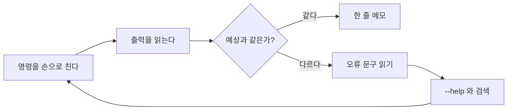
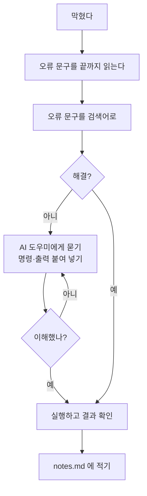

# 공부하는 법

이 강좌는 눈으로 읽는 것만으로는 안 늘어요. 터미널은 **손으로 치는** 공부예요. 자전거처럼, 읽기만 하고 타 본 적이 없으면 못 타요.

## 1. 터미널 공부 요령



### 명령은 복사하지 말고 손으로 치세요

복사·붙여넣기를 하면 눈과 손에 남는 게 없어요. 처음 열 번은 직접 치세요. 오타가 나도 괜찮아요. 오타를 고치는 과정에서 배워요. 익숙해지면 `Tab` 키(이름 자동 완성)와 위쪽 화살표(이전 명령)를 쓰세요.

### 출력을 읽으세요

명령을 치고 나서 화면을 그냥 넘기지 마세요. 아주 작은 예를 볼게요.

```bash
ls
```

출력에 무엇이 나왔는지, 왜 그 파일들인지 말로 해 보세요. 한 줄이라도 "이게 뭐지?" 하고 멈추는 습관이 가장 큰 차이를 만들어요.

- 아무 글도 안 나오는 건 보통 **성공**이에요. Linux 명령은 잘 되면 조용해요.
- 빨간 글이나 `error`, `fatal`, `denied` 가 보이면 실패예요. 그 문장을 끝까지 읽으세요.

### 모르는 명령은 `--help` 부터

```bash
ls --help
man ls
```

`--help` 는 짧게 보여 주고, `man` 은 설명서(나가기는 `q`)예요. 영어라서 처음엔 어려워도 **옵션 이름과 예**만 훑어도 충분해요.

### 한 번에 하나씩 바꾸세요

명령을 여러 개 한꺼번에 바꾸면 무엇이 문제인지 몰라요. 하나 바꾸고 실행하고 확인하세요.

## 2. 한 주 루틴 (주 6~8시간)

| 요일 | 할 일 | 시간 |
|---|---|---|
| 월 | 주차 쪽 읽기. 모르는 말에 표시 | 1시간 |
| 화 | 읽기 마무리 + 그림 따라 그리기 | 1시간 |
| 수·목 | 실습 README 를 단계별로 따라 하기 | 3~4시간 |
| 금 | 확인 문제 5개 풀고 답 보기 | 1시간 |
| 토 | 체크리스트 점검, 막혔던 것 한 쪽 정리 | 1시간 |

!!! tip "주 8시간이 어려우면"
    [12주 계획표](syllabus.md) 아래의 "12주가 길다면"을 보세요. 줄여도 돼요. **꾸준함이 속도보다 중요해요.**

### 실습 노트 한 장

매주 `notes.md` 하나에 아래만 적어 두세요(내 GitHub 저장소에 올리면 1주 뒤부터 Git 연습도 돼요).

- 오늘 처음 쓴 명령 3개와 한 줄 뜻
- 막혔던 것과 해결 방법
- 아직 모르겠는 것 1개

## 3. 막혔을 때

막히는 건 정상이에요. 아래 순서로 해 보세요.



### 오류 메시지를 검색어로

1. 오류 문구에서 **내 이름·경로를 뺀 핵심 한 줄**을 골라요. 예: `permission denied` 와 `docker.sock`.
2. 따옴표로 감싸 검색하고, 도구 이름(`docker`, `git`)을 붙여요.
3. 공식 문서, 도구의 이슈 쪽, Stack Overflow 순으로 믿을 만해요. 날짜가 오래된 글은 낡았을 수 있어요(특히 2026-03 에 중단된 Play with Docker, `docker-compose` 하이픈 명령).

### AI 도우미를 쓰되, 이해하고 실행하기

AI 도우미는 좋은 선생님이 될 수 있지만, 터미널에서는 **잘못된 명령 한 줄이 파일을 지워요**. 규칙 세 가지를 지키세요.

1. **무엇을 하는 명령인지 설명을 먼저 요청**해요. 설명을 못 읽겠으면 실행하지 않아요.
2. `rm`, `sudo`, `chmod -R`, `docker system prune` 처럼 지우거나 권한을 바꾸는 명령은 **내가 이해한 뒤에만** 실행해요([아래 4절](#danger)).
3. 오류를 물을 때는 **내가 친 명령, 전체 출력, 내 환경**(Windows/WSL, 버전)을 같이 붙여요. 비밀번호·키·토큰은 지우고 붙여요.

AI 가 낸 답이 틀릴 수도 있어요. 강좌 글과 공식 문서가 다르면 공식 문서가 맞아요.

### 그래도 안 풀리면

20~30분 해 보고 안 되면 쉬었다가 notes.md 에 "여기까지 했고 이게 안 됨"을 적어 두세요. 질문할 때 그대로 쓸 수 있어요. 질문은 [강좌 저장소의 이슈](https://github.com/metahomo/dev-container-course/issues)에 남겨도 돼요.

## 4. 위험한 명령 { #danger }

터미널에는 **휴지통이 없어요.** 지운 건 대부분 돌아오지 않아요. 아래는 꼭 알고 쓰세요.

| 명령 | 왜 위험한가 | 안전하게 쓰는 법 |
|---|---|---|
| `rm -rf 경로` | 폴더를 묻지 않고 통째로 지워요. 경로에 공백·오타가 있으면 엉뚱한 곳이 지워져요 | 먼저 `ls 경로` 로 보고, 칠 때 `-rf` 를 빼고 `rm -ri` 처럼 물어보게 해요. `rm -rf /` 나 `rm -rf ~` 같은 건 절대 안 돼요 |
| `sudo ...` | 관리자 권한. 시스템 파일도 바꿔요 | 왜 필요한지 알 때만 써요. 인터넷에서 본 `sudo` 명령을 그냥 붙여 넣지 않아요 |
| `curl ... \| sh` | 내려받은 글을 바로 실행해요 | 공식 문서에 있는 주소만 쓰고, 가능하면 먼저 내려받아 내용을 읽어요 |
| `chmod -R 777` | 모든 파일을 누구나 쓰게 열어요 | 필요한 파일에만 필요한 권한(5주) |
| `git reset --hard`, `git clean -fd` | 저장 안 한 변경이 사라져요 | 실행 전 `git status` 로 확인(1주) |
| `docker system prune -a` | 안 쓰는 이미지·컨테이너·네트워크를 한꺼번에 지워요. 볼륨까지 지우는 옵션도 있어요 | 먼저 `docker ps -a`, `docker images` 로 무엇이 있는지 보고, 필요한 것만 `docker rm`, `docker rmi` 로 지워요 |
| `docker rm -f`, `docker volume rm` | 돌고 있는 컨테이너·DB 데이터를 지워요 | 볼륨은 데이터예요(9주). 지우기 전에 백업 |

!!! danger "공용 PC·서버에서는 더 조심"
    내 WSL 안에서는 망가져도 지우고 다시 설치하면 돼요. 학교 서버나 친구 컴퓨터에서는 그렇지 않아요.

## 5. 진도 조감도 쓰는 법

[진도 조감도](progress.md)는 각 주차 쪽 맨 아래의 **체크리스트**를 모아서 내 진도를 보여 줘요.

- 체크 상태는 **내 브라우저에만 저장**돼요. 서버로 가지 않아요. 같은 브라우저·같은 컴퓨터에서 보면 남아 있어요.
- **브라우저 데이터를 지우거나, 다른 컴퓨터·다른 브라우저로 가면 사라져요.** 그래서 가끔 **내려받기**로 파일을 저장해 두세요.
- 다른 곳에서 이어 하려면 그 파일을 **불러오기**로 읽어요.
- 내려받기·불러오기 단추의 위치와 이름은 조감도 쪽의 화면을 따르세요.

체크리스트 문구가 나중에 고쳐지면 그 항목의 저장된 체크가 사라질 수 있어요. 그래서 큰 개정 때는 안내를 남길게요.

## 6. 공부가 지칠 때

- 한 주를 통째로 놓쳐도 괜찮아요. 다음 주로 가기보다 **그 주의 실습 하나**만 해 보세요.
- 안 되는 설치는 [무료 웹 실습장](setup.md#web-labs)으로 우회하고, 나중에 돌아와요.
- 함께 하는 친구가 있으면 3주(PR 주고받기)가 훨씬 재밌어요.

## 더 읽기

- [실습 환경 만들기](setup.md) · [명령어 치트시트](cheatsheet.md) · [용어집](glossary.md)
- MIT Missing Semester 2026(영어, 영상): <https://missing.csail.mit.edu/2026> — 터미널·셸·Git 을 같은 눈높이로 다뤄요.
