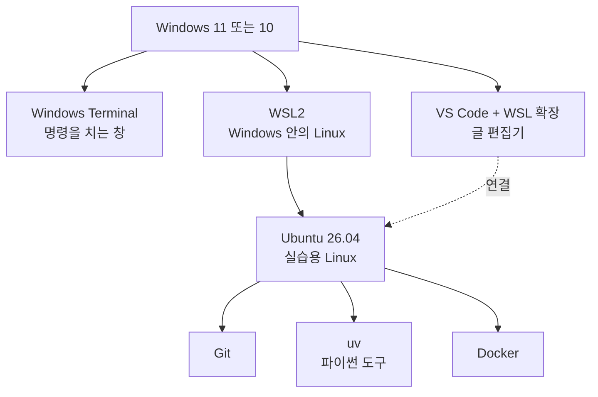

# 실습 환경 만들기

이 강좌의 실습은 거의 다 **터미널 명령**이에요. 그래서 Windows 안에 진짜 Linux 를 하나 들여놓는 일부터 시작해요. 설치는 한 번만 하면 12주 내내 써요. 천천히, 한 단계씩 따라 하세요.

!!! info "이 쪽의 기준일"
    2026-11-24. 버전과 요구사항은 바뀌어요. 막히면 각 단계의 공식 문서 링크를 먼저 열어 보세요.

## 1. 무엇을 설치하나

내 PC 에 도구를 겹겹이 쌓는다고 생각하면 쉬워요.



| 도구 | 하는 일 | 처음 쓰는 주 |
|---|---|---|
| Windows Terminal | 명령을 치는 창. 탭으로 여러 개를 열어요 | 0주 |
| WSL2 + Ubuntu | Windows 안에서 도는 Linux. 앞으로 모든 실습이 여기서 일어나요 | 0주 |
| VS Code + WSL 확장 | 코드를 고치는 편집기. WSL 안의 파일을 바로 열어요 | 0주 |
| Git | 코드의 변경 기록 도구 | 1주 |
| uv | 파이썬 프로젝트와 패키지 도구 | 8주(미리 설치) |
| Docker | 컨테이너를 만들고 돌리는 도구 | 7주 |

!!! tip "필요한 시점"
    0주에는 앞의 세 가지만 있으면 돼요. Docker 는 7주에 처음 써요. 설치가 가장 까다로우니 **미리 한 번 시도**해 두면 마음이 편해요.

## 2. 내 PC 가 되는지 확인

- Windows 11 을 권장해요. Windows 10 은 2004(빌드 19041) 이상이면 WSL 이 돼요. ([Microsoft WSL 설치 문서](https://learn.microsoft.com/en-us/windows/wsl/install))
- Docker Desktop 은 RAM 8GB, 그리고 BIOS 에서 가상화가 켜져 있어야 해요. ([Docker 설치 문서](https://docs.docker.com/desktop/setup/install/windows-install/))
- 디스크는 여유 20GB 이상을 권해요(이 숫자는 이 강좌의 경험 기준이고 공식 요구사항은 아니에요).

작업 관리자(Ctrl+Shift+Esc) → 성능 → CPU 에서 "가상화: 사용"인지 보세요. "사용 안 함"이면 [설치 오류 표](#errors)를 보세요.

## 3. Windows Terminal

Windows 11 에는 보통 이미 들어 있어요. 시작 메뉴에서 "터미널"을 검색해 보세요. 없으면 Microsoft Store 에서 "Windows Terminal"을 설치해요.

## 4. WSL2 와 Ubuntu

1. 시작 메뉴에서 "터미널"을 찾아 **마우스 오른쪽 → 관리자 권한으로 실행**해요.
2. 아래 명령을 쳐요. 기본 Ubuntu 가 설치돼요.

```powershell
wsl --install
```

3. 끝나면 **PC 를 다시 시작**해요.
4. 다시 켜면 Ubuntu 창이 열리고 사용자 이름과 비밀번호를 물어요. 비밀번호는 칠 때 화면에 안 보이는 게 정상이에요. 잊지 않게 적어 두세요.

이렇게 나오면 성공이에요(날짜·이름은 달라요).

```text
Installation successful!
yourname@PC-NAME:~$
```

설치된 Ubuntu 버전을 확인해요.

```bash
lsb_release -a
```

`Release: 26.04` 로 나오면 이 강좌와 같아요. 다른 버전이 나오면 아래로 고를 수 있는 목록을 봐요. 26.04 의 배포판 이름은 직접 `wsl --list --online` 으로 확인하세요(이름을 이 쪽에서 단정하지 않아요).

```powershell
wsl --list --online
wsl --install -d <목록에 나온 이름>
```

출처: [Microsoft WSL 설치 문서(2026-06-02 갱신)](https://learn.microsoft.com/en-us/windows/wsl/install). 설치가 0% 에서 멈추면 `wsl --install --web-download` 를 시도해요(같은 문서).

Ubuntu 26.04 는 2026-04-23 에 나온 LTS(장기 지원판)예요. ([Ubuntu 릴리스 노트](https://documentation.ubuntu.com/release-notes/26.04/))

!!! note "sudo 비밀번호"
    Ubuntu 26.04 의 `sudo` 는 새 구현(sudo-rs)이 기본이라 비밀번호를 칠 때 `*` 가 보일 수 있어요. 일반 Linux 처럼 아무것도 안 보일 수도 있어요. WSL 이미지에서 어느 쪽인지는 확인하지 못했어요. 둘 다 정상이에요. ([linuxconfig](https://linuxconfig.org/understanding-sudo-rs-on-ubuntu-26-04))

처음 한 번, 패키지 목록을 새로 고쳐요. `sudo` 는 "관리자 권한으로"라는 뜻이에요(5주에 자세히 배워요).

```bash
sudo apt update && sudo apt upgrade -y
```

## 5. VS Code 와 WSL 확장

1. [VS Code](https://code.visualstudio.com/) 를 Windows 에 설치해요.
2. VS Code 를 열고 왼쪽 확장(Extensions)에서 **WSL**(Microsoft 제작)을 설치해요.
3. Ubuntu 터미널에서 작업 폴더를 만들고 열어요.

```bash
mkdir -p ~/work && cd ~/work
code .
```

처음에는 VS Code 가 WSL 쪽 도구를 내려받느라 잠깐 걸려요. 창 왼쪽 아래에 **WSL: Ubuntu** 라고 보이면 성공이에요.

!!! warning "파일은 WSL 안에 두세요"
    작업 폴더는 `~`(홈, `/home/내이름`) 아래에 두세요. `/mnt/c/...`(Windows 쪽 폴더)에 두면 느리고 권한 문제가 생기기 쉬워요.

## 6. Git 과 uv (WSL 안에)

Git 은 **WSL 안에** 설치해요(Windows 용 Git 이 아니에요).

```bash
sudo apt install -y git
git --version
git config --global user.name "내 이름"
git config --global user.email "내 메일"
git config --global init.defaultBranch main
```

마지막 줄은 새 저장소의 기본 가지 이름을 `main` 으로 해요. 지금(Git 2.56)은 설정이 없으면 `master` 를 쓰고 경고를 내요. Git 3.0 부터는 기본이 `main` 이에요. ([Git BreakingChanges](https://git-scm.com/docs/BreakingChanges))

uv 는 파이썬 프로젝트 도구예요. 설치 명령은 공식 문서의 Linux·macOS 항목을 열어서 그대로 복사하세요(명령이 바뀔 수 있어서 이 쪽에 박아 두지 않아요). ([uv 문서](https://docs.astral.sh/uv/))

```bash
uv --version
```

버전이 나오면 성공이에요(조사 시점 최신은 0.13.9).

## 7. GitHub 계정과 학생 혜택

1. [github.com](https://github.com/) 에서 무료 계정을 만들어요. 3주에 본격적으로 써요.
2. 학생이라면 [GitHub Education](https://education.github.com/pack) 에서 학생 인증을 신청해요. 인증 뒤 혜택이 적용되기까지 시간이 걸릴 수 있어요.

| 혜택 | 내용 | 출처 |
|---|---|---|
| Codespaces | 학생은 월 180 코어시간(무료 계정은 120) | [Education 문서](https://docs.github.com/en/education/about-github-education/github-education-for-students/about-github-education-for-students) |
| Copilot Student | 인증 학생 무료. 자동 모델 선택만 되고, 매월 자격을 다시 확인해요. "Copilot Pro 무료"라는 옛 글은 틀려요 | [Copilot 플랜](https://docs.github.com/en/copilot/get-started/plans) |
| Actions | 공개 저장소의 표준 러너는 무료 | [Actions 과금](https://docs.github.com/en/billing/concepts/product-billing/github-actions) |

한국 대학 1학년의 인증 요건 세부(학교 메일·학생증 등)는 공식 문서에서 확인하지 못했어요. 신청 화면의 안내를 따르세요. Copilot Student 신규 가입이 지금 완전히 열려 있는지도 확인하지 못했어요(2026-06-17 재개 공지 이후 자료 없음). 안 열려 있어도 강좌 진행에는 지장이 없어요.

## 8. Docker

두 가지 길이 있어요. **① Docker Desktop** 이 더 쉽고, **② WSL 안에 Docker Engine 직접 설치**는 Windows Home 에서 막힐 때의 길이에요.

!!! warning "Windows Home 에서 Docker Desktop 이 되는지는 확실하지 않아요"
    Docker 공식 요구사항 목록에서 2025-10 문서 수정 이후 Windows 판이 "Enterprise, Pro, Education"만 적혀 있어요. 같은 쪽에 "Home 과 Education 은 Linux 컨테이너만 가능"이라는 문장도 남아 있어요. 그래서 Home 지원 여부는 **확인 필요**예요. ([Docker 설치 문서](https://docs.docker.com/desktop/setup/install/windows-install/)) 설치해 보고 안 되면 ②로 가세요.

=== "① Docker Desktop (Windows)"

    1. [Docker Desktop 설치 문서](https://docs.docker.com/desktop/setup/install/windows-install/)에서 설치 파일을 받아요.
    2. 설치 중 **WSL 2 사용** 옵션을 켜 둬요.
    3. 설치 뒤 Docker Desktop 을 한 번 실행하고, 설정의 WSL 통합(Resources → WSL integration)에서 내 Ubuntu 를 켜요.
    4. Ubuntu 터미널에서 확인해요.

    ```bash
    docker --version
    docker run --rm hello-world
    ```

    `Hello from Docker!` 로 시작하는 글이 나오면 성공이에요.

    개인 학습·교육 용도는 무료예요. ([Docker Desktop 라이선스](https://docs.docker.com/subscription/desktop-license/)) 요구사항은 WSL 2.1.5 이상, Windows 10 22H2 이상 또는 Windows 11 23H2 이상이에요.

=== "② WSL 안에 Docker Engine"

    Docker Desktop 없이 Ubuntu 안에 엔진만 설치해요. 설치 절차는 공식 문서를 그대로 따르세요(저장소 주소·키가 바뀔 수 있어서 이 쪽에 옮겨 적지 않아요): [Docker Engine 설치 - Ubuntu](https://docs.docker.com/engine/install/ubuntu/).

    - Ubuntu 26.04 가 그 문서의 지원 목록에 있는지는 확인하지 못했어요. 문서의 "지원 버전" 표를 먼저 보세요.
    - WSL 에서 `systemd` 가 기본으로 켜져 있는지 확인하지 못했어요. `sudo systemctl status docker` 가 안 되면 문서의 안내(WSL 설정 `systemd=true`)를 찾아보세요.
    - `sudo` 없이 쓰려면 내 계정을 `docker` 그룹에 넣어요. 이 그룹은 사실상 관리자 권한이라 **공용 PC 에서는 하지 마세요**.

    ```bash
    sudo usermod -aG docker $USER
    ```

    그 뒤 Ubuntu 창을 닫았다 다시 열고 `docker run --rm hello-world` 로 확인해요.

=== "Mac"

    - **Docker Desktop for Mac** 을 설치하면 됩니다. 개인·교육 무료 조건은 Windows 와 같아요. ([라이선스](https://docs.docker.com/subscription/desktop-license/))
    - 대안으로 OrbStack(macOS 전용, 개인 무료)이 있어요. ([OrbStack 라이선스](https://docs.orbstack.dev/licensing))
    - Mac 에는 WSL 이 필요 없어요. 기본 터미널 앱을 쓰고, Git 은 `git --version` 으로 있는지 보세요. uv 설치는 위 uv 문서를 따르세요.
    - 이 강좌의 Linux 명령은 Mac 에서 일부 다르게 동작해요(예: GNU 도구와 BSD 도구 차이). 4~6주 실습은 Ubuntu 기준이라, Mac 이면 Codespaces 같은 무료 Linux(아래)를 함께 쓰는 걸 권해요.

!!! tip "Docker Hub 로그인"
    7주 실습 전에 [hub.docker.com](https://hub.docker.com/) 에서 무료 계정을 만들고 `docker login` 을 해 두세요. 이미지를 내려받는 횟수 한도가 있는데, 숫자는 공식 문서(로그인 시 6시간에 200회)와 가격 페이지(시간당 100회)가 서로 달라 확인하지 못했어요. 로그인하면 한도가 더 넉넉한 건 같아요. ([Hub pull 문서](https://docs.docker.com/docker-hub/usage/pulls/))

## 9. Docker 를 못 깔 때: 무료 웹 실습장 { #web-labs }

설치가 안 돼도 공부는 계속할 수 있어요. 아래 중 하나를 쓰세요.

| 실습장 | 무료 조건 | 맞는 곳 |
|---|---|---|
| [GitHub Codespaces](https://docs.github.com/en/billing/concepts/product-billing/github-codespaces) | 무료 계정 월 120 코어시간(2코어 기준 약 60시간), 학생 180. 결제수단이 없으면 한도에서 멈출 뿐 과금되지 않아요 | 전 주차. 브라우저 VS Code 와 Docker |
| [Killercoda](https://killercoda.com/faq) | 무료 가입, 환경은 최대 1시간 뒤 삭제 | Ubuntu·쿠버네티스 시나리오 |
| [iximiuz Labs](https://labs.iximiuz.com/pricing) | 무료 하루 총 1시간, 동시 1개 | 짧은 Docker 실습 |

!!! danger "Play with Docker 는 쓰지 마세요"
    2026-03-01 부터 서비스가 중단됐어요. 옛 책·블로그가 안내하는 "Play with Docker 에서 실습"은 따라 하지 마세요. ([Docker 포럼 공지](https://forums.docker.com/t/play-with-docker-is-deprecated-and-will-be-unavailable-starting-march-1-2026-learn-about-alternatives/151177))

Google Cloud Shell 은 주 50시간을 주지만 Docker 가 되는지 확인하지 못해 권하지 않아요. ([한도 문서](https://docs.cloud.google.com/shell/docs/quotas-limits))

## 10. 설치 오류 표 { #errors }

| 증상 | 원인 | 해결 |
|---|---|---|
| `wsl --install` 이 "알 수 없는 명령" 또는 옵션 목록만 나와요 | Windows 가 너무 낡았어요 | Windows Update 로 최신으로 올리고 다시 해요. Windows 10 은 2004(빌드 19041) 이상이어야 해요 |
| "WSL2 is not supported…" 오류, 또는 가상화 오류 | BIOS 가상화가 꺼져 있어요. 또는 Windows 11 25H2 Home Single Language 판에서 보고된 사례([MS Q&A](https://learn.microsoft.com/en-us/answers/questions/5759687/wsl-docker-and-edition-windows-11-home-single-lang)) | 작업 관리자에서 가상화 사용 여부 확인 → 꺼져 있으면 BIOS 에서 켜기(제조사마다 메뉴 이름이 달라요). 그래도 안 되면 Codespaces |
| 설치가 0% 에서 멈춰요 | 다운로드 경로 문제 | `wsl --install --web-download` ([MS 문서](https://learn.microsoft.com/en-us/windows/wsl/install)) |
| Ubuntu 창이 열렸다 바로 닫혀요 | 설치 중 오류 | 터미널에서 `wsl` 을 쳐서 오류 문구를 읽어요. 문구를 검색어로 써요 |
| `docker: command not found` | Docker 미설치 또는 WSL 통합이 꺼져 있어요 | Docker Desktop 의 WSL integration 에서 Ubuntu 켜기, 또는 ② 설치 확인 |
| `Cannot connect to the Docker daemon` | Docker 가 안 켜졌어요 | ①: Docker Desktop 실행. ②: 엔진 서비스가 켜졌는지 확인 |
| `permission denied ... docker.sock` | 내 계정이 docker 그룹에 없어요 | 앞의 `usermod` 후 Ubuntu 창을 다시 열기. 임시로는 `sudo docker ...` |
| Docker Desktop 설치 파일이 Home 에서 막혀요 | Home 지원이 불확실 | ② WSL 안 Docker Engine, 또는 Codespaces |
| `code .` 가 "command not found" | VS Code 의 WSL 연결이 안 됐어요 | VS Code 에 WSL 확장 설치 후 Ubuntu 창을 다시 열기 |
| `toomanyrequests` (이미지 받기 실패) | Hub 받기 한도 | `docker login` 하고 잠시 뒤 다시 |

## 설치 체크리스트

터미널 하나 열고 차례로 쳐서 모두 나오면 준비 끝이에요.

```bash
lsb_release -a        # Ubuntu 26.04
git --version         # git version 2.xx
uv --version          # uv 0.xx
docker --version      # Docker version 29.x (7주 전까지)
```

## 더 읽기

- [Microsoft: WSL 설치](https://learn.microsoft.com/en-us/windows/wsl/install)
- [Docker Desktop Windows 설치](https://docs.docker.com/desktop/setup/install/windows-install/)
- [Docker Engine Ubuntu 설치](https://docs.docker.com/engine/install/ubuntu/)
- [uv 문서](https://docs.astral.sh/uv/)
- [기술 지도](tech-map.md) · [공부하는 법](how-to-study.md)
