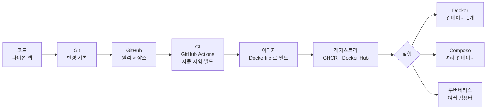

# 2026 최신 기술 지도

기준일은 **2026-11-24** 이에요. 버전과 날짜는 그날 공식 저장소(GitHub Releases·PyPI 등)와 공식 문서를 조회한 값이에요. 이 쪽은 자주 낡으니 설치할 때는 공식 페이지를 다시 확인하세요.

## 1. 내 코드가 서비스가 되기까지

처음 보면 도구가 너무 많아 보여요. 하지만 **내 코드가 남의 컴퓨터에서 돌 때까지의 길** 하나일 뿐이에요.

| 단계 | 한 줄 | 이 강좌 |
|---|---|---|
| 코드 → Git | 변경을 기록해요 | 1~2주 |
| Git → GitHub | 원격에 올려 함께 일해요 | 3주 |
| GitHub → CI | 올릴 때마다 자동으로 시험·빌드해요 | 3주 맛보기, 12주 |
| CI → 이미지 | 앱과 실행 환경을 한 덩어리로 묶어요 | 8주 |
| 이미지 → 레지스트리 | 이미지 보관소에 올려요 | 11주 |
| 레지스트리 → 실행 | Docker·Compose 로 돌려요 | 7·10주 |
| 쿠버네티스 | 큰 규모의 실행. 이 강좌에서는 개념만 | 12주 이후 |

## 2. 도구 상태 표 (2026-11-24 기준)

"조회"는 그날 직접 조회한 값이에요. 소수점 자리까지 같아야 하는 건 아니에요. 새 버전은 이미 나왔을 수 있어요.

### 개발 기본

| 도구 | 최신 | 상태·메모 | 출처 |
|---|---|---|---|
| Git | 2.56.1 | 2026-09-28 에 2.56.0. 다음은 2.98(2026-12 예정), 2.99·3.0(2027 봄 예정, 공식 문서는 출시일 미정) | [git 태그](https://github.com/git/git/tags), [GitLab 블로그](https://about.gitlab.com/blog/whats-new-in-git-2-56-0/), [BreakingChanges](https://git-scm.com/docs/BreakingChanges) |
| Git for Windows | 2.56.1.windows.1 (2026-11-10) | 이 강좌는 WSL 안의 Git 을 써요 | [릴리스](https://github.com/git-for-windows/git/releases) |
| gh CLI | 2.105.0 (2026-11-18) | GitHub 명령줄 도구 | [릴리스](https://github.com/cli/cli/releases) |
| Ubuntu | 26.04 LTS (2026-04-23) | 지원 2031-04까지(endoflife.date 는 2031-05-29). 26.10 은 비 LTS | [릴리스 노트](https://documentation.ubuntu.com/release-notes/26.04/), [endoflife.date](https://endoflife.date/ubuntu) |
| WSL | 3.0.5 (2026-11-03) | WSL 설치 문서 2026-06-02 갱신 | [릴리스](https://github.com/microsoft/WSL/releases) |
| Python | 3.15.2 (3.15 는 2026-10 출시) | 3.14.10 도 유지 중 | [endoflife.date](https://endoflife.date/python) |
| uv | 0.13.9 (2026-11-17) | 주 1회꼴로 릴리스, 아직 1.0 아님 | [릴리스](https://github.com/astral-sh/uv/releases), [PyPI](https://pypi.org/project/uv/) |

### 컨테이너

| 도구 | 최신 | 상태·메모 | 출처 |
|---|---|---|---|
| Docker Engine | 29.10.0 (2026-11-16) | 29 계열은 2025-11 시작. 새 설치는 containerd 이미지 저장소가 기본 | [moby 릴리스](https://github.com/moby/moby/releases), [Docker 블로그](https://www.docker.com/blog/docker-engine-version-29/) |
| Docker Desktop | 4.100.1 (2026-11-23) | 개인·교육 무료. Windows Home 지원은 확인 필요 | [릴리스 노트](https://docs.docker.com/desktop/release-notes/) |
| Docker Compose | v5.8.0 (2026-11-17) | v5 는 v2 와 기능이 같아요(이름만 건너뜀). `docker compose` 를 쓰고, v1 `docker-compose` 는 지원 안 해요 | [릴리스](https://github.com/docker/compose/releases), [역사 문서](https://docs.docker.com/compose/intro/history/) |
| buildx | v0.39.1 (2026-11-19) | 멀티플랫폼 빌드 | [릴리스](https://github.com/docker/buildx/releases) |
| containerd | v2.4.2 (2026-10-13) | Docker 이미지 저장소 기본. 개념만 | [릴리스](https://github.com/containerd/containerd/releases) |
| Podman | v6.2.0 (2026-11-10) | 6.0(2026-06-24)에서 Windows 10 지원 중단. 저장소가 CNCF 소유 조직 `podman-container-tools` 로 이전 | [릴리스](https://github.com/podman-container-tools/podman/releases) |
| Podman Desktop | v1.30.7 (2026-11-13) | 대안 도구 | [릴리스](https://github.com/podman-desktop/podman-desktop/releases) |
| Rancher Desktop | v1.25.0 (2026-11-05) | 2.0 첫 빌드가 2026-06 에 공개됐고 정식 출시 여부는 확인 필요 | [릴리스](https://github.com/rancher-sandbox/rancher-desktop/releases) |
| WSL Containers(`wslc`) | WSL 3.0.x 에 포함 | 2026-09-29 정식 출시. Compose 는 아직 미지원 | [Windows 블로그](https://blogs.windows.com/windowsdeveloper/2026/09/29/wsl-containers-now-generally-available/) |
| Dev Containers CLI | 0.91.0 | `devcontainer.json` 규격. Codespaces 도 같은 파일을 써요 | [npm](https://www.npmjs.com/package/@devcontainers/cli) |

### 보안과 쿠버네티스

| 도구 | 최신 | 상태·메모 | 출처 |
|---|---|---|---|
| Docker Scout CLI | v1.30.0 (2026-11-20) | 2026 Q2 에 Hub·Desktop 의 일부 화면이 은퇴하고 `docker scout quickview` 안내. 무료 저장소 수는 문서와 가격 페이지가 달라 확인 필요 | [릴리스](https://github.com/docker/scout-cli/releases), [릴리스 노트](https://docs.docker.com/scout/release-notes/platform/) |
| Trivy | v0.76.2 (2026-11-05) | 2026-03 공급망 침해(아래) | [릴리스](https://github.com/aquasecurity/trivy/releases) |
| Grype | v0.122.1 (2026-11-18) | 이미지 취약점 점검 | [릴리스](https://github.com/anchore/grype/releases) |
| Syft | v1.57.2 (2026-11-16) | SBOM(재료 목록) 생성 | [릴리스](https://github.com/anchore/syft/releases) |
| cosign | v3.1.4 (2026-10-20) | 서명. 개념만 | [릴리스](https://github.com/sigstore/cosign/releases) |
| NVIDIA Container Toolkit | v1.20.2 (2026-11-17) | GPU 컨테이너. GPU 가 있는 사람만 | [릴리스](https://github.com/NVIDIA/nvidia-container-toolkit/releases) |
| Kubernetes | v1.37.2 (2026-10-28) | 1.37 은 2026-08-26 출시 | [릴리스](https://github.com/kubernetes/kubernetes/releases) |
| kind | v0.33.0 (2026-08-26) | 로컬 클러스터. Windows/Mac 에서 Docker VM 메모리 6GB 이상 | [빠른 시작](https://kind.sigs.k8s.io/docs/user/quick-start/) |

OrbStack(macOS 전용), colima, Apple container 는 Mac 전용이라 Windows 수강생과는 관계없어요.

## 3. 2026 주요 소식

이 소식들은 **옛 책과 글이 틀려진 지점**이기도 해요. 옛 글을 만나면 이 목록을 떠올리세요.

| 소식 | 내용 | 강좌 반영 | 출처 |
|---|---|---|---|
| Play with Docker 중단 | 2026-03-01 부터 서비스 중단 공지 | 쓰지 않아요. 대안은 Codespaces·Killercoda·iximiuz Labs | [Docker 포럼](https://forums.docker.com/t/play-with-docker-is-deprecated-and-will-be-unavailable-starting-march-1-2026-learn-about-alternatives/151177) |
| WSL Containers | 2026-06-29 공개 미리보기 → 2026-09-29 정식 출시. Windows 에 내장된 Linux 컨테이너 도구. Compose 미지원 | 본선은 Docker, 참고로만 | [Windows 블로그](https://blogs.windows.com/windowsdeveloper/2026/09/29/wsl-containers-now-generally-available/) |
| Podman 6 | 2026-06-24 출시. Windows 10 지원 중단, CNI·iptables 등 제거 | Windows 11 권장의 한 근거 | [Podman 블로그](https://blog.podman.io/2026/08/) |
| Docker Desktop 요구사항 | 공식 목록에서 Windows Home 이 빠짐(문서 커밋 #23584, 2025-10 이후) | WSL 안 Docker Engine 경로를 함께 줘요 | [설치 문서](https://docs.docker.com/desktop/setup/install/windows-install/), [커밋](https://github.com/docker/docs/commit/9661be24992360322315bc13d1794dd3ac69b955) |
| Trivy 공급망 침해 | 2026-03. 악성 v0.69.4 바이너리, trivy-action 태그 변조, Docker Hub 이미지 0.69.4·0.69.5·0.69.6 변조. 권고는 Action 을 커밋 SHA 로 고정 | 11주 보안 사례. 최종 사후 보고서는 확인 필요 | [GHSA-69fq-xp46-6x23](https://github.com/aquasecurity/trivy/security/advisories/GHSA-69fq-xp46-6x23), [Aqua 블로그](https://www.aquasec.com/blog/trivy-supply-chain-attack/) |
| Copilot Student | 2026-03-13 부터 학생 혜택이 Copilot Pro 가 아닌 "Copilot Student" 플랜(무료, 자동 모델 선택만). 2026-04-20 신규 가입 일시중지, 2026-06-17 재개 공지 | 옛 "학생은 Pro 무료" 표현은 틀려요 | [changelog 03-13](https://github.blog/changelog/2026-03-13-updates-to-github-copilot-for-students), [changelog 06-17](https://github.blog/changelog/2026-06-17-copilot-individual-plan-sign-ups-are-reopening/) |
| Git 3.0 예정 | 기본 브랜치 `main`, 새 저장소 기본 해시 SHA-256, reftable 기본. `git switch`/`git restore` 는 유지 | 1주에 `init.defaultBranch main` 설정을 가르쳐요 | [BreakingChanges](https://git-scm.com/docs/BreakingChanges) |
| Git 2.56 | `git add --resolved`, `git branch --delete-merged` 등 | 2주 충돌 해결에서 소개 | [GitHub 블로그](https://github.blog/open-source/git/highlights-from-git-2-56/) |
| Ubuntu 26.04 | sudo-rs 가 기본 `sudo`. Linux 7.0 커널 | 5주 `sudo` 에서 한 줄 언급 | [The Register](https://www.theregister.com/2026/04/24/ubuntu_resolute_raccoon/) |
| OpenAI 의 Astral 인수 | uv·Ruff 제작사를 OpenAI 가 인수한다고 2026-03-19 발표(규제 승인 등 조건부). 완료 여부는 확인 필요. Astral 은 오픈소스 유지를 약속 | uv 를 기본으로 쓰되 "도구 소유권도 바뀐다"는 점만 알아 둬요 | [OpenAI 발표](https://openai.com/index/openai-to-acquire-astral) |
| Docker 공식 문서 개편 | 2026-11-19. 첫 길이 Docker Sandboxes(AI 에이전트용)로 바뀜 | 입문은 Guides 실습으로 | [Get started](https://docs.docker.com/get-started/) |
| Docker Hub 받기 한도 | 문서(로그인 6시간 200회)와 가격 페이지(시간당 100회)가 달라요 | 실습 전 `docker login` | [문서](https://docs.docker.com/docker-hub/usage/pulls/), [가격](https://www.docker.com/pricing/) |
| Docker Hardened Images | 2025-12 부터 1,000+ 이미지를 무료·Apache 2.0 으로 공개 | 참고. 받으려면 로그인이 필요하다는 2차 자료가 있어 확인 필요 | [Docker 보도자료](https://www.docker.com/press-release/docker-makes-hardened-images-free-open-and-transparent-for-everyone/) |
| Windows 10 | 2025-10-14 지원 종료. 소비자 ESU 기한은 자료끼리 달라 확인 필요 | Windows 11 권장 | [Windows Latest](https://www.windowslatest.com/2026/07/09/windows-10-is-still-getting-windows-11-features-but-its-only-for-developers/) |

## 4. 이 지도를 읽는 법

- **버전 숫자를 외우지 마세요.** 도구의 역할과 자리(위 그림)가 오래가요.
- 설치할 때는 항상 **공식 문서의 현재 페이지**를 먼저 보세요.
- 이 쪽의 "확인 필요"는 조사에서 끝내 확인하지 못한 항목이에요. 확인되면 고칠게요.

## 더 읽기

- [실습 환경 만들기](setup.md) · [교재와 자료](books.md) · [12주 계획표](syllabus.md)
