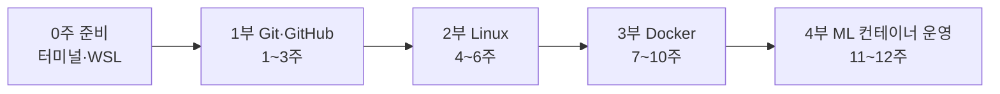

# 개발환경과 컨테이너

**파이썬 기초만 있는 대학교 1학년을 위한 12주 무료 공개 강좌**

"내 컴퓨터에서는 되는데요?" — 이 말을 다시 하지 않게 됩니다. 코드를 **기록하고(Git), 함께 만들고(GitHub), 서버를 다루고(Linux), 어디서나 똑같이 돌리는(Docker)** 법을 배우고, 마지막에는 작은 ML 서비스를 컨테이너로 묶어 배포합니다.

## 이렇게 쓰세요

1. [12주 계획표](guide/syllabus.md)에서 전체 길을 봅니다.
2. [실습 환경 만들기](guide/setup.md)를 따라 Windows Terminal·WSL2·Docker 를 준비합니다(못 깔아도 무료 웹 실습장이 있어요).
3. 매주 **주차 쪽 읽기 → 실습(터미널 명령) → 확인 문제 → 체크리스트** 순서로 공부합니다.
4. [진도 조감도](guide/progress.md)에서 체크한 만큼 진도가 보입니다(내 브라우저에만 저장돼요).

## 이 강좌의 약속

| 약속 | 뜻 |
|---|---|
| 1학년 눈높이 | 명령 하나하나에 "무엇을, 왜"를 붙이고, 성공했을 때 나오는 화면을 보여 줘요 |
| 돈 들지 않게 | 무료 도구(Git, WSL2, Docker 개인용, GitHub 무료 계정)만 써요 |
| 2026년 기준 | 낡은 방식 대신 지금 쓰는 방식으로 — [최신 기술 지도](guide/tech-map.md) |
| 끝까지 운영 | 작은 ML 앱을 이미지로 만들고, 레지스트리에 올리고, CI 로 자동 빌드하는 데까지 |

!!! tip "함께 보면 좋은 강좌"
    모델을 만들고 서버로 띄우는 법은 [딥러닝과 모델 서빙](https://metahomo.github.io/dl-serving-course/) 강좌에서 다뤄요. 이 강좌는 그 서비스를 **담고 옮기는 그릇**을 다룹니다.

!!! info "라이선스"
    글은 [CC BY 4.0](https://creativecommons.org/licenses/by/4.0/deed.ko), 코드는 [MIT](https://opensource.org/license/mit). 출처를 밝히면 자유롭게 쓰고 고칠 수 있어요.
