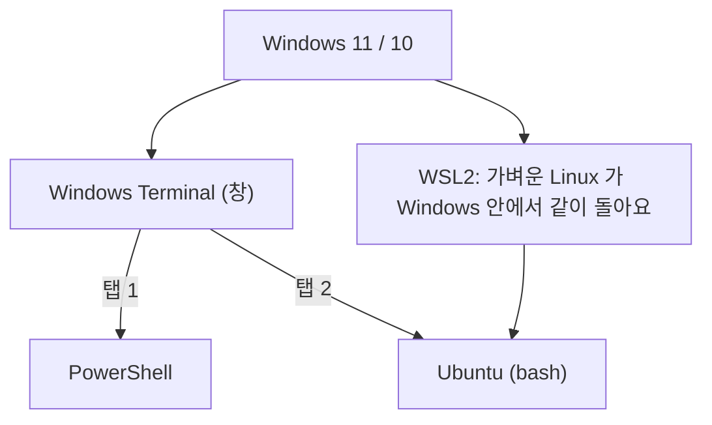
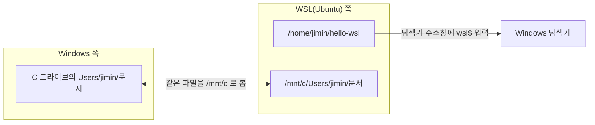

# 0주. 터미널과 WSL

!!! abstract "이번 주에 할 수 있게 되는 것"
    - Windows Terminal 을 열고 PowerShell 과 Ubuntu(WSL) 탭을 구분할 수 있다.
    - WSL2 에 Ubuntu 를 설치하고 우분투 버전과 WSL 버전을 확인할 수 있다.
    - Windows 경로(`C:\...`)와 WSL 경로(`/home/...`, `/mnt/c/...`)의 차이를 설명할 수 있다.
    - VS Code 를 WSL 에 연결해 폴더를 열 수 있다.
    - uv 를 설치하고 `uv run hello.py` 로 파이썬 파일을 실행할 수 있다.

| 준비물 | 예상 시간 |
|---|---|
| Windows 10(2004 이상) 또는 11 PC, 관리자 권한, 인터넷. 선행 주차 없음 | 읽기 2시간 · 실습 3시간 · 문제 1시간 |

## 1. 왜 배우나

이 강좌는 "내 코드를 어디서나 똑같이 돌리는 법"을 배워요. 그런데 개발 도구 대부분은 **Linux** 를 기준으로 만들어졌어요. 서버도, 나중에 배울 컨테이너도 Linux 위에서 돌아가요. Windows PC 에서도 Linux 를 쓸 수 있게 해 주는 것이 **WSL**(Windows Subsystem for Linux, 리눅스용 윈도우 하위 시스템)이에요.

WSL 을 쓰면 Windows 를 지우거나 컴퓨터를 둘로 나누지 않고도, 창 하나 안에서 진짜 Linux 명령을 칠 수 있어요. 이 강좌의 실습은 거의 다 그 창(터미널)에서 해요.

## 2. 터미널이 뭔가요

**터미널**(terminal)은 글자로 컴퓨터에게 일을 시키는 창이에요. 마우스로 폴더를 열고 파일을 끌어 놓는 대신, 명령을 쳐서 같은 일을 해요.

**셸**(shell)은 그 명령을 알아듣고 실행해 주는 프로그램이에요. 터미널은 창, 셸은 그 안에서 일하는 통역사라고 생각하면 돼요.

Windows 에는 셸이 여러 개 있어요.

| 이름 | 어디서 | 이 강좌에서 |
|---|---|---|
| PowerShell | Windows 기본 | WSL 을 설치할 때만 |
| Ubuntu(bash) | WSL 안 | **거의 모든 실습** |

**Windows Terminal** 은 이 셸들을 탭으로 모아 여는 창이에요. 탭마다 PowerShell, Ubuntu 를 골라 열 수 있어요. 새 탭은 `Ctrl+Shift+T` 예요. ([Windows Terminal 설치 문서](https://learn.microsoft.com/en-us/windows/terminal/install))

!!! warning "지금 어느 탭이지?"
    프롬프트(명령 앞에 나오는 글자)를 보세요. `PS C:\Users\...>` 는 PowerShell 이고, `jimin@컴퓨터:~$` 는 Ubuntu 예요. 같은 명령도 탭에 따라 결과가 달라서, 이 강좌에서는 `PS>` 와 `$` 로 구분해서 써요. (기호는 치지 않아요.)

## 3. WSL2 에 Ubuntu 설치

그림으로 보면 이래요.



설치는 명령 한 줄이에요. 관리자 권한 PowerShell 에서:

```powershell
PS> wsl --install
```

이 명령이 WSL 에 필요한 기능을 켜고 기본 배포판인 **Ubuntu** 를 설치해요. 끝나면 컴퓨터를 다시 시작해요. ([MS 설치 문서](https://learn.microsoft.com/en-us/windows/wsl/install))

- 첫 실행 때 Linux **사용자 이름과 비밀번호**를 만들어요. Windows 계정과는 따로예요. 비밀번호는 칠 때 화면에 안 보여도 정상이에요.
- 어떤 배포판이 있는지는 `wsl --list --online`, 골라 설치하려면 `wsl --install -d 이름` 이에요.
- **우분투 버전**: 이 강좌는 Ubuntu 26.04 LTS(2026-04-23 출시, [릴리스 노트](https://documentation.ubuntu.com/release-notes/26.04/))를 기준으로 쓰지만, 기본 `Ubuntu` 가 지금 정확히 몇 버전인지는 설치 후 `head -3 /etc/os-release` 로 직접 확인하세요. 몇 버전이든 이 강좌의 명령은 거의 같아요.
- Windows 가 너무 오래됐거나(10 의 2004 미만) 컴퓨터 가상화가 꺼져 있으면 설치가 실패해요. "막히면" 을 보세요.

!!! note "LTS 가 뭔가요?"
    LTS(Long Term Support)는 오래 지원하는 버전이에요. 우분투는 LTS 를 쓰는 게 안전해요.

## 4. Windows 와 WSL 의 경로

**경로**(path)는 파일의 주소예요. Windows 와 Linux 는 주소 쓰는 법이 달라요.

| | Windows | WSL(Linux) |
|---|---|---|
| 구분 기호 | `\` | `/` |
| 맨 위 | `C:\` 같은 드라이브 | `/` 하나 |
| 내 폴더 | `C:\Users\jimin` | `/home/jimin` (`~` 로 줄여 써요) |
| Windows 의 C 드라이브 | `C:\` | `/mnt/c/` |



**프로젝트 파일은 WSL 안(`/home/내이름/...`)에 두세요.** Microsoft 도 Linux 명령줄에서 일할 때는 WSL 파일 시스템에 두는 편이 가장 빠르다고 안내해요. `/mnt/c/...` 에 두면 느려질 수 있어요. ([파일 시스템 문서](https://learn.microsoft.com/en-us/windows/wsl/filesystems))

현재 폴더를 Windows 탐색기로 열려면 WSL 터미널에서 `explorer.exe .` 를 쳐요(맨 끝 점 `.` 이 "현재 폴더"). 탐색기 주소창에 `\\wsl$` 를 치면 WSL 의 모든 파일이 보여요.

## 5. VS Code 를 WSL 에 연결

글을 쓰고 고치는 편집기는 **VS Code** 를 써요. 중요한 점은 VS Code 가 **Windows 쪽에 설치되지만, WSL 안의 파일을 직접 편집**한다는 거예요.

1. Windows 에 VS Code 설치(설치 중 **Add to PATH** 선택).
2. VS Code 에서 **WSL** 확장 설치.
3. WSL 터미널에서 폴더로 가서 `code .`

VS Code 왼쪽 아래에 **WSL: Ubuntu** 가 보이면 연결된 거예요. 이제 VS Code 의 터미널도 WSL(bash)이에요. ([VS Code WSL 문서](https://code.visualstudio.com/docs/remote/wsl))

## 6. uv 로 파이썬 실행

**uv** 는 파이썬 프로그램과 패키지를 쉽게 돌려 주는 도구예요. 이 강좌 내내 쓸 거예요. WSL 터미널에서 설치해요.

```bash
curl -LsSf https://astral.sh/uv/install.sh | sh
```

터미널을 닫았다 다시 열고 `uv --version` 으로 확인해요. 설치 방법은 [uv 설치 문서](https://docs.astral.sh/uv/getting-started/installation/)를 따랐어요.

아주 작은 예부터 해 봐요. 파일 `hello.py` 를 만들고 `uv run hello.py` 로 실행해요. 자세한 단계는 실습에 있어요.

```python
import platform

name = input("이름이 뭐예요? ")
print(f"안녕, {name}! 여기는 {platform.system()} 이에요.")
```

WSL 안에서 돌리면 `Linux` 라고 나와요. 이 한 줄이 "내 코드가 Linux 위에서 돈다" 는 증거예요.

!!! info "uv 와 회사 소식"
    uv 를 만든 Astral 을 OpenAI 가 인수하겠다고 2026-03 에 발표했어요. 인수가 끝났는지는 이 글을 쓸 때 확인하지 못했어요. uv 는 계속 새 버전이 나오고 있어서 이 강좌에서는 그대로 써요. ([OpenAI 발표](https://openai.com/index/openai-to-acquire-astral))

=== "Windows"

    WSL 터미널(Ubuntu 탭)에서 위 명령을 그대로 쳐요. Windows 쪽(PowerShell)에 uv 를 따로 설치할 필요는 없어요. 이 강좌의 실습은 WSL 안에서 해요.

=== "Mac"

    WSL 은 필요 없어요. 기본 **터미널**(Terminal) 앱을 열고, uv 설치 명령은 같아요. `explorer.exe .` 대신 `open .` 을 써요. 편집기는 VS Code 를 설치하고 `code .` 를 쓰면 돼요. Mac 의 `python` 출력은 `Darwin` 이라고 나와요.

## 직접 해보기

[0주 실습: `docs/labs/week00/README.md`](../labs/week00/README.md) 를 따라 해요.

- 만드는 것: WSL 의 `~/hello-wsl/hello.py`
- 확인: `uv run hello.py` 가 `안녕, 이름! 여기는 Linux 이에요.` 를 출력해요.

## 막히면

- **증상**: `wsl --install` 이 도움말만 나온다. **원인**: WSL 이 이미 일부 설치돼 있어서 이 명령이 동작하지 않는 경우. **해결**: `wsl --list --online` 으로 이름을 보고 `wsl --install -d Ubuntu`.
- **증상**: 설치 진행률이 0% 에서 멈춘다. **해결**: `wsl --install --web-download -d Ubuntu` 로 먼저 내려받아요. ([MS 문서](https://learn.microsoft.com/en-us/windows/wsl/install))
- **증상**: "가상화가 꺼져 있다" 는 취지의 오류. **원인**: 컴퓨터 BIOS/UEFI 에서 가상화가 꺼져 있을 수 있어요. **해결**: 컴퓨터 제조사 안내에 따라 가상화를 켠 뒤 다시 시도해요(기종마다 방법이 달라서 이 강좌에서 한 가지로 안내하지 못해요).
- **증상**: Windows 11 Home Single Language 에서 "WSL2 is not supported…" 오류가 났다는 보고가 있어요([MS Q&A](https://learn.microsoft.com/en-us/answers/questions/5759687/wsl-docker-and-edition-windows-11-home-single-lang)). **해결**: 확실한 해결책은 확인하지 못했어요. 막히면 GitHub Codespaces 같은 웹 실습장으로 1~3주를 진행할 수 있어요(월 사용 한도가 있어요).
- **증상**: `uv: command not found`. **원인**: 설치 직후 터미널이 새 경로를 아직 몰라요. **해결**: 터미널을 닫았다 다시 열어요.
- **증상**: 비밀번호를 쳐도 아무것도 안 보인다. **원인**: 정상이에요(보안상 안 보이거나 `*` 로 보여요). **해결**: 그냥 치고 Enter.

## 확인 문제

1. 터미널과 셸은 어떻게 달라요?

    ??? note "답 보기"
        터미널은 글자를 입력하고 보는 창이고, 셸은 입력한 명령을 알아듣고 실행하는 프로그램이에요.

2. WSL 을 설치하는 명령은 무엇이고, 어떤 권한으로 실행해야 해요?

    ??? note "답 보기"
        `wsl --install`. 관리자 권한으로 연 PowerShell(Windows Terminal)에서 실행하고 끝나면 재시작해요.

3. Windows 의 `C:\Users\jimin\문서` 는 WSL 안에서 어떤 경로로 보여요?

    ??? note "답 보기"
        `/mnt/c/Users/jimin/문서`

4. 프로젝트 파일을 `/mnt/c/...` 대신 `/home/내이름/...` 에 두라고 하는 이유는?

    ??? note "답 보기"
        Linux 명령줄로 일할 때는 WSL 파일 시스템에 둘 때 속도가 가장 빠르다고 Microsoft 가 안내하기 때문이에요. `/mnt/c` 는 Windows 드라이브를 연결한 곳이라 느릴 수 있어요.

5. 프롬프트가 `jimin@PC:~$` 로 보이면 지금 어느 셸이고, `uv run hello.py` 가 어디에서 `Linux` 라고 출력해요?

    ??? note "답 보기"
        Ubuntu(bash) 셸, 즉 WSL 이에요. WSL 안에서 실행하면 `platform.system()` 이 `Linux` 를 돌려줘요.

## 더 읽기

- [Microsoft: WSL 설치](https://learn.microsoft.com/en-us/windows/wsl/install)
- [Microsoft: 파일 시스템 사이에서 일하기](https://learn.microsoft.com/en-us/windows/wsl/filesystems)
- [VS Code: WSL 에서 개발하기](https://code.visualstudio.com/docs/remote/wsl)
- [uv 문서](https://docs.astral.sh/uv/)
- 교재: The Linux Command Line(William Shotts, 무료 PDF) 1장 "What is the Shell?" — [linuxcommand.org](https://www.linuxcommand.org/tlcl.php)

## 이번 주 체크리스트

- [ ] 읽기: 터미널·셸·WSL·경로 개념을 읽었다
- [ ] 실습: WSL2 에 Ubuntu 를 설치하고 `wsl --list --verbose` 로 VERSION 2 를 확인했다
- [ ] 실습: VS Code 에서 `WSL: Ubuntu` 로 폴더를 열었다
- [ ] 실습: `uv run hello.py` 가 `Linux` 를 출력했다
- [ ] 문제: 확인 문제 5개를 풀었다
