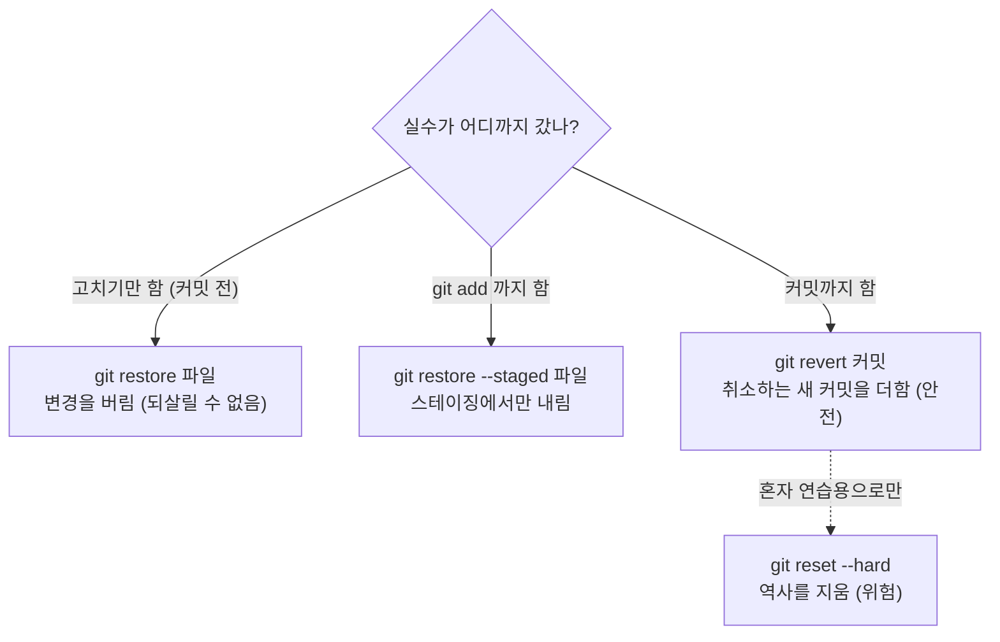

# 1주. Git 첫걸음

!!! abstract "이번 주에 할 수 있게 되는 것"
    - Git 을 처음 설정하고(`user.name`, `user.email`, `init.defaultBranch main`) 저장소를 만들 수 있다.
    - 작업 폴더·스테이징 영역·저장소의 차이를 그림으로 설명할 수 있다.
    - `status`, `add`, `commit`, `log`, `diff` 로 변경을 기록하고 확인할 수 있다.
    - `restore` 와 `revert` 로 실수를 되돌리고, `reset --hard` 가 왜 위험한지 말할 수 있다.
    - `.gitignore` 로 기록하면 안 되는 파일을 빼고, 좋은 커밋 메시지를 쓸 수 있다.

| 준비물 | 예상 시간 |
|---|---|
| 0주 완료(WSL Ubuntu, VS Code). Git 은 Ubuntu 에 대개 이미 있어요(`git --version`). 없으면 `sudo apt update && sudo apt install -y git` | 읽기 2시간 · 실습 3시간 · 문제 1시간 |

## 1. 왜 배우나

과제 파일을 `보고서_최종.py`, `보고서_진짜최종.py`, `보고서_진짜최종_수정.py` 로 저장해 본 적 있나요? 그러다 "어제 잘 되던 버전" 이 어느 파일인지 모르게 돼요. 친구와 같이 고치면 더 엉켜요.

**버전 관리**(version control)는 파일이 바뀐 **역사**를 기록해 두는 일이에요. **Git** 은 그 일을 하는 도구예요. 게임의 세이브 포인트처럼 "여기까지 됐다" 를 저장해 두고, 망치면 그 지점으로 돌아가요. 또 "누가 언제 왜 바꿨나" 가 남아서 함께 일할 수 있어요(2~3주차).

Git 은 내 컴퓨터 안에서 혼자 써도 충분히 유용해요. 이번 주는 GitHub 없이 내 컴퓨터에서만 해요.

## 2. 처음 한 번: 설정

Git 은 모든 기록에 "누가 했나" 를 적어요. 그래서 이름과 메일을 알려 줘야 해요. 그리고 첫 가지(브랜치)의 이름을 `main` 으로 정해 둬요. 지금 쓰는 Git(2.56)은 설정이 없으면 `master` 로 만들고 안내 글을 보여 줘요. Git 3.0 부터는 `main` 이 기본이 될 예정이에요. ([Git BreakingChanges](https://git-scm.com/docs/BreakingChanges))

```bash
git config --global user.name "내이름"
git config --global user.email "내메일@example.com"
git config --global init.defaultBranch main
```

`--global` 은 "이 컴퓨터의 내 계정 전체에 적용" 이라는 뜻이에요. 한 번만 하면 돼요.

## 3. 세 장소: 작업 폴더, 스테이징, 저장소

Git 의 핵심은 파일이 **세 곳**을 지나간다는 거예요. 택배에 비유하면 이래요.

- **작업 폴더**(working directory): 내가 파일을 고치는 책상 위.
- **스테이징 영역**(staging area): 상자에 담을 물건을 골라 놓은 곳.
- **저장소**(repository): 포장해서 보관 창고에 넣은 기록(커밋).


왜 굳이 중간 단계가 있을까요? 파일 세 개를 고쳤는데 "인사말 바꾼 것"과 "오타 고친 것"은 **따로** 기록하고 싶을 때가 있기 때문이에요. 담을 것만 골라(`add`) 한 커밋으로 묶어요.

## 4. 첫 커밋: init, status, add, commit, log

**저장소 만들기**: 폴더 안에서 `git init`. 숨은 폴더 `.git` 이 생기고, 그 안에 모든 기록이 들어가요. 이 폴더를 지우면 역사도 사라져요.

**지금 상태 보기**: `git status`. 가장 자주 쓰는 명령이에요. 헷갈리면 일단 `git status`.

가장 작은 예예요. 파일 하나를 만들어 기록해요.

```bash
mkdir git-lab && cd git-lab
git init
echo "# 내 첫 저장소" > README.md
git status        # README.md 가 "Untracked"(추적 안 함)
git add README.md # 스테이징 영역에 올림
git commit -m "README 추가"
git log --oneline
```

`git status` 의 상태 이름이 곧 위 그림이에요.

| status 가 보여 주는 말 | 어디 있나 |
|---|---|
| `Untracked files` | 작업 폴더에만 있고 Git 이 아직 몰라요 |
| `Changes not staged for commit` | 고쳤지만 `add` 전 |
| `Changes to be committed` | 스테이징에 올라가 있어요 |
| `nothing to commit, working tree clean` | 작업 폴더가 마지막 커밋과 같아요 |

`git log --oneline` 은 커밋을 한 줄씩(번호 + 메시지) 보여 줘요. 맨 앞 7글자가 커밋 번호예요. 번호는 사람마다 달라요.

**`-m "메시지"` 를 빼면** 편집기(nano 나 vim)가 열려요. 처음엔 당황하니 `-m` 을 쓰세요. (vim 이 열렸다면 `Esc` 누르고 `:q!` 후 Enter 로 빠져나와요.)

## 5. 바뀐 것 보기: diff

`git diff` 는 **무엇이 바뀌었나** 를 줄 단위로 보여 줘요. `-` 는 지워진 줄, `+` 는 생긴 줄이에요.

```diff
-    return "안녕, " + name
+    return "반갑다, " + name
```

함정이 하나 있어요. `git diff` 는 기본으로 **스테이징 안 한 변경**만 보여 줘요. `git add` 뒤에는 빈 화면이 돼요. 올려 둔 것을 보려면 `git diff --staged` 예요. 커밋 전에 `git diff --staged` 로 "내가 지금 무엇을 기록하려는지" 확인하는 습관을 들이세요.

## 6. 되돌리기: restore, revert, reset

실수를 되돌리는 방법은 "**어디까지 갔나**" 에 따라 달라요.



- **`git restore 파일`**: 작업 폴더의 변경을 마지막 커밋 모습으로 되돌려요. **커밋 안 한 변경은 영영 사라져요.**
- **`git restore --staged 파일`**: `add` 를 취소해요. 파일 내용은 그대로예요.
- **`git revert 커밋`**: 그 커밋이 한 일을 **거꾸로 하는 새 커밋**을 만들어요. 역사가 지워지지 않아서 안전해요. 친구와 공유한 뒤에도 쓸 수 있어요. 가장 최근 것은 `git revert HEAD`(`HEAD` 는 "지금 내가 있는 커밋").
- **`git reset --hard 커밋`**: 지정한 커밋으로 역사를 되감고 **그 뒤 변경까지 지워요.** 기록이 사라지고 커밋 안 한 변경은 되살릴 수 없어서 **위험**해요. 이미 남과 공유한 커밋에는 절대 쓰지 마세요(3주차에 이유가 나와요). 연습용 저장소에서 이런 것이 있다는 것만 체험해요. 실수로 했다면 `git reflog` 로 최근 이동을 볼 수 있고, 거기 보이는 번호로 다시 되감을 수 있어요.

한 줄 규칙: **평소엔 restore 와 revert. reset --hard 는 마지막 수단.**

`git switch`/`git restore` 방식은 Git 3.0 이 와도 그대로 통해요(Git 공식 문서가 유지된다고 밝혀요).

## 7. 기록하지 말 것: .gitignore

모든 파일을 기록하면 안 돼요.

- 비밀번호·API 키가 든 파일(`.env`). 한번 기록하면 지워도 역사에 남아요.
- 자동으로 생기는 파일(`__pycache__/`, `*.pyc`, 가상환경 `.venv/`).
- 내 컴퓨터에서만 의미 있는 파일.

프로젝트 맨 위에 `.gitignore` 파일을 만들어 한 줄에 하나씩 쓰면 Git 이 그 파일을 모른 척해요.

```text
__pycache__/
.env
*.pyc
.venv/
```

`.gitignore` 자체는 기록해서 팀원과 나눠요. **이미 기록한 파일**은 `.gitignore` 에 써도 계속 추적돼요. 처음부터 만들어 두세요.

## 8. 좋은 커밋 메시지

커밋 메시지는 미래의 나(와 동료)에게 쓰는 편지예요. 나중에 `git log --oneline` 만 보고도 무슨 일이 있었는지 알아야 해요.

| 나쁜 예 | 좋은 예 |
|---|---|
| `수정` | `인사말을 반갑다로 변경` |
| `ㅇㅇ` | `README 에 실행 방법 추가` |
| `final` | `구구단 출력 함수 추가` |

- **한 커밋에 한 가지 일.** 메시지에 "그리고" 가 들어가면 둘로 나눌 수 있어요.
- 첫 줄은 짧게(한 줄), "무엇을 했나" 를 써요.
- 영어든 한국어든 팀에서 하나로 통일해요.

더 길게 쓰고 싶으면 첫 줄 뒤에 빈 줄을 두고 이유를 적어요(편집기가 열리는 `git commit`).

## 직접 해보기

[1주 실습: `docs/labs/week01/README.md`](../labs/week01/README.md)

- 만드는 것: `~/git-lab` 저장소. 마지막에 `git log --oneline` 으로 **커밋 10개**.
- 확인: `.gitignore` 로 `.env` 가 목록에서 사라진다. `restore` 와 `revert` 를 한 번씩 써 본다. `git status` 가 clean 이다.

## 막히면

- **증상**: `Author identity unknown` / `Please tell me who you are`. **원인**: 이름·메일 설정 전. **해결**: 2절의 `git config --global user.name`, `user.email`.
- **증상**: `On branch master` 로 나온다. **원인**: `init.defaultBranch` 설정 전에 `git init` 함. **해결**: `git branch -m main`, 그리고 설정을 해 둬요.
- **증상**: `git commit` 했더니 알 수 없는 화면(vim)이 떴다. **원인**: `-m` 을 빼서 편집기가 열림. **해결**: `Esc`, `:q!`, Enter 로 빠져나와 `git commit -m "메시지"` 로 다시.
- **증상**: `nothing added to commit` / `no changes added to commit`. **원인**: `git add` 를 안 했거나 고친 게 없음. **해결**: `git status` 를 읽고 `git add 파일`.
- **증상**: `.gitignore` 에 썼는데도 파일이 계속 보인다. **원인**: 이미 추적 중인 파일. **해결**: `git rm --cached 파일` 로 추적을 끊고 커밋해요(파일은 폴더에 남아요).
- **증상**: `fatal: not a git repository`. **원인**: `git init` 한 폴더 밖에 있음. **해결**: `cd` 로 저장소 폴더에 들어가요. `pwd` 로 위치 확인.

## 확인 문제

1. 작업 폴더, 스테이징 영역, 저장소의 차이를 한 문장씩 설명해 보세요.

    ??? note "답 보기"
        작업 폴더는 내가 파일을 고치는 곳, 스테이징 영역은 다음 커밋에 넣을 변경을 골라 놓은 곳, 저장소는 커밋(기록)이 쌓이는 곳이에요.

2. `git add greet.py` 뒤에 `git diff` 를 쳤는데 아무것도 안 나왔어요. 고친 내용을 보려면 어떻게 하나요?

    ??? note "답 보기"
        `git diff` 는 스테이징 안 한 변경만 보여 줘서 그래요. `git diff --staged` 로 올려 둔 변경을 봐요.

3. 파일을 고쳤는데 커밋 전에 마음이 바뀌었어요. 어떤 명령을 쓰고, 무엇을 주의해야 하나요?

    ??? note "답 보기"
        `git restore 파일`. 커밋 안 한 변경이 영영 사라지므로 되살릴 수 없다는 점을 주의해요.

4. 이미 커밋한 것을 취소하고 싶어요. `revert` 와 `reset --hard` 중 평소에 쓸 것은 무엇이고, 왜 그런가요?

    ??? note "답 보기"
        `revert`. 취소하는 새 커밋을 더해서 역사가 지워지지 않아 안전해요. `reset --hard` 는 역사와 커밋 안 한 변경을 지워서 위험해요.

5. `.env` 에 비밀번호가 있어요. 어떻게 하면 실수로 커밋하지 않나요? 이미 커밋한 파일은 `.gitignore` 에 써도 될까요?

    ??? note "답 보기"
        처음부터 `.gitignore` 에 `.env` 를 써 두고 커밋해요. 이미 추적 중인 파일은 `.gitignore` 에 써도 계속 추적돼서, `git rm --cached .env` 로 추적을 끊어야 해요. (역사에는 남으니 비밀번호는 바꿔야 해요.)

## 더 읽기

- [Pro Git 한국어판 1~2장](https://git-scm.com/book/ko/v2) — 무료(CC BY-NC-SA 3.0). 한국어판은 영어 원본보다 오래된 편이라 명령 설명은 그대로 쓰고 기본 브랜치 이름은 이 쪽 설명을 따르세요.
- [생활코딩 지옥에서 온 Git](https://opentutorials.org/course/2708) — 원리 위주(2019 게시, 페이지에 신판으로 대체된다는 표시가 있어요).
- [GitHub Docs 한국어: 헬로 월드](https://docs.github.com/ko/get-started/start-your-journey/hello-world)

## 이번 주 체크리스트

- [ ] 읽기: 세 장소(작업 폴더·스테이징·저장소)와 되돌리기 그림을 읽었다
- [ ] 실습: Git 설정(`user.name`, `user.email`, `init.defaultBranch main`)을 했다
- [ ] 실습: `restore` 와 `revert` 를 한 번씩 써 봤다
- [ ] 실습: `.gitignore` 로 `.env` 를 뺐다
- [ ] 실습: `git log --oneline` 에 커밋 10개를 만들었다
- [ ] 문제: 확인 문제 5개를 풀었다
