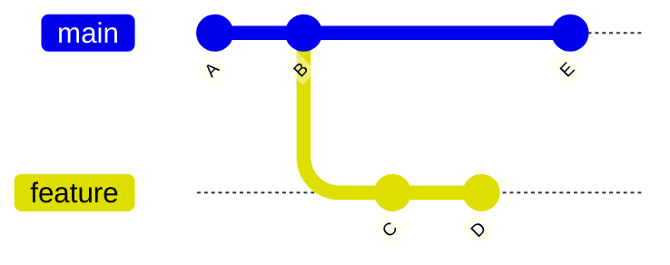
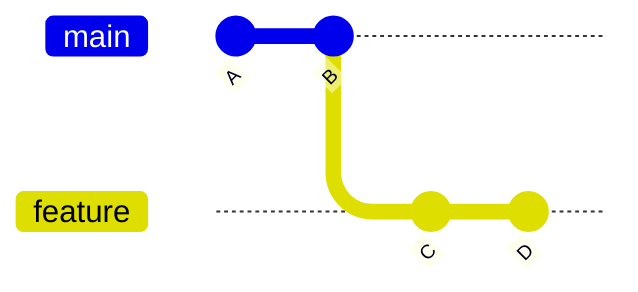
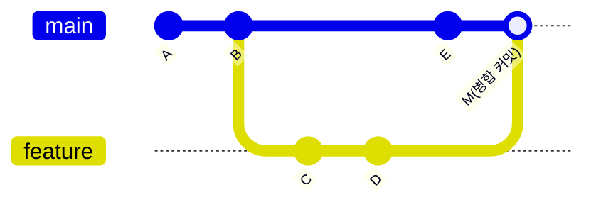
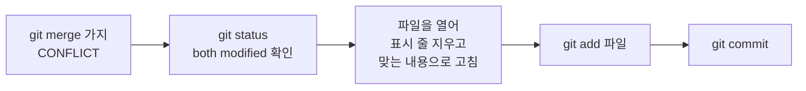
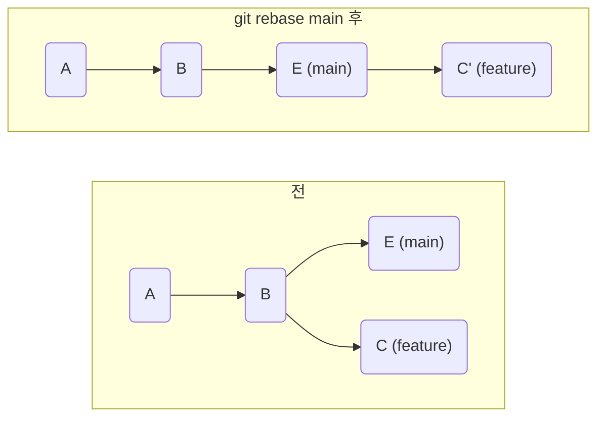

# 2주. 브랜치와 병합

!!! abstract "이번 주에 할 수 있게 되는 것"
    - 브랜치(branch)가 무엇이고 왜 쓰는지 그림으로 설명할 수 있다.
    - `git switch` 로 브랜치를 만들고 옮겨 다니며 작업할 수 있다.
    - fast-forward 병합과 3-way 병합의 차이를 설명하고 직접 해 볼 수 있다.
    - 병합 충돌이 났을 때 충돌 표시를 읽고 직접 풀 수 있다.
    - rebase 가 무엇이고 왜 "내 것만" 해야 하는지 말할 수 있다.

| 준비물 | 예상 시간 |
|---|---|
| 1주 완료(Git 설정, add·commit·log). 실습 스크립트 `conflict-lab.sh` | 읽기 2시간 · 실습 3시간 · 문제 1시간 |

## 1. 왜 배우나

잘 돌아가는 프로그램에 새 기능을 넣고 싶어요. 그런데 고치다 망가지면 어떡하죠? 그리고 친구도 같은 프로그램의 다른 부분을 동시에 고치고 있다면요?

**브랜치**(branch, 가지)는 "원래 줄기는 그대로 두고, 따로 갈라져 나가서 마음껏 고쳐 보는 작업선"이에요. 잘 되면 줄기에 **합치고**(병합, merge), 안 되면 가지째 버려요. 여러 사람이 서로 방해하지 않고 일하려면 필수예요.

## 2. 브랜치는 이름표

브랜치가 "파일 전체를 복사한 것"이라고 생각하기 쉽지만 아니에요. Git 에서 브랜치는 **커밋 하나를 가리키는 이름표**일 뿐이라서 만드는 게 아주 빨라요.



`main` 과 `feature` 두 가지가 B 에서 갈라졌어요. `main` 은 E, `feature` 는 D 를 가리켜요. 지금 내가 어느 가지에 있는지를 `HEAD` 가 가리켜요. (`git branch` 에서 `*` 표시.)

```bash
git branch                   # 브랜치 목록 (* 가 지금 있는 곳)
git switch -c feature/title  # 새 브랜치를 만들고 그곳으로 이동
git switch main              # main 으로 돌아가기
```

`git switch` 는 브랜치를 옮기는 명령이에요. (`-c` 는 create, 만들기.) 옛 책에는 `git checkout` 이 나오는데 같은 일을 하는 옛 이름이에요. 이 강좌는 `switch` 를 써요.

!!! tip "브랜치 이름"
    `feature/title`, `fix/typo` 처럼 **무엇을 하는 가지인지** 써요. 한글·공백은 피해요.

## 3. 병합 ①: fast-forward

`main` 에서 갈라진 뒤 `main` 이 **움직이지 않았다면**, 합치는 건 이름표를 앞으로 옮기기만 하면 돼요.



여기서 `git switch main` 하고 `git merge feature` 를 하면 `main` 도 D 를 가리켜요. 새 커밋은 안 생겨요. Git 이 `Fast-forward` 라고 알려 줘요.

```bash
git switch main
git merge feature
```

## 4. 병합 ②: 3-way

갈라진 뒤 **양쪽이 다 움직였다면** 한 줄로 이을 수 없어요. 그래서 Git 은 세 지점(갈라진 곳 B, 양쪽 끝 E 와 D)을 보고 합쳐서 **병합 커밋**을 새로 만들어요. 그래서 "3-way"(세 방향) 병합이에요.



양쪽이 **서로 다른 파일(또는 다른 줄)** 을 고쳤다면 Git 이 알아서 합쳐요. 합칠 때 메시지는 `git merge feature -m "메시지"` 로 줘요. (`-m` 이 없으면 편집기가 열려요.)

병합이 끝난 가지는 `git branch -d 가지이름` 으로 지워요. 가리키던 이름표만 지워지고 커밋은 남아요.

`git log --oneline --graph --all` 로 모양을 볼 수 있어요. `--graph` 는 가지 그림, `--all` 은 모든 브랜치를 보여 줘요.

## 5. 충돌

양쪽이 **같은 파일의 같은 줄**을 서로 다르게 고쳤다면 Git 은 어느 쪽이 맞는지 몰라요. 이게 **충돌**(conflict)이에요. 고장이 아니에요. "여기는 사람이 정해 주세요" 라는 요청이에요.

충돌이 나면 Git 이 파일 안에 표시를 남겨요.

```text
<<<<<<< HEAD
    return "Good day, " + name
=======
    return "Hey, " + name
>>>>>>> casual
```

- `<<<<<<< HEAD` ~ `=======`: **내 쪽**(지금 있는 브랜치)
- `=======` ~ `>>>>>>> casual`: **합치려는 쪽**(`casual` 브랜치)

푸는 순서는 항상 같아요.



1. `git status` 로 충돌 난 파일을 찾아요(`both modified`).
2. 파일을 열어 **표시 줄(`<<<<<<<`, `=======`, `>>>>>>>`)을 모두 지우고** 남길 내용을 정해요. 둘 다 섞어도 돼요.
3. 돌려 봐요(파이썬이면 실행).
4. `git add 파일` → `git commit`.

도망치고 싶다면 `git merge --abort` 로 병합을 시작하기 전으로 돌려놓을 수 있어요.

Git 2.56 에는 `git add --resolved` 가 새로 생겼어요. 충돌 표시가 남은 파일은 거부해 줘서, 표시를 지우지 않고 커밋하는 실수를 막아 줘요. ([GitHub 블로그: Git 2.56](https://github.blog/open-source/git/highlights-from-git-2-56/)) 내 Git 이 2.56 보다 낮으면 그냥 `git add` 를 써요.

!!! note "충돌은 무서워할 일이 아니에요"
    협업하면 충돌은 자주 나요. 파일을 작게 나누고, 커밋을 자주 하고, 남과 같은 줄을 동시에 고치지 않게 말을 맞추면 줄어요.

## 6. rebase 와 "내 것만" 규칙

**rebase** 는 내 가지의 커밋들을 **떼어서 `main` 의 최신 뒤로 옮겨 다시 쌓는** 방법이에요. 병합 커밋 없이 역사가 한 줄로 깔끔해져요.



`C` 가 `C'` 로 **바뀐** 점이 중요해요. 커밋은 "무엇이 바뀌었나 + 바로 앞 커밋" 으로 번호가 정해지는데, 앞 커밋이 달라졌으니 **새 커밋이 새 번호로 만들어져요.** 옛 `C` 는 버려져요.

그래서 규칙이 하나 있어요.

!!! warning "rebase 는 내 것만"
    **아직 아무도 받아 가지 않은, 나만 쓰는 브랜치**에서만 rebase 해요. 이미 남이 받아 간(공유한) 커밋을 rebase 하면 커밋 번호가 바뀌어서 남의 기록과 어긋나요. 헷갈리면 rebase 대신 `git merge` 를 쓰세요. 잘못되지 않아요.

```bash
git switch feature
git rebase main     # feature 의 커밋을 main 최신 뒤로 옮김
git switch main
git merge --ff-only feature   # 이제 한 줄이라 fast-forward 로 끝
```

## 직접 해보기

[2주 실습: `docs/labs/week02/README.md`](../labs/week02/README.md) 와 같은 폴더의 [`conflict-lab.sh`](../labs/week02/conflict-lab.sh)

- 만드는 것: ① fast-forward 와 3-way 병합 한 번씩 ② 스크립트가 만든 충돌을 직접 풀기 ③ 나만 쓰는 가지 rebase
- 확인: `git log --oneline --graph` 에 갈라졌다 합쳐진 모양이 보이고, 충돌 파일에 표시 줄이 없다.

## 막히면

- **증상**: `error: Your local changes would be overwritten by merge` 또는 `switch` 가 거부된다. **원인**: 커밋 안 한 변경이 있음. **해결**: 먼저 `git commit` 하거나 버릴 거면 `git restore 파일`.
- **증상**: 충돌 후 `git commit` 이 안 된다 / `Unmerged paths`. **원인**: `git add` 로 해결 표시를 안 함. **해결**: 파일을 고치고 `git add 파일`, 다시 `git commit`.
- **증상**: 파이썬에서 `SyntaxError: invalid syntax`(`<<<<<<<`). **원인**: 충돌 표시 줄을 안 지움. **해결**: 파일에서 `<<<<<<<`, `=======`, `>>>>>>>` 줄을 찾아 지워요(VS Code 의 검색으로 `<<<<<<<` 찾기).
- **증상**: 병합이 꼬여서 모르겠다. **해결**: `git merge --abort` 로 병합 전으로 돌아가 다시 시작.
- **증상**: `git branch -d` 가 "not fully merged" 라며 거부한다. **원인**: 아직 합치지 않은 커밋이 있음. **해결**: 정말 버릴 가지면 `git branch -D 이름`(대문자 D, 커밋이 사라지니 주의).
- **증상**: `conflict-lab.sh` 가 "이미 있어요" 라고 한다. **해결**: `rm -r conflict-lab` 후 다시, 또는 다른 폴더 이름을 인자로.

## 확인 문제

1. 브랜치는 "파일 전체의 복사본" 인가요? 아니라면 무엇인가요?

    ??? note "답 보기"
        아니에요. 커밋 하나를 가리키는 이름표라서 만들고 옮기는 게 빨라요.

2. fast-forward 병합이 되는 조건은 무엇이고, 이때 병합 커밋이 생기나요?

    ??? note "답 보기"
        갈라진 뒤 합치는 대상(`main`)이 움직이지 않았을 때예요. 이름표만 앞으로 옮겨서 병합 커밋은 생기지 않아요.

3. 충돌 표시에서 `<<<<<<< HEAD` 와 `=======` 사이는 누구의 내용이에요? 충돌을 푼 뒤 마지막에 어떤 명령 두 개를 쳐야 해요?

    ??? note "답 보기"
        내 쪽(지금 있는 브랜치)의 내용이에요. 파일을 고친 뒤 `git add 파일` 과 `git commit` 이에요.

4. 충돌 표시 줄을 안 지우고 `git add`, `git commit` 까지 해 버렸다면 어떤 일이 생길까요? 어떻게 막을 수 있나요?

    ??? note "답 보기"
        표시 줄이 파일에 그대로 기록돼서 파이썬에서 문법 오류가 나요. 커밋 전에 파일을 열어 확인하고 돌려 보거나, Git 2.56 이상이면 `git add --resolved 파일` 로 표시가 남은 파일을 거부당할 수 있어요.

5. 다른 사람이 이미 받아 간 브랜치를 rebase 하면 안 되는 이유는?

    ??? note "답 보기"
        rebase 는 커밋을 새 번호로 다시 만들어요. 남이 가진 옛 커밋과 내 새 커밋이 달라져서 기록이 어긋나요. 그래서 나만 쓰는 브랜치에서만 해요.

## 더 읽기

- [Pro Git 한국어판 3장 "Git 브랜치"](https://git-scm.com/book/ko/v2) — 무료(CC BY-NC-SA 3.0). 한국어판은 원본보다 오래돼서 명령은 `switch` 로 바꿔 읽어요.
- [Git 공식 문서: git-merge](https://git-scm.com/docs/git-merge)
- [GitHub Docs 한국어](https://docs.github.com/ko)

## 이번 주 체크리스트

- [ ] 읽기: 브랜치·병합(fast-forward, 3-way)·충돌·rebase 그림을 읽었다
- [ ] 실습: fast-forward 병합과 3-way 병합을 한 번씩 했다
- [ ] 실습: `conflict-lab.sh` 로 만든 충돌을 직접 풀고 병합 커밋을 만들었다
- [ ] 실습: 나만 쓰는 브랜치를 rebase 해 보았다
- [ ] 문제: 확인 문제 5개를 풀었다
