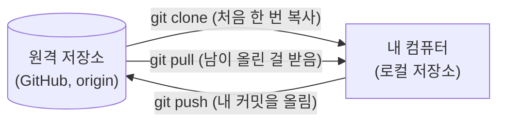
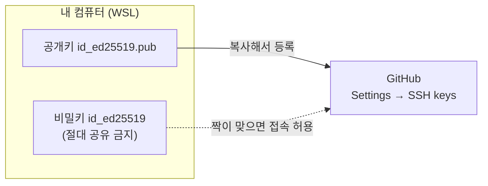
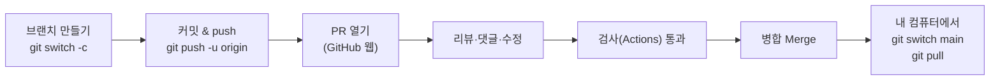
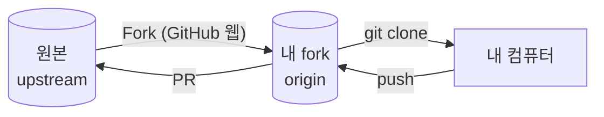

# 3주. GitHub 로 함께 일하기

!!! abstract "이번 주에 할 수 있게 되는 것"
    - 원격 저장소(remote)가 무엇인지 말하고 `clone`, `push`, `pull` 을 쓸 수 있다.
    - SSH 키를 만들어 GitHub 에 등록하고 연결을 확인할 수 있다.
    - 브랜치로 작업해 PR(풀 리퀘스트)을 만들고, 리뷰하고, 병합할 수 있다.
    - 이슈로 할 일을 적고, fork 로 남의 저장소에 기여하는 흐름을 설명할 수 있다.
    - GitHub Actions 로 PR 마다 pytest 가 자동으로 도는 것을 확인할 수 있다.

| 준비물 | 예상 시간 |
|---|---|
| 1~2주 완료. 무료 GitHub 계정, WSL. 같이 할 친구가 있으면 좋아요(없어도 돼요) | 읽기 2시간 · 실습 3~4시간 · 문제 1시간 |

## 1. 왜 배우나

지금까지의 Git 은 내 컴퓨터 안에서만 돌아갔어요. 컴퓨터가 고장 나면 기록도 같이 사라지고, 친구와 파일을 나누려면 메신저로 보내야 했죠.

**GitHub** 는 내 Git 저장소를 인터넷에 올려 두는 곳이에요. 여기에 올리면 ① **백업**이 되고, ② **함께 일할 수 있고**(PR·리뷰·이슈), ③ 올릴 때마다 **자동으로 시험을 돌릴 수 있어요**(Actions). 이 강좌의 모든 결과물도 여기에 쌓아요.

## 2. 원격 저장소: clone, push, pull

**원격 저장소**(remote)는 인터넷(또는 다른 컴퓨터)에 있는 같은 Git 저장소예요. 이름은 보통 `origin` 이에요. 내 컴퓨터의 저장소(로컬)와 원격을 **주고받는** 세 가지 명령이 핵심이에요.



- `git clone 주소` : 원격 저장소를 통째로 내 컴퓨터에 복사해요(처음 한 번). 원격은 자동으로 `origin` 이라는 이름이 붙어요.
- `git push` : 내 새 커밋을 원격에 올려요.
- `git pull` : 원격에 새로 올라온 커밋을 내려받아 합쳐요.
- `git remote -v` : 연결된 원격 주소 보기.

처음 브랜치를 올릴 때는 `git push -u origin 브랜치이름` 으로 `-u` 를 붙여요. 그 뒤로는 `git push`, `git pull` 만 쳐도 돼요.

**push 가 거부되는 경우**: 내가 모르는 사이 친구가 먼저 올렸다면 `! [rejected] main -> main (fetch first)` 로 거부돼요. 해결은 `git pull` 로 먼저 받은 뒤 다시 push 예요. 이때 `git pull` 이 "divergent branches" 라는 안내를 하면 `git config --global pull.rebase false`(합치기 방식)를 해 두면 돼요.

!!! warning "1주차의 `reset --hard` 와 2주차의 rebase 를 다시 떠올려요"
    **이미 push 한(남이 받아 갔을 수 있는) 커밋의 역사를 고치지 마세요.** `reset --hard` 나 rebase 로 역사를 바꾸고 강제로 올리면, 남의 저장소와 어긋나서 친구의 작업이 꼬여요. 이미 올린 실수는 `git revert` 로 새 커밋을 더해 취소해요.

연습은 먼저 GitHub 없이 해 볼 수 있어요. 내 컴퓨터의 폴더를 "원격" 처럼 써서 clone·push·pull 을 해 보는 방법이 실습 0단계에 있어요.

## 3. SSH 키로 연결하기

GitHub 에 올릴 때마다 비밀번호를 치기는 번거로워요. 대신 **SSH 키**를 써요. 열쇠 한 쌍을 만들어서 **공개키**는 GitHub 에 맡기고, **비밀키**는 내 컴퓨터에만 둬요. 이 둘이 짝이 맞으면 "이 컴퓨터는 이 사람이 맞구나" 하고 믿어 줘요.



```bash
ssh-keygen -t ed25519 -C "내메일@example.com"
cat ~/.ssh/id_ed25519.pub     # 공개키를 화면에 찍어 복사
ssh -T git@github.com         # 연결 확인
```

GitHub 가 권장하는 키 종류는 `ed25519` 예요. ([GitHub Docs: SSH 키 만들기](https://docs.github.com/ko/authentication/connecting-to-github-with-ssh/generating-a-new-ssh-key-and-adding-it-to-the-ssh-agent)) 저장소 주소는 `https://...` 대신 `git@github.com:내아이디/저장소.git` 형태(SSH 주소)를 써요.

!!! warning "비밀키는 비밀번호보다 중요해요"
    `.pub` 가 없는 파일(`id_ed25519`)은 메신저에 보내거나 저장소에 올리지 마세요. 실수로 올렸다면 GitHub 에서 그 키를 삭제하고 새로 만들어요.

## 4. 브랜치 → PR → 리뷰 → 병합

함께 일하는 표준 흐름이에요. `main` 에는 **직접 커밋하지 않고**, 브랜치에서 작업한 뒤 PR 로 합쳐요.



**PR**(Pull Request, 풀 리퀘스트)은 "내 브랜치를 `main` 에 합쳐 주세요" 라는 **요청서**예요. 요청서 안에서 바뀐 줄을 같이 보고 댓글을 달 수 있어요.

- **리뷰**(review): 바뀐 줄 옆에 질문·제안을 남겨요. "왜 이렇게 했어요?", "이 줄은 이렇게 하면 어때요?". 리뷰는 비난이 아니라 **같이 더 좋게 만드는 일**이에요.
- **이슈**(issue): 할 일, 버그, 아이디어를 적는 게시판이에요. PR 설명에 `Closes #번호` 라고 쓰면 병합될 때 그 이슈가 같이 닫혀요.
- 친구를 저장소의 **Collaborator** 로 초대하면 같은 저장소에서 같이 일할 수 있어요. 친구가 없으면 나 자신과 PR 을 주고받아도 같은 연습이에요.

## 5. fork: 남의 저장소에 기여하기

남의 공개 저장소에는 내가 직접 push 할 수 없어요. 그래서 **fork** 를 해요. 내 계정으로 저장소를 통째로 복사해 와서, 거기서 고치고, 원래 저장소에 PR 을 보내요.



로컬에서는 원본을 `upstream` 이라는 이름으로 `git remote add upstream 주소` 해 두면 원본의 최신 변경을 받을 수 있어요.

## 6. GitHub Actions: 시험 자동 실행

코드를 올릴 때마다 사람이 시험을 돌리는 건 깜빡하기 쉬워요. **GitHub Actions** 는 올릴 때(push)나 PR 이 열릴 때 GitHub 가 **대신 시험을 돌려 주는** 기능이에요. 이런 자동화를 **CI**(Continuous Integration, 지속적 통합)라고 불러요.

설정은 저장소의 `.github/workflows/` 폴더에 **YAML 파일**을 하나 두는 것이 전부예요. 이번 주 실습의 견본은 이래요.

```yaml
name: test

on:
  push:
    branches: [main]
  pull_request:

jobs:
  pytest:
    runs-on: ubuntu-latest
    steps:
      - uses: actions/checkout@v7
      - uses: actions/setup-python@v7
        with:
          python-version: "3.13"
      - run: python -m pip install pytest
      - run: python -m pytest -v
```

한 줄씩 읽어요.

- `on:` — 언제 돌까요? `main` 에 push 될 때, 그리고 PR 이 있을 때.
- `runs-on: ubuntu-latest` — GitHub 가 빌려주는 Linux 컴퓨터에서 돌아요.
- `uses: actions/checkout@v7` — 내 저장소 코드를 그 컴퓨터로 내려받기.
- `uses: actions/setup-python@v7` — 파이썬 준비.
- `run:` — 내가 평소 치던 명령(설치, `pytest`).

PR 화면에 **초록 체크**(통과) 또는 **빨간 X**(실패)가 뜨고, 실패하면 병합 전에 고칠 수 있어요. 공개 저장소에서 표준 러너는 무료예요. ([Actions 과금 문서](https://docs.github.com/en/billing/concepts/product-billing/github-actions))

!!! warning "남이 만든 Action 은 믿을 만한 것만, 가능하면 고정해서"
    2026-03 에 보안 점검 도구 Trivy 의 Action 태그들이 변조된 공급망 사고가 있었어요. 태그(`@v7`)는 가리키는 코드가 바뀔 수 있어서, 중요한 곳에서는 커밋 번호로 고정하는 걸 권장해요. 자세한 건 보안 주차에서 다시 만나요. ([Aqua 블로그](https://www.aquasec.com/blog/trivy-supply-chain-attack/))

## 7. 학생이라면: 무료 혜택 (2026-11 기준)

학생 인증(GitHub Education)을 받으면 도움이 되는 혜택이 있어요. 아래는 공식 문서로 확인한 것만 적었어요.

| 혜택 | 내용 | 확인 |
|---|---|---|
| Codespaces(브라우저 속 개발 환경) | 일반 무료 계정은 월 120 코어시간, **학생은 180 코어시간** | [Codespaces 과금](https://docs.github.com/en/billing/concepts/product-billing/github-codespaces), [Education 문서](https://docs.github.com/en/education/about-github-education/github-education-for-students/about-github-education-for-students) |
| Copilot Student | 인증 학생에게 $0 인 별도 플랜(자동 모델 선택만, 서드파티 에이전트 제외, **매월 자격을 다시 확인**). "Copilot Pro 무료" 가 아니에요 | [Copilot 플랜](https://docs.github.com/en/copilot/get-started/plans) |
| Actions | 공개 저장소의 표준 러너는 무료 | [Actions 과금](https://docs.github.com/en/billing/concepts/product-billing/github-actions) |

!!! note "확인하지 못한 것"
    한국 대학 1학년의 구체적인 인증 요건(학교 메일·학생증 등), Student Developer Pack 의 개별 혜택 변동, Copilot Student 신규 가입이 지금 완전히 열려 있는지는 이 글을 쓸 때 공식 문서에서 확인하지 못했어요. 신청하기 전에 [GitHub Education](https://education.github.com/pack) 에서 직접 확인하세요. 학생 인증이 안 되어도 이 강좌는 무료 계정으로 모두 할 수 있어요.

## 직접 해보기

[3주 실습: `docs/labs/week03/README.md`](../labs/week03/README.md) · 견본 파일: [`calc.py`](../labs/week03/calc.py), [`test_calc.py`](../labs/week03/test_calc.py), [`.github-workflow-example.yml`](../labs/week03/.github-workflow-example.yml)

- 만드는 것: GitHub 저장소 `devenv-course`, PR 1개(나 자신 또는 친구와), 그 PR 에서 도는 pytest.
- 확인: PR 화면에 초록 체크가 뜬다. 일부러 `add` 를 망가뜨리면 빨간 X 로 바뀐다.

## 막히면

- **증상**: `Permission denied (publickey)`. **원인**: 공개키를 GitHub 에 등록 안 했거나 다른 키를 씀. **해결**: `cat ~/.ssh/id_ed25519.pub` 를 GitHub Settings → SSH keys 에 등록하고 `ssh -T git@github.com` 으로 확인.
- **증상**: `! [rejected] main -> main (fetch first)`. **원인**: 원격에 내가 모르는 커밋이 있음. **해결**: `git pull` 한 뒤 `git push`.
- **증상**: `git pull` 이 "divergent branches" 를 안내한다. **원인**: 내 커밋과 원격 커밋이 갈라짐. **해결**: `git config --global pull.rebase false` 후 다시 `git pull`. 충돌이 나면 2주차처럼 풀어요.
- **증상**: Actions 가 빨간 X 다. **원인**: 시험이 실패했거나 yml 오류. **해결**: PR 의 검사 항목을 눌러 로그를 읽고, 내 컴퓨터에서 `uv run --no-project --with pytest python -m pytest` 로 재현해 고쳐요.
- **증상**: Actions 탭에 아무것도 안 돈다. **원인**: yml 파일 위치·이름이 틀림(`.github/workflows/` 아래 `.yml`). **해결**: 경로와 들여쓰기(공백 2칸)를 확인해요.
- **증상**: `fatal: Could not read from remote repository`. **원인**: 주소 오타, 비공개 저장소 권한, SSH 설정. **해결**: `git remote -v` 로 주소를 확인하고 SSH 연결을 먼저 확인해요.

## 확인 문제

1. `clone`, `push`, `pull` 은 각각 언제 쓰고 방향은 어느 쪽인가요?

    ??? note "답 보기"
        `clone` 은 원격을 내 컴퓨터로 처음 복사할 때(원격 → 로컬), `push` 는 내 커밋을 원격에 올릴 때(로컬 → 원격), `pull` 은 원격의 새 커밋을 받아 합칠 때(원격 → 로컬)예요.

2. SSH 키의 공개키와 비밀키 중 GitHub 에 등록하는 것은 어느 쪽이고, 다른 하나는 어떻게 다뤄야 하나요?

    ??? note "답 보기"
        공개키(`.pub`)를 등록해요. 비밀키는 내 컴퓨터에만 두고 절대 공유하거나 저장소에 올리지 않아요.

3. `main` 에 직접 커밋하지 않고 PR 을 거치는 이유를 두 가지 말해 보세요.

    ??? note "답 보기"
        합치기 전에 다른 사람이 바뀐 줄을 보고 리뷰할 수 있고, 자동 검사(시험)를 통과한 것만 합칠 수 있어요. 실수해도 `main` 이 보호돼요.

4. 친구가 먼저 push 해서 내 push 가 `rejected (fetch first)` 로 거부됐어요. 어떻게 해야 하나요? 이때 `reset --hard` 로 강제로 맞춰도 될까요?

    ??? note "답 보기"
        `git pull` 로 친구의 커밋을 먼저 받아 합치고 다시 push 해요. `reset --hard` 로 역사를 지우고 강제로 맞추면 남의 작업이 꼬이거나 사라질 수 있어서 안 돼요.

5. GitHub Actions 의 workflow 파일은 어디에 두고, `on:` 은 무엇을 정하나요? 그리고 Action 을 `@v7` 같은 태그로만 쓸 때 어떤 위험이 있나요?

    ??? note "답 보기"
        저장소의 `.github/workflows/` 폴더에 두고, `on:` 은 언제 실행할지(push, pull_request 등)를 정해요. 태그는 가리키는 코드가 나중에 바뀔 수 있어서, 변조되면 내 저장소에서 악성 코드가 돌 수 있어요. 중요한 곳에서는 커밋 번호로 고정해요.

## 더 읽기

- [Pro Git 한국어판 2장(원격 저장소), 5장(분산 Git)](https://git-scm.com/book/ko/v2) — 무료(CC BY-NC-SA 3.0)
- [GitHub Docs 한국어: 헬로 월드](https://docs.github.com/ko/get-started/start-your-journey/hello-world)
- [GitHub Skills: Introduction to GitHub](https://github.com/skills/introduction-to-github) — 영어, 브라우저로 진행. 안내 주소가 최근 바뀌어 새 위치의 코스 목록은 확인하지 못했어요.
- [GitHub CLI(gh)](https://cli.github.com/) — 터미널에서 PR 을 다루는 도구(선택)
- [GitHub Actions 과금 문서](https://docs.github.com/en/billing/concepts/product-billing/github-actions)

## 이번 주 체크리스트

- [ ] 읽기: clone·push·pull, SSH 키, PR 흐름, Actions 를 읽었다
- [ ] 실습: SSH 키를 만들어 GitHub 에 등록하고 `ssh -T git@github.com` 이 성공했다
- [ ] 실습: `devenv-course` 저장소를 만들어 clone·push 했다
- [ ] 실습: PR 을 만들어 리뷰(댓글)하고 병합했다
- [ ] 실습: Actions 로 pytest 가 PR 에서 자동 실행되어 초록 체크를 봤다
- [ ] 문제: 확인 문제 5개를 풀었다
