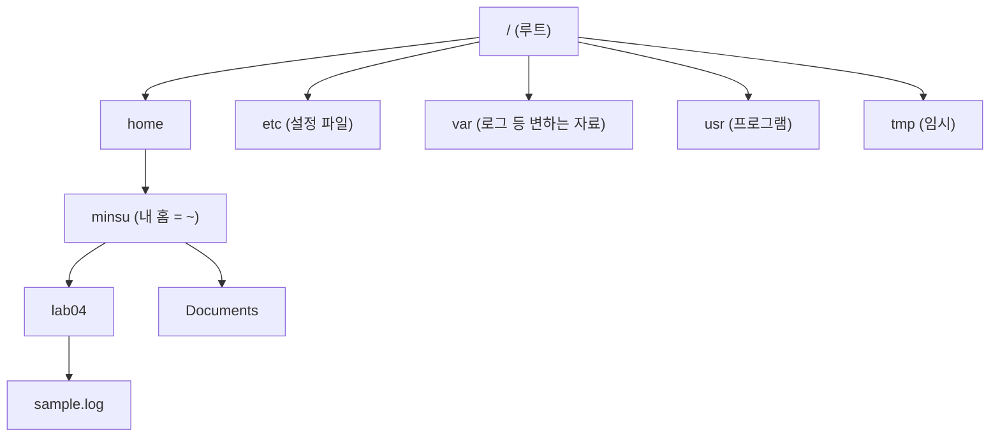
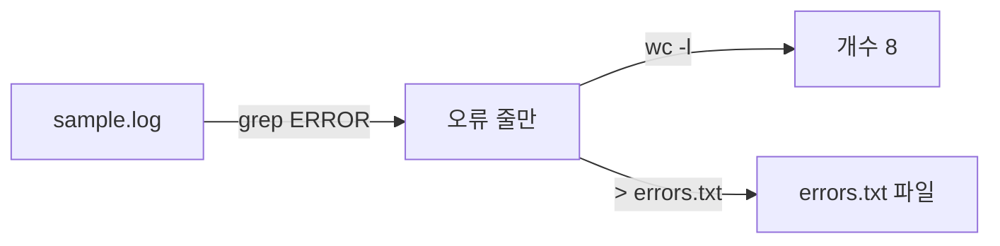

# 4주. 셸과 파일 시스템

!!! abstract "이번 주에 할 수 있게 되는 것"
    - 리눅스의 디렉터리 구조를 그려 설명하고, 절대 경로와 상대 경로로 원하는 곳에 갈 수 있다.
    - `ls`, `cd`, `cp`, `mv`, `mkdir`, `rm` 으로 파일과 폴더를 만들고, 옮기고, 지울 수 있다(지우기는 조심해서).
    - `cat`, `less`, `head`, `tail` 로 파일 내용을 볼 수 있다.
    - 파이프(`|`)와 리다이렉션(`>`, `>>`)으로 명령을 이어 붙일 수 있다.
    - `grep`, `find`, `wc`, 와일드카드로 로그 파일에서 오류 줄만 골라 세어 볼 수 있다.

| 준비물 | 예상 시간 |
|---|---|
| 0주(WSL2 Ubuntu 터미널이 열리는 상태). 1~3주의 Git 은 몰라도 돼요 | 읽기 2시간 · 실습 3시간 · 문제 1시간 |

## 1. 왜 배우나

여러분이 평소 쓰는 윈도 탐색기는 마우스로 폴더를 열고 파일을 끌어다 놓아요. 그런데 나중에 쓸 서버(남의 컴퓨터)와 컨테이너에는 **화면이 없어요**. 글자로 명령을 보내는 창, 터미널만 있어요.

터미널 안에서 우리 명령을 받아 실행해 주는 프로그램이 **셸(shell)** 이에요. 우리가 쓰는 Ubuntu 의 기본 셸은 `bash` 예요. 이번 주에는 셸에서 쓰는 가장 기본 명령을 배워요. 이 명령들은 Docker 를 배우는 7주 이후에도 컨테이너 안에서 똑같이 써요.

명령을 칠 때 줄 맨 앞에 보이는 글자(프롬프트)는 이렇게 읽어요.

```text
minsu@PC:~$
```

- `minsu` 는 내 사용자 이름, `PC` 는 컴퓨터 이름이에요.
- `~` 는 지금 있는 폴더(여기서는 내 홈 폴더)예요.
- `$` 는 "이제 명령을 쳐도 돼요"라는 표시예요. 글에서 명령 앞에 `$` 를 붙여 두면 `$` 는 빼고 쳐요.

## 2. 디렉터리 구조: 나무를 거꾸로 세운 모양

리눅스의 파일은 **하나의 나무**에 모두 달려 있어요. 윈도의 `C:`, `D:` 처럼 드라이브가 따로 있지 않고, 맨 위 뿌리 `/`(루트, root)에서 시작해서 폴더(리눅스에서는 **디렉터리(directory)** 라고 불러요) 아래로 내려가요.



- `/home/minsu` 가 내 **홈 디렉터리(home directory)** 예요. 줄여서 `~` 라고 써요. 내 파일은 여기에 두어요.
- `/etc` 에는 설정 파일, `/var/log` 에는 프로그램들이 남긴 로그가 있어요.
- WSL 에서는 윈도의 `C:` 드라이브가 `/mnt/c` 로 보여요. 하지만 **실습 파일은 `/mnt/c` 가 아니라 홈(`~`) 아래에 두세요.** 홈 아래가 훨씬 빠르고 권한 문제도 적어요.

### 지금 어디 있는지 알아보기

```bash
$ pwd
/home/minsu
```

`pwd`(print working directory)는 "지금 있는 곳의 전체 주소"를 보여줘요.

### 절대 경로와 상대 경로

주소를 말하는 방법이 두 가지예요. 집 주소를 말할 때 "서울시 ○○구 ○○로 1번지"라고 처음부터 말할 수도 있고, "여기서 두 블록 가서 왼쪽"이라고 지금 위치 기준으로 말할 수도 있죠.

| 종류 | 시작 | 예 |
|---|---|---|
| 절대 경로(absolute path) | `/` 로 시작. 어디서 쳐도 같은 곳 | `/home/minsu/lab04/sample.log` |
| 상대 경로(relative path) | `/` 가 아닌 것으로 시작. 지금 위치 기준 | `lab04/sample.log` |

상대 경로에서 쓰는 특별한 이름 세 개를 외워 두세요.

| 기호 | 뜻 |
|---|---|
| `.` | 지금 디렉터리 |
| `..` | 한 칸 위(부모) 디렉터리 |
| `~` | 내 홈 디렉터리 |

```bash
$ cd /home/minsu/lab04   # 절대 경로로 이동
$ pwd
/home/minsu/lab04
$ cd ..                  # 한 칸 위로
$ pwd
/home/minsu
$ cd lab04               # 상대 경로로 이동
$ cd ~                   # 어디서든 홈으로 (그냥 cd 만 쳐도 같아요)
```

## 3. 파일과 폴더 다루기

### 보기: `ls`

```bash
$ ls            # 이름만
$ ls -l         # 자세히 (권한·크기·날짜). 5주에 권한을 배워요
$ ls -a         # 점(.)으로 시작하는 숨김 파일까지
$ ls -lh        # 크기를 읽기 쉽게 (K, M)
```

### 만들기: `mkdir`, `touch`

```bash
$ mkdir project                # 폴더 만들기
$ mkdir -p project/src/utils   # 중간 폴더까지 한 번에
$ touch project/readme.txt     # 빈 파일 만들기
```

### 복사·이동·이름 바꾸기: `cp`, `mv`

`mv` 는 "이동"과 "이름 바꾸기"를 둘 다 해요. 어차피 둘 다 "주소를 바꾸는 일"이기 때문이에요.

```bash
$ cp sample.log backup.log        # 복사
$ cp -r project project-copy      # 폴더는 -r(recursive, 안까지 전부)
$ mv backup.log old.log           # 이름 바꾸기
$ mv old.log project/             # project 폴더 안으로 이동
```

### 지우기: `rm` (조심!)

!!! danger "`rm` 은 휴지통이 없어요"
    윈도와 달리 `rm` 으로 지운 파일은 **휴지통에 가지 않고 바로 사라져요.** 되돌릴 수 없어요.

    - `rm -r 폴더` 는 폴더 안을 전부 지워요. 명령을 치기 전에 `pwd` 와 `ls` 로 내 위치를 한 번 더 확인해요.
    - `rm -rf /` 나 `rm -rf ~` 같은 명령은 **절대 치지 마세요.** 인터넷에서 본 명령을 이해하지 못한 채 붙여 넣지도 마세요.
    - 불안하면 `rm -i 파일`(지우기 전에 물어봄)을 써요.

```bash
$ rm old.log          # 파일 하나 지우기
$ rmdir empty-dir     # 비어 있는 폴더만 지워져요 (안전)
$ rm -r project-copy  # 폴더와 그 안 전부 지우기
```

## 4. 파일 내용 보기

```bash
$ cat sample.log            # 전체를 한꺼번에 화면에 (짧은 파일에)
$ less sample.log           # 한 화면씩. 방향키/스페이스로 넘기고 q 로 나와요
$ head -n 3 sample.log      # 앞 3줄
$ tail -n 3 sample.log      # 뒤 3줄
$ tail -f app.log           # 파일 끝을 계속 지켜봐요 (Ctrl+C 로 멈춤) — 로그 볼 때 자주 써요
```

`less` 안에서는 `/오류` 처럼 `/` 다음에 글자를 치면 찾을 수 있어요.

## 5. 도움말 보는 법

명령마다 옵션이 많아서 다 외울 수 없어요. 이럴 때 도움말을 봐요.

```bash
$ ls --help | head -n 5     # 짧은 도움말
$ man ls                    # 설명서(manual). q 로 나와요
```

!!! tip "자동 완성"
    파일 이름 앞부분만 치고 **Tab** 키를 누르면 나머지를 채워 줘요. 위쪽 방향키는 이전에 친 명령을 불러와요. 오타도 줄고 속도도 빨라져요.

## 6. 파이프와 리다이렉션: 작은 명령을 이어 붙이기

리눅스 명령은 대부분 **한 가지 일만 잘해요.** 대신 서로 이어 붙일 수 있어서, 작은 도구를 레고처럼 조립해 큰 일을 해요.



명령은 세 가지 통로를 가져요.

| 통로 | 이름 | 기본 연결 |
|---|---|---|
| 0 | 표준 입력(stdin) | 키보드 |
| 1 | 표준 출력(stdout) | 화면 |
| 2 | 표준 오류(stderr) | 화면 |

| 기호 | 하는 일 | 예 |
|---|---|---|
| `\|` | 앞 명령의 출력을 뒤 명령의 입력으로 | `cat a.txt \| wc -l` |
| `>` | 출력을 파일로 (**기존 내용을 덮어써요**) | `ls > list.txt` |
| `>>` | 출력을 파일 끝에 덧붙여요 | `echo hi >> list.txt` |
| `2>` | 오류만 파일로 | `ls nothing 2> err.txt` |

```bash
$ echo "첫 줄" > memo.txt
$ echo "둘째 줄" >> memo.txt
$ cat memo.txt
첫 줄
둘째 줄
```

!!! warning "`>` 는 덮어써요"
    `>` 를 쓰면 같은 이름의 파일이 이미 있어도 아무 말 없이 비우고 새로 써요. 이어 쓰려면 `>>` 예요.

## 7. 찾기와 세기: `grep`, `find`, `wc`

### `grep` — 파일 안에서 글자 찾기

`grep 찾을말 파일` 은 그 말이 들어 있는 **줄**을 보여줘요.

```bash
$ grep ERROR sample.log           # ERROR 가 들어 있는 줄
$ grep -c ERROR sample.log        # 줄 수만 세기
8
$ grep -n jiwoo sample.log        # 줄 번호도 같이
$ grep -i slow sample.log         # 대소문자 구분 안 함
$ grep -v INFO sample.log         # INFO 가 "없는" 줄
$ grep -E ' 5[0-9]{2} ' sample.log  # 정규식(패턴): 공백으로 둘러싸인 500~599
```

### `wc` — 세기

`wc -l`(lines)은 줄 수, `wc -w` 는 단어 수, `wc -c` 는 글자(바이트) 수예요.

```bash
$ wc -l sample.log
30 sample.log
```

### `find` — 파일 이름으로 찾기

`grep` 이 파일 "안"을 찾는다면, `find` 는 파일 "자체"를 찾아요.

```bash
$ find . -name "*.log"       # 지금 폴더 아래의 .log 파일
$ find . -type d             # 디렉터리만
$ find ~ -name "sample*" -size -1M
```

### 이어 붙이면 힘이 세져요

"서비스별 오류가 몇 번이었나"는 한 줄이에요.

```bash
$ grep ERROR sample.log | cut -d' ' -f4 | sort | uniq -c | sort -rn
      4 web
      2 db
      2 auth
```

하나씩 읽어 봐요.

1. `grep ERROR sample.log` — 오류 줄만 뽑아요.
2. `cut -d' ' -f4` — 공백으로 자르고 네 번째 칸(서비스 이름)만 남겨요.
3. `sort` — 같은 것끼리 모이게 정렬해요.
4. `uniq -c` — 이웃한 같은 줄을 세어 앞에 개수를 붙여요(그래서 먼저 정렬해야 해요).
5. `sort -rn` — 숫자(n) 큰 순서(r, reverse)로 정렬해요.

## 8. 와일드카드

파일 이름의 일부를 `*`, `?` 로 대신 쓰는 것을 **와일드카드(wildcard)** 라고 해요. 셸이 명령을 실행하기 **전에** 이름 목록으로 바꿔 줘요.

| 기호 | 뜻 | 예 |
|---|---|---|
| `*` | 아무 글자 0개 이상 | `*.log` → `a.log`, `b.log` |
| `?` | 아무 글자 딱 1개 | `file?.txt` → `file1.txt` (`file10.txt` 는 아님) |
| `[abc]` | 괄호 안 글자 중 하나 | `file[12].txt` |

```bash
$ ls *.log
$ cp *.txt backup/
$ rm *.tmp         # 지우기 전에 ls *.tmp 로 무엇이 걸리는지 먼저 확인해요!
```

!!! note "따옴표 안에서는 달라져요"
    `grep` 이나 `find -name` 에 쓰는 패턴은 셸이 먼저 풀어 버리지 않도록 `"*.log"` 처럼 따옴표로 감싸요.

## 직접 해보기

[`docs/labs/week04/README.md`](../labs/week04/README.md)를 따라 해요. 연습용 로그 파일 [`sample.log`](../labs/week04/sample.log)(직접 만든 가짜 데이터, 30줄)에서 **오류만 골라내고, 서비스별로 세고, 결과를 파일로 저장**해요. 끝나면 `errors.txt` 와 `report.txt` 두 파일이 생겨요.

!!! info "Mac 을 쓴다면"
    Mac 터미널(zsh)에서도 이 주의 명령은 거의 같아요. 다른 점: `ls --help` 는 `ls` 가 지원하지 않아 `man ls` 를 쓰고, `wc` 출력에는 앞에 공백이 더 붙고, `find` 결과 순서가 달라요. 다음 주(권한·프로세스·서비스)부터는 Linux 에만 있는 기능이 많아요.

## 막히면

| 증상 | 원인 | 해결 |
|---|---|---|
| `No such file or directory` | 이름 오타, 또는 지금 위치가 틀림 | `pwd` 로 위치, `ls` 로 파일 이름을 확인. Tab 자동 완성을 써요 |
| `command not found` | 명령 이름 오타, 또는 설치되지 않음 | 철자 확인. 5주에 `apt` 로 설치하는 법을 배워요 |
| `Permission denied` | 그 파일을 읽거나 쓸 권한이 없음 | 5주에 권한을 배워요. 우선 `/mnt/c` 가 아니라 `~` 아래에서 작업해요 |
| 파일이 비어 버림 | `>` 로 기존 파일에 덮어씀 | 이어 쓰기는 `>>`. 중요한 파일은 먼저 `cp` 로 복사해 둬요 |
| `grep` 이 아무것도 안 보여줌 | 대소문자가 다르거나 글자가 없음 | `grep -i` 로 대소문자 무시. 줄 수는 `grep -c` 로 확인 |
| `less` 에서 못 나옴 | 종료 키를 모름 | `q` 를 눌러요 |

## 확인 문제

**1.** 지금 `/home/minsu/lab04` 에 있어요. `/home/minsu/Documents` 로 가는 상대 경로 명령을 쓰세요.

??? note "답 보기"
    `cd ../Documents` — `..` 으로 한 칸 위(`/home/minsu`)로 올라간 뒤 `Documents` 로 내려가요. 절대 경로로는 `cd /home/minsu/Documents` 예요.

**2.** `ls > list.txt` 와 `ls >> list.txt` 의 차이는 무엇인가요?

??? note "답 보기"
    `>` 는 `list.txt` 의 기존 내용을 지우고 새로 쓰고, `>>` 는 기존 내용 뒤에 덧붙여요.

**3.** `sample.log` 에서 `WARN` 이 들어 있는 줄의 수를 세는 명령을 두 가지로 쓰세요.

??? note "답 보기"
    `grep -c WARN sample.log` 또는 `grep WARN sample.log | wc -l`. 둘 다 4 가 나와요.

**4.** `rm *.tmp` 를 치기 전에 어떤 명령으로 무엇을 확인하면 좋을까요?

??? note "답 보기"
    `ls *.tmp` 로 지워질 파일 목록을 먼저 봐요. 와일드카드는 셸이 같은 방식으로 풀어 주기 때문에, `ls` 에서 보인 파일이 그대로 지워질 파일이에요.

**5.** `grep ERROR sample.log | sort | uniq -c` 에서 `sort` 를 빼면 왜 결과가 이상해질 수 있나요?

??? note "답 보기"
    `uniq` 는 **이웃한** 같은 줄만 합쳐 세기 때문이에요. 같은 줄이 떨어져 있으면 따로 세어져요. 그래서 먼저 `sort` 로 같은 줄을 모아 줘야 해요.

## 더 읽기

- William Shotts, *The Linux Command Line* — 무료 공개판 1~6장 (탐색, 파일 다루기, 명령 알아보기, 리다이렉션 등 이 주의 내용): <https://www.linuxcommand.org/tlcl.php> (영어. 한국어판은 종이책만 있어요)
- Linux Journey (영어, 무료): <https://labex.io/linuxjourney>
- MIT *The Missing Semester* 2026 — 셸 강의(영어): <https://missing.csail.mit.edu/2026>
- 터미널에서 `man grep`, `man find` — 가장 정확한 설명서예요.

## 이번 주 체크리스트

- [ ] 4주 본문을 읽고 절대·상대 경로를 그림으로 설명할 수 있다
- [ ] 실습 1~3단계(탐색, 만들기·복사·이동, 보기)를 끝냈다
- [ ] 실습 4~6단계(grep·파이프·리다이렉션)로 `errors.txt` 와 `report.txt` 를 만들었다
- [ ] 확인 문제 5개를 풀었다
- [ ] `rm` 을 쓰기 전에 확인하는 습관 세 가지를 말할 수 있다
