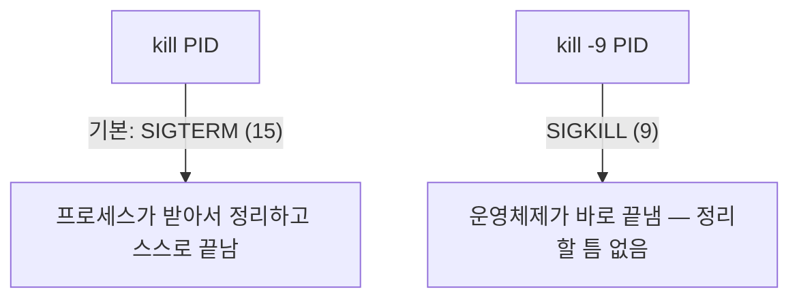
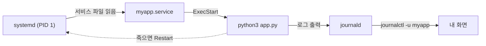

# 5주. 권한·프로세스·서비스

!!! abstract "이번 주에 할 수 있게 되는 것"
    - `ls -l` 의 `rwxr-xr-x` 를 읽고 `chmod` 로 권한을 바꿀 수 있다.
    - `sudo` 가 왜 필요한지 설명하고, 꼭 필요할 때만 쓸 수 있다.
    - `ps`, `top` 으로 프로세스를 보고, `kill` 로 신호(SIGTERM·SIGKILL)를 보내 끝낼 수 있다.
    - `apt` 로 프로그램을 설치·삭제할 수 있다.
    - 내 파이썬 앱을 systemd 서비스로 등록해 띄우고, `journalctl` 로 로그를 볼 수 있다.

| 준비물 | 예상 시간 |
|---|---|
| 4주(셸 기본 명령), 0주(WSL2 Ubuntu). 파이썬 3 (Ubuntu 에 보통 이미 있어요) | 읽기 2시간 · 실습 3.5시간 · 문제 1시간 |

## 1. 왜 배우나

내 노트북에서 `python app.py` 를 치면 앱이 떠요. 그런데 **터미널을 닫으면 꺼져요.** 서버에서는 내가 로그아웃해도, 컴퓨터가 다시 켜져도 앱이 저절로 떠 있어야 해요. 그러려면 세 가지를 알아야 해요.

1. **누가** 이 파일을 읽고 실행해도 되는가 → 사용자와 권한
2. 실행 중인 프로그램은 어떻게 보고 끝내는가 → 프로세스와 신호
3. 컴퓨터가 켜질 때 앱을 대신 띄우고 죽으면 되살려 주는 관리자 → 서비스(systemd)

## 2. 사용자와 그룹, 권한

리눅스는 한 컴퓨터를 **여러 사람이 함께 쓰는 것**을 전제로 만들어졌어요. 그래서 모든 파일에 "주인"이 있고, 누가 무엇을 할 수 있는지 적혀 있어요.

```bash
$ whoami
minsu
$ id
uid=1000(minsu) gid=1000(minsu) groups=1000(minsu),27(sudo)
```

- **사용자(user)**: 사람(또는 프로그램)마다 하나. 숫자 번호(uid)도 있어요.
- **그룹(group)**: 사용자를 묶은 것. `sudo` 그룹에 들어 있는 사용자는 관리자 일을 할 수 있어요. (`id` 출력의 숫자는 컴퓨터마다 달라요.)
- **root**: 모든 것을 할 수 있는 관리자 계정(uid 0). 평소에는 쓰지 않아요.

### rwx 읽기

```bash
$ ls -l app.py
-rw-r--r-- 1 minsu minsu 1856 Nov 24 12:50 app.py
```

맨 앞 10글자 `-rw-r--r--` 를 나눠서 읽어요.


| 글자 | 파일에서 | 폴더에서 |
|---|---|---|
| `r` (read) | 내용을 읽기 | 목록 보기(`ls`) |
| `w` (write) | 내용을 바꾸기 | 안에 파일 만들기·지우기 |
| `x` (execute) | 프로그램으로 실행하기 | 안으로 들어가기(`cd`) |

첫 글자 `-` 는 보통 파일, `d` 는 디렉터리예요. 위 예는 "주인은 읽기·쓰기, 그룹과 남은 읽기만"이라는 뜻이에요.

### 권한 바꾸기: `chmod`

```bash
$ chmod +x run.sh        # 모두에게 실행 권한 추가
$ chmod u+w,go-w file    # u=주인, g=그룹, o=그 밖 / +는 더하기, -는 빼기
$ chmod 644 file         # 숫자로: rw-r--r--
$ chmod 755 run.sh       # 숫자로: rwxr-xr-x
```

숫자는 `r=4`, `w=2`, `x=1` 을 더한 거예요. 주인·그룹·그 밖 세 자리를 차례로 써요.

$$
\texttt{rwx}=4+2+1=7,\quad \texttt{rw-}=4+2=6,\quad \texttt{r--}=4
$$

그래서 `644` 는 `rw-` `r--` `r--`, `755` 는 `rwx` `r-x` `r-x` 예요.

주인을 바꾸는 `chown` 은 관리자 권한이 필요해요: `sudo chown minsu:minsu file`.

## 3. sudo: 잠깐만 관리자

시스템 설정이나 프로그램 설치는 보통 사용자는 못 하게 막혀 있어요. 실수로 컴퓨터를 망가뜨리지 않게요. 그럴 때 명령 앞에 `sudo` 를 붙이면 **그 명령 하나만** 관리자 권한으로 실행해요.

```bash
$ sudo apt update
[sudo] password for minsu:
```

- 비밀번호를 칠 때 화면에 아무것도 안 보이는 것은 정상이에요. (Ubuntu 26.04 의 기본 `sudo` 는 Rust 로 다시 만든 **sudo-rs** 라서 비밀번호를 칠 때 `*` 가 보인다고 해요. [출처](https://linuxconfig.org/understanding-sudo-rs-on-ubuntu-26-04) — WSL 의 Ubuntu 이미지도 같은지는 확인하지 못했어요. 실습 1단계에서 `sudo --version` 으로 직접 확인해 봐요.)
- `id` 출력에 `sudo` 그룹이 보이면 `sudo` 를 쓸 수 있어요.

!!! warning "sudo 는 꼭 필요할 때만"
    `sudo` 로 실행한 명령은 안전장치가 없어요. 이유를 모르는 `sudo` 명령은 치지 말고, 인터넷에서 본 `sudo rm ...`, `sudo chmod -R 777 ...` 은 특히 조심해요. 내 홈 폴더 안의 일에는 `sudo` 가 필요 없어요. `sudo` 로 파일을 만들면 주인이 root 가 되어 나중에 내가 못 고치는 일이 자주 생겨요.

## 4. 프로세스: 실행 중인 프로그램

프로그램 파일(`app.py`)이 **실행되고 있는 상태**를 **프로세스(process)** 라고 해요. 프로세스마다 번호(PID)가 붙어요.

```bash
$ ps aux | head -n 3          # 모든 프로세스 (a=모든 사용자, u=자세히, x=터미널 없는 것도)
$ ps aux | grep app.py        # 내 앱 찾기
$ top                         # 실시간 화면. q 로 나가요
$ pgrep -f app.py             # PID 만 출력
```

`top` 에서는 CPU·메모리를 많이 쓰는 프로세스가 위에 보여요.

### 신호로 끝내기: `kill`

`kill` 은 이름과 달리 프로세스에게 **신호(signal)** 를 보내는 명령이에요. 신호를 받은 프로세스가 어떻게 할지는 신호 종류에 따라 달라요.



| 신호 | 번호 | 뜻 | 프로세스가 가로챌 수 있나 |
|---|---|---|---|
| SIGINT | 2 | 터미널에서 Ctrl+C | 예 |
| SIGTERM | 15 | "이제 끝내 주세요" (`kill` 기본값) | 예 → 파일 저장·연결 정리 후 종료 |
| SIGKILL | 9 | "강제 종료" | **아니요** → 즉시 사라짐 |

**순서가 중요해요.** 먼저 `kill PID`(SIGTERM)로 정중히 부탁하고, 그래도 안 끝날 때만 `kill -9 PID` 를 써요. SIGKILL 은 저장 중이던 파일을 깨뜨릴 수 있어요. 번호와 설명은 `man 7 signal` 에 있어요.

!!! info "종료 코드로 구분하기"
    신호로 끝난 프로세스의 종료 코드는 128 에 신호 번호를 더한 값이에요. SIGTERM 이면 143, SIGKILL 이면 137 이에요. 이 값은 systemd 와 Docker 에서도 그대로 볼 수 있어요.

### 백그라운드로 보내기

```bash
$ sleep 300 &          # 끝에 & 를 붙이면 뒤에서 실행, 터미널은 바로 돌려받음
[1] 12345
$ jobs                 # 이 터미널에서 돌고 있는 일 목록
$ fg %1                # 앞으로 가져오기 (Ctrl+Z 로 일시 정지, bg 로 뒤에서 재개)
$ kill %1              # 번호 대신 작업 번호로 끝내기
```

`&` 로 띄운 프로세스는 **터미널을 닫으면 같이 끝나기 쉬워요.** 터미널과 무관하게 계속 돌리려면 다음 절의 서비스가 정석이에요.

## 5. apt: 프로그램 설치

Ubuntu 에서 프로그램은 **패키지(package)** 로 설치해요. 윈도처럼 설치 파일을 웹에서 받아 더블클릭하지 않고, 공식 저장소에서 `apt` 가 내려받아 설치해요.

```bash
$ sudo apt update              # 설치 가능한 목록을 최신으로 (아직 설치는 안 함)
$ apt search tree              # 검색 (sudo 필요 없음)
$ apt show tree                # 설명 보기
$ sudo apt install tree        # 설치
$ sudo apt remove tree         # 삭제
$ sudo apt upgrade             # 설치된 것들을 새 버전으로
```

`apt update` 를 먼저 하는 이유: 가게의 **상품 목록(카탈로그)** 부터 새로 받아야 새 상품을 주문할 수 있어요. 설치 중간에 `Do you want to continue? [Y/n]` 가 나오면 `Y` 를 쳐요.

## 6. systemd: 서비스로 앱 띄우기

**서비스(service)** 는 사람이 터미널에서 띄우지 않아도, 컴퓨터가 켜질 때 저절로 시작하고, 죽으면 다시 살려주는 프로그램이에요. 리눅스에서 이 일을 맡은 관리자가 **systemd** 예요. 우리는 "앱을 어떻게 띄울지" 적은 **서비스 파일(unit file)** 만 쓰면 돼요.



서비스 파일은 세 칸으로 되어 있어요. ([systemd.service 공식 문서](https://www.freedesktop.org/software/systemd/man/latest/systemd.service.html))

```ini
[Unit]
Description=내 파이썬 앱
After=network.target        # 네트워크가 준비된 뒤에 시작

[Service]
Type=simple                 # ExecStart 의 프로세스가 곧 서비스 본체
User=minsu                  # 이 사용자 권한으로 실행 (root 로 돌리지 않기)
WorkingDirectory=/home/minsu/lab05
Environment=PORT=8000       # 환경 변수
ExecStart=/usr/bin/python3 /home/minsu/lab05/app.py   # 실행 명령 (전체 경로)
Restart=on-failure          # 비정상 종료(오류·신호)면 다시 시작
RestartSec=3                # 3초 쉬었다가

[Install]
WantedBy=multi-user.target  # 부팅 후 일반 상태가 되면 같이 시작
```

`Restart=on-failure` 는 오류 종료·신호 종료 때 다시 시작하고, 정상 종료(코드 0)일 때는 다시 시작하지 않아요. (위 코드 블록의 `#` 설명은 이해를 돕는 주석이에요. 실습 파일 [`myapp.service`](../labs/week05/myapp.service)에는 한 줄 설명을 따로 달지 않았어요.)

서비스 파일은 `/etc/systemd/system/` 에 두고, `systemctl` 로 다뤄요.

```bash
$ sudo systemctl daemon-reload        # 파일을 새로 읽어요 (파일을 만들거나 고친 뒤 꼭)
$ sudo systemctl enable --now myapp   # 부팅 때 자동 시작 + 지금 시작
$ systemctl status myapp              # 상태 (Active: active (running) 이면 성공)
$ sudo systemctl restart myapp        # 재시작
$ sudo systemctl stop myapp           # 중지 (SIGTERM 을 보냄)
$ journalctl -u myapp -n 20           # 이 서비스의 로그 마지막 20줄
$ journalctl -u myapp -f              # 로그를 계속 지켜보기 (Ctrl+C 로 멈춤)
```

로그는 앱이 **화면에 출력(`print`)** 하면 systemd 가 모아서 `journalctl` 로 보여줘요. 그래서 앱은 로그를 파일로 직접 쓰지 않고 그냥 출력만 해도 돼요. ([journalctl 공식 문서](https://www.freedesktop.org/software/systemd/man/latest/journalctl.html))

### WSL 에서 systemd 켜기

systemd 는 WSL 에서 기본으로 켜져 있지 않을 수 있어요. Microsoft 문서에 따르면 지금 `wsl --install` 로 설치하는 Ubuntu 는 systemd 가 기본이고, 다른 배포판이거나 꺼져 있다면 직접 켜야 해요. ([Microsoft: WSL 에서 systemd 사용](https://learn.microsoft.com/en-us/windows/wsl/systemd))

먼저 켜져 있는지 확인해요.

```bash
$ systemctl is-system-running
running
```

`running` 이나 `degraded` 가 나오면 systemd 가 돌고 있는 거예요. `System has not been booted with systemd` 같은 오류면 꺼진 거예요. 켜는 방법은 다음과 같아요(문서 기준: WSL 버전 0.67.6 이상).

1. WSL 터미널에서 `sudo nano /etc/wsl.conf` 를 열고 아래 두 줄을 넣어요.

    ```ini
    [boot]
    systemd=true
    ```

2. 저장하고(`Ctrl+O`, 엔터, `Ctrl+X`) Windows 의 **PowerShell** 에서 `wsl.exe --shutdown` 을 실행해요.
3. Ubuntu 터미널을 다시 열고 `systemctl is-system-running` 으로 확인해요.

!!! warning "WSL 의 한계"
    Microsoft 문서에 따르면 **systemd 서비스가 돌고 있어도 WSL 이 켜져 있게 붙들어 주지는 않아요.** 서비스만으로는 WSL 이 계속 켜져 있지 않아요. 그래서 WSL 위의 서비스는 "연습용"이에요. 진짜 서버에서는 (원격 컴퓨터는 항상 켜져 있으니) 똑같은 서비스 파일이 하루 종일 돌아요.

## 직접 해보기

[`docs/labs/week05/README.md`](../labs/week05/README.md)를 따라 해요. 작은 파이썬 웹 앱 [`app.py`](../labs/week05/app.py)(표준 라이브러리만 사용)를 (1) 터미널에서 띄우고, (2) 백그라운드로 보내 `kill` 로 끝내 보고, (3) [`myapp.service`](../labs/week05/myapp.service)로 서비스에 등록해요. 끝나면 `curl localhost:8000/health` 가 `{"status": "ok", ...}` 를 돌려주고, 앱을 일부러 죽여도 3초 뒤 되살아나요.

## 막히면

| 증상 | 원인 | 해결 |
|---|---|---|
| `Permission denied` 로 스크립트 실행 불가 | 실행 권한 `x` 가 없음 | `chmod +x 파일` |
| `Operation not permitted`, `Permission denied` (설치·설정 시) | 관리자 권한이 필요함 | 정말 필요한 명령이면 `sudo` 를 앞에 붙여요 |
| `System has not been booted with systemd` | WSL 에서 systemd 가 꺼짐 | 위 "WSL 에서 systemd 켜기" 를 따라 `wsl.conf` 설정 후 `wsl.exe --shutdown` |
| `Address already in use` | 같은 포트를 다른 프로세스가 이미 씀 | `ps aux \| grep app.py` 로 찾아 `kill`. 서비스로 이미 떠 있는지도 확인 |
| 서비스가 `failed` / `Active: failed` | 경로 오타, `User` 오타, 앱 오류 | `journalctl -u myapp -n 30` 으로 이유를 읽어요. 고친 뒤 `daemon-reload` 와 `restart` |
| `apt install` 이 `Unable to locate package` | 목록이 오래됨 | `sudo apt update` 를 먼저 |
| 서비스가 반복해서 재시작 | 앱이 시작 직후 계속 죽음 | 로그를 읽고 앱을 먼저 터미널에서 직접 실행해 봐요 |

## 확인 문제

**1.** `-rwxr-x---` 의 의미를 말하고, 숫자로는 얼마인가요?

??? note "답 보기"
    보통 파일이고, 주인은 읽기·쓰기·실행, 그룹은 읽기·실행, 그 밖의 사람은 아무것도 못 해요. 숫자로는 `750` 이에요 (`7`=4+2+1, `5`=4+1, `0`).

**2.** `kill PID` 로 안 끝나는 프로세스에 곧바로 `kill -9` 를 쓰는 게 왜 조심스러운가요?

??? note "답 보기"
    SIGKILL(9)은 프로세스가 가로챌 수 없어서 정리할 기회 없이 즉시 사라져요. 저장 중이던 파일이 깨지거나 연결이 정리되지 않을 수 있어요. 먼저 SIGTERM(15)으로 정중히 부탁하고, 그래도 안 될 때만 써요.

**3.** `sudo apt update` 와 `sudo apt upgrade` 는 각각 무엇을 하나요?

??? note "답 보기"
    `update` 는 설치 가능한 패키지의 **목록**만 최신으로 받아요(설치는 안 해요). `upgrade` 는 이미 설치된 패키지를 목록의 새 버전으로 **올려요**.

**4.** 서비스 파일의 `Restart=on-failure` 가 있을 때, 앱이 `sys.exit(0)` 으로 끝나면 다시 시작될까요? `kill -9` 로 죽으면요?

??? note "답 보기"
    `sys.exit(0)` 은 정상 종료라 다시 시작하지 않아요. `kill -9` 는 신호로 죽은 비정상 종료라 `RestartSec` 뒤 다시 시작해요.

**5.** 서비스 파일을 고쳤는데 반영이 안 돼요. 어떤 명령이 빠졌을까요?

??? note "답 보기"
    `sudo systemctl daemon-reload` 로 파일을 다시 읽게 한 뒤 `sudo systemctl restart 서비스이름` 을 해요.

## 더 읽기

- *The Linux Command Line* 무료 공개판 9~11장, 14장 (권한·프로세스·패키지 관련 장): <https://www.linuxcommand.org/tlcl.php>
- Microsoft, [WSL 에서 systemd 사용](https://learn.microsoft.com/en-us/windows/wsl/systemd)
- systemd 공식 문서: [systemd.service](https://www.freedesktop.org/software/systemd/man/latest/systemd.service.html), [journalctl](https://www.freedesktop.org/software/systemd/man/latest/journalctl.html)
- `man 7 signal`, `man chmod`, `man apt`

## 이번 주 체크리스트

- [ ] 5주 본문을 읽고 `rwx` 와 `755` 를 서로 바꿔 말할 수 있다
- [ ] 실습 1~2단계(권한·`sudo` 확인, `apt` 로 `tree` 설치)를 끝냈다
- [ ] 실습 3~4단계(앱 실행, 백그라운드, `kill` 로 SIGTERM·SIGKILL)를 끝냈다
- [ ] 실습 5~6단계(systemd 서비스 등록, `journalctl` 로 로그 확인)를 끝냈다
- [ ] 확인 문제 5개를 풀었다
