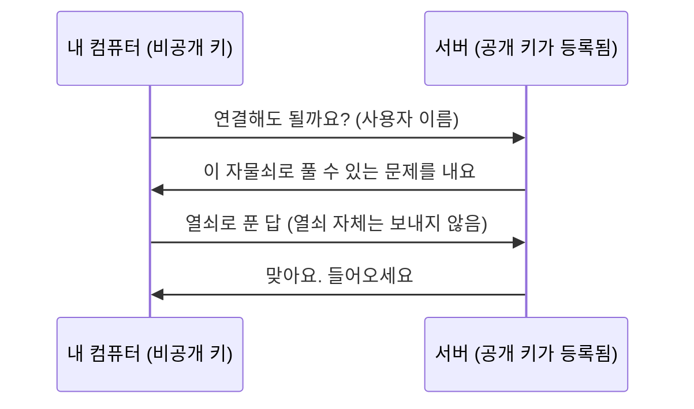

# 6주. 원격 접속과 자동화

!!! abstract "이번 주에 할 수 있게 되는 것"
    - SSH 가 키로 로그인하는 원리를 그림으로 설명하고, 키를 만들어 `~/.ssh/config` 에 등록할 수 있다.
    - `ssh` 로 원격 컴퓨터에 들어가고 `scp` 로 파일을 주고받을 수 있다.
    - 변수·`if`·`for`·함수·종료 코드를 써서 셸 스크립트를 쓰고, `set -euo pipefail` 이 왜 필요한지 말할 수 있다.
    - 환경 변수와 `.env` 파일로 설정을 코드 밖에 둘 수 있다.
    - `cron` 으로 스크립트를 정해진 시간에 실행하고 로그를 남길 수 있다.
    - `uv` 로 파이썬 프로젝트 환경을 만들 수 있다.

| 준비물 | 예상 시간 |
|---|---|
| 4주(파이프·리다이렉션), 5주(권한·`chmod`). 3주에서 SSH 키를 만들어 봤다면 더 쉬워요 | 읽기 2시간 · 실습 3.5시간 · 문제 1시간 |

## 1. 왜 배우나

서버는 멀리 있는 컴퓨터예요. 화면도 키보드도 없으니, **인터넷을 통해 그 컴퓨터의 터미널에 들어가는 방법**이 필요해요. 그게 SSH 예요.

그리고 서버에서 하는 일은 대부분 **반복**이에요. 매일 백업하기, 로그 정리하기, 앱 다시 띄우기. 같은 명령을 매일 사람이 치는 대신, 명령을 파일에 적어 두고(셸 스크립트) 컴퓨터가 정해진 시간에 실행하게(cron) 해요. 이번 주 결과물은 **매일 백업하는 스크립트**예요.

## 2. SSH: 안전하게 원격 로그인

**SSH(Secure Shell)** 는 두 컴퓨터 사이를 **암호화**해서 터미널을 연결해 주는 방법이에요. 중간에서 누가 엿봐도 내용을 알 수 없어요.

로그인 방법은 비밀번호 대신 **키 쌍(key pair)** 을 쓰는 게 안전하고 편해요. 키 쌍은 **자물쇠와 열쇠**와 같아요.

- **공개 키(public key)**: 자물쇠. 서버에 달아 둬요. 남이 봐도 괜찮아요.
- **비공개 키(private key)**: 열쇠. **내 컴퓨터에만** 있어요. 절대 남에게 주거나 GitHub 에 올리면 안 돼요.



### 키 만들기

```bash
$ ssh-keygen -t ed25519 -C "내메일@example.com"
Generating public/private ed25519 key pair.
Enter file in which to save the key (/home/minsu/.ssh/id_ed25519):
Enter passphrase (empty for no passphrase):
```

- 파일 이름은 그냥 엔터(기본값).
- **암호(passphrase)** 를 넣으면 키 파일이 유출돼도 한 번 더 막아 줘요. 넣기를 권해요. (GitHub 문서도 `ed25519` 를 권해요: [새 SSH 키 만들기](https://docs.github.com/ko/authentication/connecting-to-github-with-ssh/generating-a-new-ssh-key-and-adding-it-to-the-ssh-agent))

두 파일이 만들어져요.

```bash
$ ls -l ~/.ssh
-rw------- 1 minsu minsu  411 Nov 24 12:51 id_ed25519       # 비공개 키 (나만 읽기/쓰기)
-rw-r--r-- 1 minsu minsu   98 Nov 24 12:51 id_ed25519.pub   # 공개 키
```

비공개 키의 권한이 `-rw-------`(600)이어야 해요. 5주에 배운 권한이에요. 너무 열려 있으면 SSH 가 키를 거절해요.

### 공개 키를 서버에 등록하고 접속하기

서버의 `~/.ssh/authorized_keys` 파일에 공개 키 한 줄을 넣으면 돼요. 그 일을 대신해 주는 명령이 있어요.

```bash
$ ssh-copy-id minsu@192.0.2.10     # 서버 주소 예시 (문서용 주소예요)
$ ssh minsu@192.0.2.10             # 이제 비밀번호 없이 들어가요
minsu@server:~$ exit               # 돌아오기
```

처음 접속하면 이런 질문이 나와요.

```text
The authenticity of host '192.0.2.10 (192.0.2.10)' can't be established.
ED25519 key fingerprint is SHA256:....
Are you sure you want to continue connecting (yes/no/[fingerprint])?
```

"이 서버가 진짜 맞는지" 확인하라는 거예요. 서버 관리자에게 받은 지문과 같다면 `yes` 를 쳐요. 그러면 `~/.ssh/known_hosts` 에 기억해 두고, 다음에 서버가 바뀌면 경고해 줘요.

### 설정 파일 `~/.ssh/config`

접속할 때마다 `ssh -i ... -p 2222 minsu@긴주소` 를 치기 번거로우니, 별명을 만들어 둘 수 있어요.

```text
Host myserver
    HostName 192.0.2.10
    User minsu
    Port 22
    IdentityFile ~/.ssh/id_ed25519
```

이제 `ssh myserver` 만 치면 돼요. `scp` 도 같은 별명을 써요. ([ssh_config 설명서](https://www.openssh.org/manual.html), 터미널에서는 `man ssh_config`)

### 파일 주고받기: `scp`

`scp` 는 `cp` 와 모양이 같은데 **한쪽이 원격**이에요. 원격 쪽은 `사용자@주소:경로` 로 써요.

```bash
$ scp report.txt myserver:~/             # 내 컴퓨터 → 서버 홈
$ scp myserver:~/app.log .               # 서버 → 내 현재 폴더
$ scp -r project myserver:~/             # 폴더는 -r
```

!!! warning "비공개 키는 지켜요"
    - `id_ed25519`(.pub 가 없는 쪽)는 이메일·메신저·GitHub 에 올리지 않아요. `.pub` 만 공유해요.
    - 같은 키를 여러 서버에 써도 되지만, 노트북을 잃어버렸다면 서버의 `authorized_keys` 에서 그 공개 키 줄을 지워요.

## 3. 셸 스크립트: 명령을 파일에 적어 두기

터미널에 친 명령을 **파일 하나에 순서대로 적어** 두면 그게 **셸 스크립트(shell script)** 예요. 같은 일을 언제든 한 줄로 다시 할 수 있어요.

가장 작은 예예요. `hello.sh` 를 만들어요.

```bash
#!/usr/bin/env bash
echo "안녕하세요, $1"
```

```bash
$ chmod +x hello.sh      # 실행 권한 (5주)
$ ./hello.sh 리눅스
안녕하세요, 리눅스
```

- 첫 줄 `#!/usr/bin/env bash` 를 **셔뱅(shebang)** 이라고 해요. "이 파일은 bash 로 실행해요"라는 뜻이에요.
- `$1` 은 스크립트에 준 첫 번째 값(인자)이에요. 두 번째는 `$2`, 인자 개수는 `$#` 예요.

### 변수, if, for, 함수

```bash
#!/usr/bin/env bash
name="${1:-세상}"            # 인자가 없으면 기본값 "세상"
count=3

if [ "$count" -ge 3 ]; then  # 숫자 비교: -eq -ne -lt -le -gt -ge
    echo "안녕, $name"
fi

for f in a b c; do           # 목록을 하나씩
    echo "파일 $f"
done

greet() {                    # 함수
    echo "함수가 받은 값: $1"
}
greet "$name"
```

실행하면 이렇게 나와요.

```text
안녕, 세상
파일 a
파일 b
파일 c
함수가 받은 값: 세상
```

!!! warning "자주 하는 실수 세 가지"
    1. `name = "값"` 처럼 `=` 앞뒤에 **띄어쓰기를 넣으면** 안 돼요. `name="값"` 으로 붙여 써요.
    2. 변수는 `"$name"` 처럼 **큰따옴표로 감싸요.** 값에 공백이 있어도 한 덩어리로 다뤄요.
    3. `[ ... ]` 안쪽 양옆에는 공백이 꼭 있어야 해요. (`[ "$a" -ge 3 ]`)

### 종료 코드: 성공은 0

모든 명령은 끝날 때 **종료 코드(exit code)** 를 남겨요. **0 은 성공, 그 밖은 실패**예요. 직전 명령의 종료 코드는 `$?` 에 있어요.

```bash
$ ls /etc > /dev/null; echo $?
0
$ ls /없는곳 2> /dev/null; echo $?
2
```

(실패한 `ls` 의 종료 코드 숫자는 시스템마다 달라요. 0 이 아니라는 점이 중요해요.) 내 스크립트에서도 `exit 0`(성공), `exit 1`(실패)로 알려줘요. 그래야 cron·systemd·Docker 가 성공했는지 알 수 있어요.

`&&` 는 "앞이 성공하면 뒤를 실행", `||` 는 "앞이 실패하면 뒤를 실행"이에요.

```bash
$ mkdir data && cd data
$ ls /없는곳 2> /dev/null || echo "없어요"
없어요
```

### `set -euo pipefail`: 조용한 실패를 막는 한 줄

스크립트 위쪽에 이 한 줄을 습관처럼 써요.

```bash
set -euo pipefail
```

| 옵션 | 효과 | 없을 때 생기는 일 |
|---|---|---|
| `-e` | 명령이 실패하면 스크립트를 **바로 멈춤** | 실패를 무시하고 다음 줄을 계속 실행 → 엉뚱한 곳을 지울 수도 |
| `-u` | 정해지지 않은 변수를 쓰면 **오류** | `rm -r "$DIR/"` 에서 `DIR` 이 비면 `rm -r /` 가 되는 사고 |
| `-o pipefail` | 파이프 중간 명령이 실패해도 **실패로 처리** | `false \| true` 가 성공(0)으로 보임 |

```bash
$ bash -c 'set -e; echo before; false; echo after'
before
```

`false` 에서 멈춰서 `after` 는 나오지 않아요.

## 4. 환경 변수와 `.env`

**환경 변수(environment variable)** 는 프로그램 밖에서 정해 주는 설정값이에요. 비밀번호·주소·포트처럼 **코드에 적으면 안 되는 값**을 이렇게 전달해요.

```bash
$ export GREETING="안녕"          # export 해야 자식 프로그램에도 전달돼요
$ bash -c 'echo $GREETING'
안녕
$ PORT=8080 python3 app.py        # 이 명령 한 번만 쓰는 값 (5주 app.py 가 읽어요)
```

그동안 써 온 `PATH` 도 환경 변수예요. 명령 이름을 치면 셸이 `PATH` 에 적힌 폴더들을 차례로 찾아봐요.

값이 많아지면 **`.env` 파일**에 모아 두고 불러와요.

```text
# .env
DB_HOST=localhost
DB_PASSWORD=아주비밀
```

```bash
set -a            # 이후에 읽는 변수를 자동으로 export
. ./.env          # 파일을 현재 셸에서 읽기 (source 와 같아요)
set +a
echo "$DB_HOST"
```

!!! danger ".env 는 Git 에 올리지 않아요"
    비밀값이 든 `.env` 를 GitHub 에 올리면 전 세계가 볼 수 있어요. `.gitignore` 에 `.env` 한 줄을 넣고, 대신 값 없는 `.env.example` 을 올려요. 9주(Docker 의 환경 변수·비밀값)에서 다시 만나요.

## 5. cron: 정해진 시간에 자동 실행

**cron** 은 "매일 3시에 이 명령을 실행해 줘"를 맡아 주는 프로그램이에요. 일정은 **crontab** 이라는 표에 한 줄씩 적어요.

```text
분  시  일  월  요일   명령
30  3   *   *   *      /home/minsu/lab06/backup.sh ...
```

| 칸 | 범위 | `*` 의 뜻 |
|---|---|---|
| 분 | 0~59 | 매분 |
| 시 | 0~23 | 매시 |
| 일 | 1~31 | 매일 |
| 월 | 1~12 | 매월 |
| 요일 | 0~7 (0, 7 = 일요일) | 매 요일 |

`*/5 * * * *` 는 5분마다, `0 9 * * 1-5` 는 평일 9시 정각이에요.

```bash
$ crontab -e      # 내 일정표 편집 (처음엔 편집기를 고르라고 해요: nano 가 쉬워요)
$ crontab -l      # 내 일정표 보기
```

cron 에서 쓸 때 꼭 지킬 세 가지예요.

1. **명령은 절대 경로로.** cron 은 내 터미널과 환경이 달라서 `PATH` 가 짧고 현재 위치도 홈이에요.
2. **출력은 파일로.** 화면이 없어서 메시지가 갈 곳이 없어요. 끝에 `>> 로그파일 2>&1` 을 붙여 출력(1)과 오류(2)를 같이 모아요.
3. **처음엔 매분으로 시험**하고 잘 되면 원하는 시간으로 바꿔요. 시험이 끝나면 꼭 지워요.

!!! warning "WSL 에서의 cron"
    cron 은 서비스예요. Ubuntu 에 `cron` 이 없으면 `sudo apt install cron` 으로 설치하고, `sudo systemctl enable --now cron` 으로 켜요(5주의 systemd 가 켜져 있어야 해요). 또 5주에서 본 것처럼 **WSL 이 꺼져 있으면 cron 도 못 돌아요.** 연습용이고, 항상 켜진 서버에서는 같은 설정이 매일 돌아요.

## 6. 로그 남기기

스크립트가 새벽에 혼자 돌면 **무슨 일이 있었는지 나중에 알려 줄 기록**이 필요해요. 가장 쉬운 방법은 날짜를 붙여 파일 끝에 한 줄씩 덧붙이는 거예요 (`>>`, 4주).

```bash
log() {
    echo "$(date '+%Y-%m-%d %H:%M:%S') $*" >> "$LOG"
}
log "백업 시작"
```

`$(명령)` 은 명령의 출력을 그 자리에 넣어 줘요. 실습의 `backup.sh` 가 이 방식이에요. 로그는 4주의 `tail -f`, `grep ERROR` 로 읽어요.

## 7. uv 로 파이썬 환경 만들기

파이썬 프로젝트마다 필요한 라이브러리 버전이 달라요. 그래서 프로젝트마다 **가상 환경(virtual environment, `.venv`)** 이라는 독립된 폴더에 라이브러리를 따로 설치해요. 이걸 쉽게 해 주는 도구가 **uv** 예요.

```bash
$ curl -LsSf https://astral.sh/uv/install.sh | sh    # 설치 (Linux/Mac, 공식 설치 명령)
$ uv --version
```

설치 명령 출처: [uv 설치 문서](https://docs.astral.sh/uv/getting-started/installation/). (uv 를 만든 Astral 은 2026-03 에 OpenAI 가 인수하겠다고 발표했어요. 완료 여부는 확인하지 못했고, uv 는 계속 공개 소프트웨어로 업데이트되고 있어요.)

```bash
$ mkdir myproject && cd myproject
$ uv init --no-package      # 프로젝트 시작: pyproject.toml, main.py 등이 생김
$ uv add requests           # 라이브러리 추가 → .venv 와 uv.lock 이 생김
$ uv run main.py            # .venv 안의 파이썬으로 실행
Hello from myproject!
```

| 파일 | 하는 일 | Git 에 올리나 |
|---|---|---|
| `pyproject.toml` | 프로젝트 이름과 필요한 라이브러리 목록 | 올려요 |
| `uv.lock` | 실제 설치한 정확한 버전 기록 | 올려요 |
| `.python-version` | 쓸 파이썬 버전 | 올려요 |
| `.venv/` | 설치된 라이브러리 | **안 올려요** (`.gitignore`) |

다른 컴퓨터에서 `uv sync` 한 번이면 `uv.lock` 대로 똑같은 환경이 만들어져요. "내 컴퓨터에선 되는데"를 줄이는 첫걸음이고, 8주 Dockerfile 에서 그대로 이어져요.

## 직접 해보기

[`docs/labs/week06/README.md`](../labs/week06/README.md)를 따라 해요. 폴더를 날짜가 붙은 `.tar.gz` 로 묶고 오래된 백업을 지우는 [`backup.sh`](../labs/week06/backup.sh)를 실행하고, 로그를 읽고, [`crontab-example.txt`](../labs/week06/crontab-example.txt)를 보고 cron 에 등록해요. SSH 는 서버가 없어도 GitHub 에 접속해 보거나 같은 컴퓨터(localhost)로 연습해요.

## 막히면

| 증상 | 원인 | 해결 |
|---|---|---|
| `Permission denied (publickey)` | 서버에 내 공개 키가 없거나 다른 키를 보냄 | `ssh-copy-id` 를 다시. `ssh -v 주소` 로 어떤 키를 쓰는지 봐요 |
| `WARNING: UNPROTECTED PRIVATE KEY FILE!` | 비공개 키 권한이 너무 열림 | `chmod 600 ~/.ssh/id_ed25519` |
| `REMOTE HOST IDENTIFICATION HAS CHANGED!` | 같은 주소의 서버 지문이 바뀜(서버를 다시 만들었거나, 중간에 가로채기) | 서버 관리자에게 확인한 뒤, 정말 바뀐 거라면 `ssh-keygen -R 주소` |
| `bash: ./backup.sh: Permission denied` | 실행 권한 없음 | `chmod +x backup.sh` |
| `unbound variable` | `set -u` 로 오타 낸 변수를 잡아냄 | 변수 이름 철자 확인 |
| cron 이 안 돌아요 | cron 서비스가 꺼짐, 상대 경로, WSL 이 꺼져 있음 | `systemctl status cron`, 절대 경로, 로그 파일(`cron.log`)을 읽어요 |
| `uv: command not found` | 설치 직후 PATH 가 갱신되지 않음 | 터미널을 새로 열어요 |

## 확인 문제

**1.** SSH 에서 공개 키와 비공개 키 중 서버에 두는 것은 어느 쪽이고, 왜 그래도 안전한가요?

??? note "답 보기"
    공개 키예요. 공개 키는 자물쇠 구실만 하고, 그것만으로는 로그인할 수 없어요. 열쇠인 비공개 키는 내 컴퓨터를 떠나지 않아요.

**2.** 스크립트의 `rm -r "$DIR/"` 에서 `DIR` 의 철자를 틀리면 어떤 일이 생길 수 있고, 무엇으로 막나요?

??? note "답 보기"
    비어 있는 변수가 되어 `rm -r /` 처럼 엉뚱한 곳을 지우게 될 수 있어요. 스크립트 위쪽에 `set -u`(`set -euo pipefail`)를 쓰면 정해지지 않은 변수를 만나는 즉시 오류로 멈춰요.

**3.** crontab 의 `0 9 * * 1-5` 는 언제 실행되나요?

??? note "답 보기"
    월요일부터 금요일까지(요일 1~5) 매일 오전 9시 0분이에요.

**4.** cron 으로 돌리는 스크립트 끝에 `>> backup.log 2>&1` 를 붙이는 이유는?

??? note "답 보기"
    cron 에는 화면이 없어서 출력이 사라져요. `>>` 로 파일에 덧붙이고 `2>&1` 로 오류 메시지도 같은 파일에 모으면, 실패했을 때 이유를 읽을 수 있어요.

**5.** `uv.lock` 은 Git 에 올리고 `.venv` 는 올리지 않는 이유는?

??? note "답 보기"
    `uv.lock` 은 정확한 버전 기록이라 작고, 다른 컴퓨터에서 `uv sync` 로 같은 환경을 다시 만들 수 있어요. `.venv` 는 컴퓨터마다 다르고 크기도 크며, `uv.lock` 으로 언제든 다시 만들 수 있어서 올릴 필요가 없어요.

## 더 읽기

- *The Linux Command Line* 무료 공개판에서 네트워크와 셸 스크립트 장 (목차에서 찾아봐요): <https://www.linuxcommand.org/tlcl.php>
- GitHub Docs(한국어): [새 SSH 키 생성](https://docs.github.com/ko/authentication/connecting-to-github-with-ssh/generating-a-new-ssh-key-and-adding-it-to-the-ssh-agent), [SSH 연결 테스트](https://docs.github.com/en/authentication/connecting-to-github-with-ssh/testing-your-ssh-connection)
- OpenSSH 설명서: <https://www.openssh.org/manual.html>
- uv 문서: <https://docs.astral.sh/uv/>
- 터미널에서 `man crontab`, `man 5 crontab`, `man bash`

## 이번 주 체크리스트

- [ ] 6주 본문을 읽고 SSH 키 로그인 과정을 그림 없이 설명할 수 있다
- [ ] 실습 1~2단계(SSH 키 만들기, `config` 등록)를 끝냈다
- [ ] 실습 3~4단계(`backup.sh` 실행, 로그 확인)를 끝냈다
- [ ] 실습 5단계(cron 으로 매분 시험 후 등록 해제)를 끝냈다
- [ ] 실습 6단계(uv 프로젝트 만들기)를 끝냈다
- [ ] 확인 문제 5개를 풀었다
