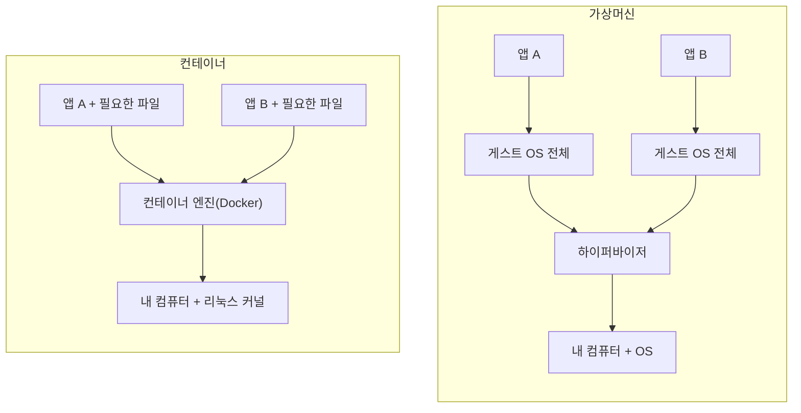
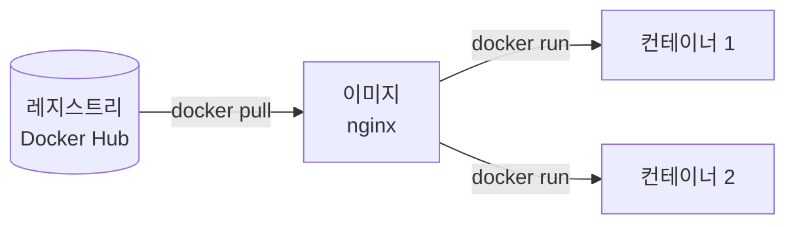
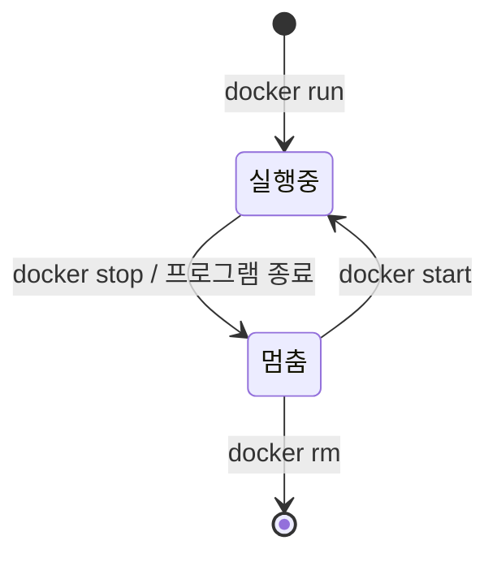

# 7주. 컨테이너와 이미지

!!! abstract "이번 주에 할 수 있게 되는 것"
    - 가상머신과 컨테이너가 어떻게 다른지 그림으로 설명할 수 있다.
    - 이미지(image)·컨테이너(container)·레지스트리(registry)의 관계를 말할 수 있다.
    - `docker run`, `ps`, `logs`, `exec`, `stop`, `rm` 으로 컨테이너를 만들고 확인하고 지울 수 있다.
    - 포트를 연결(`-p`)해서 내 브라우저로 컨테이너 안의 웹 서버를 볼 수 있다.
    - 내 PC에 맞는 Docker 설치 경로를 고르고, 못 깔 때 쓸 무료 실습장을 안다.

| 준비물 | 예상 시간 |
|---|---|
| 0주차 WSL2 Ubuntu, 4~6주차(터미널·프로세스·포트 개념), Docker(아래 2절에서 설치) | 읽기 2시간 · 실습 3시간 · 문제 1시간 |

## 1. 왜 배우나

친구에게 파이썬 앱을 보냈는데 "내 컴퓨터에선 안 돼" 하고 답이 와요. 파이썬 버전이 다르거나, 라이브러리가 없거나, 운영체제 설정이 달라서예요. 개발자들은 이걸 "내 컴퓨터에선 되는데" 문제라고 불러요.

컨테이너는 **앱과 앱이 필요한 것(파이썬, 라이브러리, 설정)을 한 상자에 담아서**, 어느 컴퓨터에서든 같은 모습으로 돌리는 방법이에요. 이번 주에는 남이 만든 상자(공식 이미지)를 받아서 열어 보고 지우는 것까지 해요. 내 상자를 만드는 건 8주차예요.

## 2. 가상머신과 컨테이너

"격리된 환경"을 만드는 방법은 예전부터 가상머신(Virtual Machine, VM)이 있었어요. VM 은 컴퓨터 한 대를 통째로 흉내 내서, 그 안에 운영체제를 따로 설치해요. 컨테이너는 운영체제 전체를 새로 띄우지 않고, **내 컴퓨터의 리눅스 커널(kernel)을 함께 쓰면서** 프로세스만 따로 가둬요.



| | 가상머신 | 컨테이너 |
|---|---|---|
| 운영체제 | 각자 통째로 | 커널을 같이 씀 |
| 시작 | 운영체제 부팅이 필요해서 느린 편 | 프로세스를 띄우는 정도라 빠른 편 |
| 크기 | 큰 편 | 작은 편 |
| 격리 | 강함 | 가벼운 대신 커널은 공유 |

Windows 에서 Docker 를 쓰면 리눅스 컨테이너는 WSL2 가 주는 리눅스 커널 위에서 돌아가요. 그래서 이 강좌는 WSL2 Ubuntu 를 기본 실습장으로 해요.

## 3. 이미지, 컨테이너, 레지스트리

세 낱말만 정확히 알면 이번 주 절반은 끝나요.

- **이미지(image)**: 앱과 필요한 파일을 담은 **읽기 전용 설계도**예요. 쿠키 틀과 비슷해요.
- **컨테이너(container)**: 이미지를 실제로 **실행한 것**이에요. 틀로 찍어 낸 쿠키 한 개예요. 같은 이미지로 컨테이너를 여러 개 만들 수 있어요.
- **레지스트리(registry)**: 이미지를 올려 두고 내려받는 **창고**예요. 가장 유명한 곳이 Docker Hub 예요.



이미지 이름은 `이름:태그` 모양이에요. 예: `python:3.13-slim` 은 python 이미지의 `3.13-slim` 버전이에요. 태그를 안 쓰면 `latest` 로 취급돼요. `latest` 는 "그때그때 최신"이라 언제 받느냐에 따라 달라질 수 있어서, 앞으로는 가능하면 태그를 적을 거예요.

## 4. 첫 컨테이너: run

가장 작은 예부터 해요.

```bash
docker run hello-world
```

Docker 는 내 PC 에 `hello-world` 이미지가 없으면 레지스트리에서 받고(`pull`), 컨테이너를 만들어 실행해요. 메시지를 출력하고 프로그램이 끝나면 컨테이너도 멈춰요. 컨테이너는 **안에서 돌던 프로그램이 끝나면 같이 끝나는** 물건이에요.

이번에는 웹 서버(nginx)를 띄워 봐요.

```bash
docker run -d --name web -p 8080:80 nginx
```

| 조각 | 뜻 |
|---|---|
| `-d` | 뒤에서 돌려요(detach). 터미널을 붙잡지 않아요 |
| `--name web` | 컨테이너에 이름을 붙여요. 안 붙이면 Docker 가 아무 이름이나 지어요 |
| `-p 8080:80` | 내 PC 의 8080번 포트 → 컨테이너의 80번 포트로 연결해요 |
| `nginx` | 쓸 이미지 |


컨테이너는 자기만의 네트워크 안에 있어서, 포트를 연결(publish)해 주지 않으면 밖에서 접근할 수 없어요. `왼쪽:오른쪽` 은 **내 PC 쪽 : 컨테이너 쪽** 순서예요. 브라우저에서 `http://localhost:8080` 을 열면 nginx 환영 페이지가 보여요.

## 5. 살펴보고 들어가고 지우기

| 명령 | 하는 일 |
|---|---|
| `docker ps` | 돌고 있는 컨테이너 목록 (`-a` 는 멈춘 것까지) |
| `docker logs web` | 컨테이너가 출력한 로그 (`-f` 는 계속 따라 보기) |
| `docker exec -it web bash` | 돌고 있는 컨테이너 안에 터미널로 들어가기 |
| `docker stop web` | 멈추기 |
| `docker start web` | 멈춘 컨테이너 다시 시작 |
| `docker rm web` | 멈춘 컨테이너 지우기 |
| `docker images` | 내 PC 에 받아 둔 이미지 목록 |
| `docker rmi nginx` | 이미지 지우기 |

`exec` 의 `-it` 는 "키보드로 입력할 수 있는 터미널로 붙여 줘"라는 뜻이에요. 들어가서 `exit` 로 나오면 컨테이너는 계속 돌아요.

컨테이너의 한살이는 이래요.



`docker run --rm ...` 으로 띄우면 멈출 때 자동으로 지워져서, 한 번 쓰고 버릴 때 편해요.

!!! warning "컨테이너 안에 만든 파일은 컨테이너와 함께 사라져요"
    `docker rm` 을 하면 컨테이너 안에서 만든 파일도 없어져요. 데이터를 남기는 방법은 9주차에 배워요.

## 6. 공식 이미지: nginx 와 python

Docker Hub 에는 프로그램 제작 쪽이 직접 관리하는 **공식 이미지(Docker Official Image)** 가 있어요. `nginx`, `python`, `postgres` 같은 이름이에요. 아무나 올린 이미지는 믿을 수 있는지 먼저 살펴보고, 처음엔 공식 이미지로 시작하세요.

파이썬 이미지는 이렇게 써 봐요.

```bash
docker run --rm python:3.13-slim python -c "print('컨테이너에서 안녕')"
```

내 PC 에 파이썬이 없어도 돼요. 이미지 안에 파이썬이 들어 있으니까요. `slim` 은 꼭 필요한 것만 담아 작게 만든 변형이에요. 이 방식은 8주차에 내 앱을 담을 때 그대로 이어져요.

## 7. Docker 는 어디에 설치하나

학생 개인 학습에는 Docker Desktop 을 무료로 쓸 수 있어요([라이선스 안내](https://docs.docker.com/subscription/desktop-license/)). 다만 Windows 설치 환경은 몇 가지를 알아 두세요(2026-11 조사 기준).

| 경로 | 설명 |
|---|---|
| **Docker Desktop** | 설치 마법사로 쉽게 깔려요. 공식 요구사항 목록에는 Windows 의 Enterprise·Pro·Education 판이 적혀 있고, Home 판은 목록에서 빠져 있어요. Home 판에서 되는지는 확인하지 못했어요. [설치 문서](https://docs.docker.com/desktop/setup/install/windows-install/) |
| **WSL 안에 Docker Engine 직접 설치** | 0주차에 만든 Ubuntu 안에서 `apt` 로 설치해요. 공식 절차는 [Ubuntu 설치 문서](https://docs.docker.com/engine/install/ubuntu/) 를 따르세요. Home 판에서 Desktop 이 안 될 때의 예비 경로예요 |
| 무료 웹 실습장 | 아래 표 |

Windows 11 을 권장해요. Docker Desktop 문서에는 Windows 10 22H2 도 적혀 있지만, 최신 도구(예: Podman 6.0)에서는 Windows 10 지원을 끊는 곳이 있어요.

설치 뒤에는 이 두 줄로 확인해요.

```bash
docker version
docker run hello-world
```

`docker login` 으로 Docker Hub 계정에 로그인해 두면 이미지를 받을 때 한도에 덜 걸려요. 무료 계정의 정확한 받기 한도는 Docker 문서와 가격 페이지가 서로 달라서 여기엔 숫자를 적지 않아요. 같은 학교 와이파이로 여러 명이 로그인 없이 받으면 한도에 걸릴 수 있어요.

!!! info "참고: wslc"
    2026-09-29 에 Microsoft 가 Windows 에 내장된 리눅스 컨테이너 도구 `wslc`(WSL Containers)를 정식으로 내놓았어요. Compose 는 아직 지원하지 않아서 이 강좌는 Docker 로 진행해요. ([Windows 개발자 블로그](https://blogs.windows.com/windowsdeveloper/2026/09/29/wsl-containers-now-generally-available/))

### Docker 를 못 깔 때: 무료 실습장

!!! warning "Play with Docker 는 쓰지 마세요"
    예전 책·블로그가 안내하던 Play with Docker 는 2026-03-01 부터 서비스를 중단한다고 공지됐어요. ([공지](https://forums.docker.com/t/play-with-docker-is-deprecated-and-will-be-unavailable-starting-march-1-2026-learn-about-alternatives/151177))

| 대안 | 알아 둘 점 |
|---|---|
| [GitHub Codespaces](https://github.com/features/codespaces) | 브라우저 VS Code 에서 Docker 사용. 무료 계정은 월 120 코어시간, GitHub Education 학생은 180 코어시간 |
| [Killercoda](https://killercoda.com/) | 무료 가입, 환경은 최대 1시간 뒤 삭제 |
| [iximiuz Labs](https://labs.iximiuz.com/) | 무료 등급은 하루 총 1시간, 동시에 하나 |

한도는 바뀔 수 있으니 가입 전에 각 사이트 안내를 확인하세요.

## 직접 해보기

[`docs/labs/week07/README.md`](../labs/week07/README.md) 의 순서대로 해요. 공식 이미지로 nginx 웹 서버를 띄우고, 브라우저로 보고, 로그를 읽고, 안에 들어가고, 지우는 것까지 해요. 끝나면 `docker ps -a` 에 아무것도 남지 않아야 해요. (이번 주 실습은 노트북이 아니라 터미널 명령이라 Colab 배지는 없어요.)

## 막히면

| 증상 | 원인 | 해결 |
|---|---|---|
| `Cannot connect to the Docker daemon` | Docker 엔진이 안 켜져 있어요 | Docker Desktop 을 실행하세요. WSL 안 Engine 이라면 `sudo systemctl status docker` 로 확인하고 꺼져 있으면 `sudo systemctl start docker` |
| `permission denied ... docker.sock` | 내 사용자가 docker 를 쓸 권한이 없어요 | 앞에 `sudo` 를 붙여 보세요. 계속 쓸 거라면 [설치 후 안내](https://docs.docker.com/engine/install/linux-postinstall/) 를 읽어 보세요 |
| `port is already allocated` / `address already in use` | 내 PC 의 8080번을 다른 프로그램이나 컨테이너가 이미 써요 | `-p 8081:80` 처럼 왼쪽 번호를 바꾸세요 |
| `The container name "/web" is already in use` | 같은 이름의 컨테이너가 남아 있어요 | `docker rm web`(돌고 있으면 `docker rm -f web`) 후 다시 |
| 이미지를 받다가 `toomanyrequests` | 받기 한도에 걸렸어요 | `docker login` 후 다시, 또는 잠시 기다려요 |

## 확인 문제

1. 이미지와 컨테이너의 관계를 쿠키 틀과 쿠키에 빗대어 한 문장으로 말해 보세요.

    ??? note "답 보기"
        이미지는 읽기 전용 설계도(틀)이고, 컨테이너는 그 이미지를 실행한 것(쿠키)이에요. 이미지 하나로 컨테이너를 여러 개 만들 수 있어요.

2. 가상머신과 달리 컨테이너가 빠르고 작은 이유는 무엇인가요?

    ??? note "답 보기"
        운영체제를 통째로 따로 띄우지 않고, 내 컴퓨터의 리눅스 커널을 같이 쓰면서 프로세스만 격리하기 때문이에요.

3. `docker run -d --name web -p 9000:80 nginx` 를 실행했어요. 브라우저에서 어떤 주소로 접속하나요?

    ??? note "답 보기"
        `http://localhost:9000`. `-p` 의 왼쪽이 내 PC 포트, 오른쪽이 컨테이너 포트예요.

4. `docker ps` 에는 안 보이는데 `docker ps -a` 에는 보이는 컨테이너는 어떤 상태인가요? 어떻게 없애나요?

    ??? note "답 보기"
        멈춘 상태예요. `docker rm 이름` 으로 지워요.

5. 컨테이너 안에서 파일을 만들고 `docker rm` 을 하면 그 파일은 어떻게 되나요?

    ??? note "답 보기"
        컨테이너와 함께 사라져요. 남기려면 볼륨을 써야 하고, 9주차에 배워요.

## 더 읽기

- [Docker 공식 문서: Get started](https://docs.docker.com/get-started/)
- [Docker Official Images 설명](https://docs.docker.com/docker-hub/image-library/trusted-content/)
- [docker run 레퍼런스](https://docs.docker.com/reference/cli/docker/container/run/)
- [Docker Desktop 라이선스](https://docs.docker.com/subscription/desktop-license/)

## 이번 주 체크리스트

- [ ] Docker 를 설치하고 `docker run hello-world` 가 성공했다
- [ ] 이미지·컨테이너·레지스트리를 내 말로 설명할 수 있다
- [ ] nginx 컨테이너를 `-p` 로 띄우고 브라우저에서 확인했다
- [ ] `ps`·`logs`·`exec`·`stop`·`rm` 을 모두 써 봤다
- [ ] 확인 문제 5개를 풀었다
- [ ] 실습이 끝난 뒤 컨테이너를 정리했다
