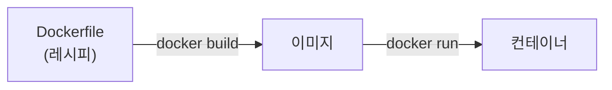
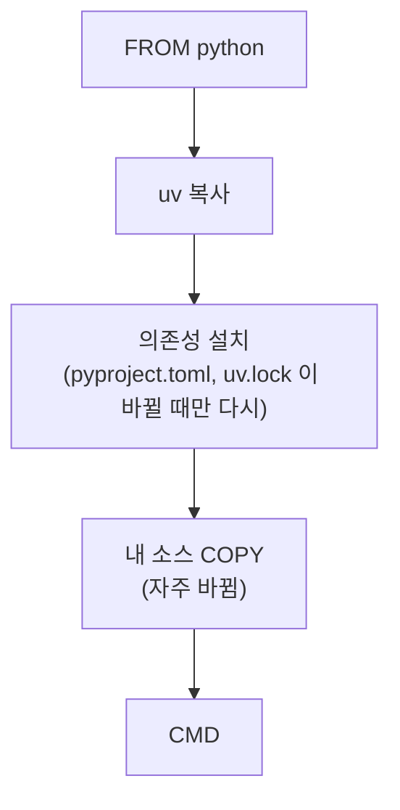
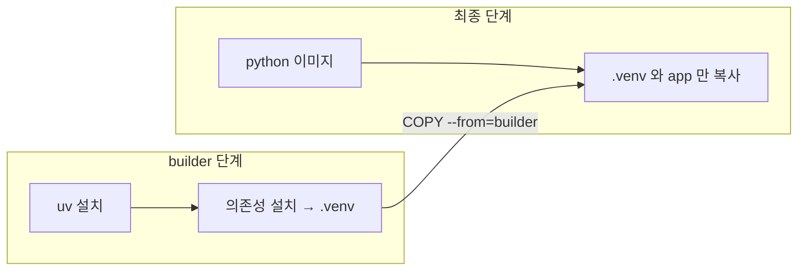

# 8주. Dockerfile 과 빌드

!!! abstract "이번 주에 할 수 있게 되는 것"
    - Dockerfile 의 `FROM`·`WORKDIR`·`COPY`·`RUN`·`ENV`·`EXPOSE`·`CMD` 가 하는 일을 한 줄씩 설명할 수 있다.
    - 레이어(layer)와 빌드 캐시(cache)를 이해하고, 캐시가 잘 먹도록 명령 순서를 정할 수 있다.
    - `.dockerignore` 로 이미지에 넣지 않을 파일을 정할 수 있다.
    - uv 공식 방식으로 FastAPI 앱 이미지를 만들고, 멀티스테이지 빌드와 크기를 비교할 수 있다.
    - 컨테이너를 root 가 아닌 사용자로 실행하게 만들 수 있다.

| 준비물 | 예상 시간 |
|---|---|
| 7주차(Docker 설치, `run`·`ps`), 파이썬 기초, uv(설치 안 했다면 [uv 문서](https://docs.astral.sh/uv/)) | 읽기 2시간 · 실습 3시간 · 문제 1시간 |

## 1. 왜 배우나

7주차에는 남이 만든 이미지를 썼어요. 내 앱을 남에게 주려면 **내 이미지**를 만들어야 해요. 그 레시피가 `Dockerfile` 이에요. 레시피를 글로 적어 두면 누가 만들어도 같은 이미지가 나와요. 요리법을 적어 두는 것과 같아요.



## 2. 아주 작은 Dockerfile

실습용 앱은 FastAPI 로 만든 작은 웹 앱이에요(`app/main.py`). `/` 에서 인사말을, `/health` 에서 `{"status":"ok"}` 를 돌려줘요. 이 앱의 Dockerfile 이 [`Dockerfile`](../labs/week08/Dockerfile) 이고, 한 줄씩 읽어 볼게요. 먼저 뼈대만 봐요(돌아가는 완성본은 4절이에요).

```dockerfile
FROM python:3.13-slim-trixie
WORKDIR /app
COPY app ./app
CMD ["python", "-m", "http.server", "8000"]
```

| 명령 | 하는 일 |
|---|---|
| `FROM` | 어떤 이미지 위에서 시작할지. 모든 Dockerfile 의 첫 줄이에요 |
| `WORKDIR` | 이후 명령을 실행할 폴더. 없으면 만들어요 |
| `COPY 원본 대상` | 내 PC 의 파일을 이미지 안으로 복사 |
| `RUN` | **이미지를 만드는 동안** 실행할 명령(설치 등) |
| `ENV` | 환경 변수 설정 |
| `EXPOSE` | "이 앱은 이 포트를 써요" 하는 안내문이에요. 포트를 실제로 열어 주지는 않아요(열기는 `-p`) |
| `USER` | 이후 명령과 컨테이너를 이 사용자로 실행 |
| `CMD` | **컨테이너가 시작될 때** 실행할 명령 |

`RUN` 과 `CMD` 를 헷갈리기 쉬워요. `RUN` 은 빌드할 때 한 번, `CMD` 는 컨테이너를 켤 때마다예요. `CMD` 는 `["명령", "인자"]` 형태(JSON 목록)로 쓰는 게 좋아요. 그래야 셸을 거치지 않고 내 프로그램이 직접 신호를 받아 깔끔하게 멈춰요.

## 3. 레이어와 캐시: 순서가 속도를 정한다

Dockerfile 의 명령 한 줄은 이미지의 **층(layer)** 하나를 만들어요. 층은 쌓이기만 하고, 한 번 만든 층은 입력이 같으면 **캐시(cache)** 에서 다시 쓰여요. 어떤 줄이 바뀌면 **그 줄부터 아래 층은 모두 다시** 만들어요.



그래서 **잘 안 바뀌는 것을 위에, 자주 바뀌는 것을 아래에** 둬요. 파이썬 앱에서는 이래요.

- 의존성 목록(`pyproject.toml`, `uv.lock`)은 가끔 바뀌어요 → 위에서 먼저 설치.
- 내 소스 코드는 자주 바뀌어요 → 아래에서 복사.

반대로 `COPY . .` 를 맨 위에 두면, 글자 하나만 고쳐도 의존성 설치부터 다시 해서 매번 몇 분씩 걸려요.

## 4. uv 공식 방식으로 파이썬 앱 이미지 만들기

uv 의 [공식 Docker 가이드](https://docs.astral.sh/uv/guides/integration/docker/) 가 권하는 방식을 따라요(2026-11 조사 기준, uv 0.13.9).

```dockerfile
FROM python:3.13-slim-trixie
COPY --from=ghcr.io/astral-sh/uv:0.13.9 /uv /uvx /bin/
WORKDIR /app
ENV UV_COMPILE_BYTECODE=1 \
    UV_LINK_MODE=copy

RUN --mount=type=cache,target=/root/.cache/uv \
    --mount=type=bind,source=uv.lock,target=uv.lock \
    --mount=type=bind,source=pyproject.toml,target=pyproject.toml \
    uv sync --locked --no-install-project

COPY app ./app
ENV PATH="/app/.venv/bin:$PATH"
```

한 줄씩 볼게요.

- `COPY --from=ghcr.io/astral-sh/uv:0.13.9 /uv /uvx /bin/`: uv 프로그램만 공식 이미지에서 꺼내 와요. 버전을 적어 두면 누가 언제 빌드해도 같은 uv 를 써요.
- `UV_COMPILE_BYTECODE=1`: 설치할 때 파이썬 바이트코드를 미리 만들어 시작이 빨라져요.
- `UV_LINK_MODE=copy`: 캐시와 설치 위치가 다른 파일 시스템이라 생기는 경고를 막아요.
- `RUN --mount=type=cache...`: uv 의 내려받기 캐시를 빌드 사이에 보관해요. `--mount=type=bind...` 는 두 파일을 **이미지에 남기지 않고** 이 명령 동안만 보이게 해요.
- `uv sync --locked --no-install-project`: `uv.lock` 에 적힌 버전 그대로 의존성**만** 설치해요. `--locked` 는 lock 파일과 `pyproject.toml` 이 맞지 않으면 실패해요. 같은 버전이 설치된다는 보장이에요.
- `COPY app ./app`: 소스는 그 다음에 복사해서, 코드만 고치면 위 설치 층은 캐시를 써요.
- `ENV PATH=...`: uv 가 만든 가상환경(`.venv`)의 `uvicorn` 을 바로 부를 수 있게 해요.

!!! note "uv.lock 은 어디서 오나요?"
    내 PC 에서 `uv lock` 을 실행하면 `uv.lock` 이 만들어져요. 이 파일을 Git 에 커밋하고 이미지 빌드에서 사용해요. 실습 폴더에 이미 만들어 두었어요.

## 5. 비 root 사용자로 실행하기

컨테이너는 아무 말 없으면 **root** 로 돌아요. 앱에 보안 구멍이 있을 때 root 로 돌고 있으면 피해가 커져요. 앱에는 root 권한이 필요 없으니 일반 사용자를 만들어 써요.

```dockerfile
RUN useradd --create-home --uid 1000 appuser
USER appuser
```

`USER` 줄 뒤의 명령과 컨테이너 실행은 `appuser` 로 해요. 확인은 실습에서 `/whoami` 가 `user_id: 1000` 을 돌려주는지로 해요. 비 root 사용자는 11주차 보안에서 더 다뤄요. (uv 공식 가이드 본문에는 비 root 사용자 설명이 없어서, 이 부분은 Docker 의 `USER` 명령 일반 규칙으로 추가한 거예요.)

## 6. .dockerignore

`docker build .` 의 마지막 `.` 은 **빌드 컨텍스트(context)**, 즉 Docker 에게 보내 줄 폴더예요. 폴더 안 파일이 전부 Docker 에게 전달돼요. `.venv` 같은 큰 폴더나 `.env`(비밀번호)까지 딸려 가면 느려지고 위험해요. 보내지 않을 것은 `.dockerignore` 에 적어요.

```text
.venv/
__pycache__/
*.pyc
.git/
.env
.env.*
```

`.gitignore` 와 쓰는 법이 거의 같아요. 비밀값이 든 `.env` 는 반드시 넣어요(9주차).

## 7. 멀티스테이지: 만들 때 필요한 것과 돌릴 때 필요한 것을 나눈다

위 이미지에는 uv 와 설치에 쓴 도구가 같이 들어 있어요. 앱을 **돌리는** 데는 필요 없어요. 멀티스테이지(multi-stage) 빌드는 Dockerfile 안에 `FROM` 을 두 번 써서, 앞 단계(builder)에서 만들고 **결과물만** 뒤 단계로 복사해요.



```dockerfile
FROM python:3.13-slim-trixie AS builder
# ... uv 로 /app/.venv 에 설치 ...

FROM python:3.13-slim-trixie
COPY --from=builder /app/.venv /app/.venv
COPY app ./app
```

최종 이미지는 마지막 `FROM` 이하만 남아서 uv 와 내려받기 캐시가 없어요. 전체는 [`Dockerfile.multistage`](../labs/week08/Dockerfile.multistage) 에 있어요. 실제로 얼마나 작아지는지는 숫자를 외우지 말고 `docker images` 로 직접 재 보세요. 이 앱은 의존성이 적어서 차이가 작게 나올 수도 있어요. 의존성이 많아질수록 이 방식의 효과가 커져요.

## 직접 해보기

[`docs/labs/week08/README.md`](../labs/week08/README.md) 를 따라 해요. 앱을 먼저 `uv run` 으로 돌려 보고, 한 단계짜리와 멀티스테이지 이미지를 둘 다 만들어 크기를 비교하고, 코드를 고쳐서 캐시가 먹는 걸 눈으로 확인해요. (노트북이 아니라 터미널 실습이라 Colab 배지는 없어요.)

## 막히면

| 증상 | 원인 | 해결 |
|---|---|---|
| `failed to read dockerfile: open Dockerfile: no such file` | 빌드 명령을 실행한 폴더에 Dockerfile 이 없어요 | `cd` 로 `week08` 폴더로 가거나 `-f` 로 파일 지정 |
| `COPY failed: file not found` | 컨텍스트 밖의 파일이거나 `.dockerignore` 에 걸렸어요 | 경로를 컨텍스트 기준으로 쓰고 `.dockerignore` 를 확인 |
| 빌드는 되는데 `localhost:8000` 이 안 열려요 | `-p 8000:8000` 을 안 줬거나 앱이 `127.0.0.1` 에서만 받아요 | `docker run -p 8000:8000 ...` 로, 앱은 `--host 0.0.0.0` 으로 실행 |
| 코드 한 줄 고쳤는데 의존성을 또 설치해요 | `COPY . .` 가 설치보다 위에 있어요 | 설치 층을 위로, 소스 복사를 아래로 |
| `uv sync --locked` 가 실패해요 | `pyproject.toml` 을 고치고 `uv lock` 을 안 했어요 | 내 PC 에서 `uv lock` 후 다시 빌드 |

## 확인 문제

1. `RUN` 과 `CMD` 의 차이는 무엇인가요?

    ??? note "답 보기"
        `RUN` 은 이미지를 만드는 동안 실행되고 결과가 이미지에 저장돼요. `CMD` 는 이미지가 아니라 컨테이너를 시작할 때 실행돼요.

2. 파이썬 이미지를 만들 때 의존성 설치를 소스 복사보다 위에 두는 이유는?

    ??? note "답 보기"
        소스는 자주 바뀌고 의존성 목록은 드물게 바뀌어요. 어떤 층이 바뀌면 그 아래 층을 모두 다시 만드니, 안 바뀌는 설치를 위에 두어 캐시를 재사용해요.

3. `EXPOSE 8000` 만 쓰고 `docker run` 에 `-p` 를 안 쓰면 브라우저에서 접속되나요?

    ??? note "답 보기"
        안 돼요. `EXPOSE` 는 안내문일 뿐이에요. 내 PC 에서 접속하려면 `-p 8000:8000` 으로 포트를 연결해야 해요.

4. 멀티스테이지 빌드가 최종 이미지를 작게 만드는 원리는?

    ??? note "답 보기"
        빌드에만 필요한 도구(uv, 캐시)는 builder 단계에 두고, 최종 단계에는 실행에 필요한 결과물(`.venv`, 소스)만 복사해서 최종 이미지에는 그것만 남아요.

5. 컨테이너를 root 로 돌리지 않는 이유와 방법은?

    ??? note "답 보기"
        앱이 뚫렸을 때 피해를 줄이기 위해서예요. Dockerfile 에서 `useradd` 로 일반 사용자를 만들고 `USER` 로 지정해요.

## 더 읽기

- [Dockerfile 레퍼런스](https://docs.docker.com/reference/dockerfile/)
- [빌드 캐시 설명](https://docs.docker.com/build/cache/)
- [멀티스테이지 빌드](https://docs.docker.com/build/building/multi-stage/)
- [uv 공식 Docker 가이드](https://docs.astral.sh/uv/guides/integration/docker/)
- [.dockerignore 설명](https://docs.docker.com/build/concepts/context/#dockerignore-files)

## 이번 주 체크리스트

- [ ] 앱을 `uv run` 으로 먼저 돌려 봤다
- [ ] 한 단계 Dockerfile 로 이미지를 만들고 `docker run` 으로 접속했다
- [ ] 코드만 고쳐 다시 빌드해서 캐시가 쓰이는 것을 봤다
- [ ] 멀티스테이지 이미지를 만들고 `docker images` 로 크기를 비교했다
- [ ] `/whoami` 로 root 가 아닌 사용자(1000)임을 확인했다
- [ ] 확인 문제 5개를 풀었다
