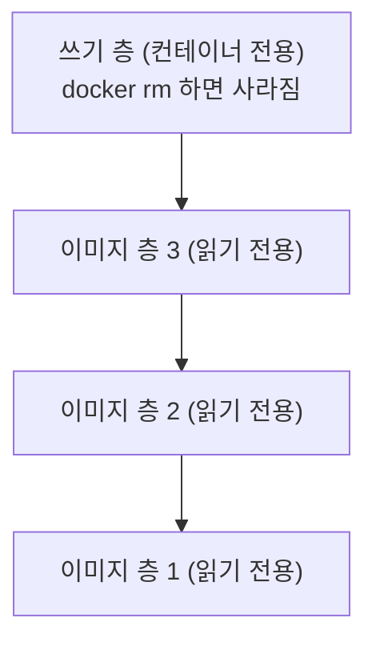
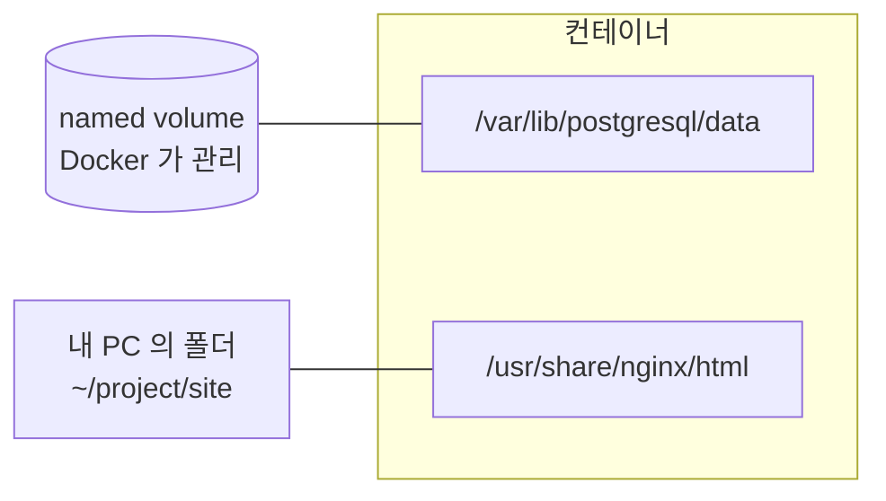

# 9주. 볼륨·네트워크·설정

!!! abstract "이번 주에 할 수 있게 되는 것"
    - 컨테이너를 지우면 안의 데이터가 왜 사라지는지 설명할 수 있다.
    - named volume 과 bind mount 를 구분해 쓰고, 볼륨을 백업·복원할 수 있다.
    - 사용자 정의 네트워크에서 컨테이너를 이름(DNS)으로 부를 수 있다.
    - 환경 변수와 `--env-file` 로 설정을 넣고, 비밀값을 이미지에 넣지 않는다.

| 준비물 | 예상 시간 |
|---|---|
| 7·8주차(`run`, `exec`, 이미지 빌드), 4~6주차의 환경 변수 | 읽기 2시간 · 실습 3시간 · 문제 1시간 |

## 1. 왜 배우나

데이터베이스 컨테이너에 글 100개를 저장했는데, 컨테이너를 새 버전으로 바꿨더니 글이 전부 사라졌다면 큰일이에요. 반대로 비밀번호를 코드에 적어서 이미지로 만들어 공개 레지스트리에 올렸다면 더 큰일이에요. 이번 주에는 **데이터는 컨테이너 밖에 두고, 설정은 밖에서 넣는** 습관을 배워요.

## 2. 컨테이너 데이터는 왜 사라지나

컨테이너는 이미지(읽기 전용 층들) 위에 **얇은 쓰기용 층** 하나를 얹어서 만들어요. 컨테이너 안에서 만든 파일은 그 쓰기 층에 쌓여요. `docker rm` 은 이 쓰기 층을 통째로 버려요.



컨테이너를 "쓰고 버리는 물건"으로 만들어 두면 업데이트도 쉬워요. 새 이미지로 새 컨테이너를 만들면 되니까요. 그러니 **남겨야 할 데이터는 컨테이너 밖**에 둬야 해요.

## 3. 두 가지 방법: named volume 과 bind mount



| | named volume | bind mount |
|---|---|---|
| 만들기 | `-v pgdata:/var/lib/postgresql/data` | `-v "$PWD/site":/usr/share/nginx/html` |
| 저장 위치 | Docker 가 알아서 관리 | 내 PC 의 내가 정한 폴더 |
| 쓰는 곳 | DB 데이터처럼 **컨테이너가 쓰는** 데이터 | 개발 중 내 소스·설정 파일을 컨테이너에서 바로 보기 |
| 장점 | 이식성·백업 도구가 편함, 경로를 몰라도 됨 | 편집기에서 고치면 바로 반영 |

구분법은 쉬워요. `-v` 왼쪽이 **그냥 이름**이면 named volume, **경로(`/`나 `$PWD`)** 이면 bind mount 예요. 읽기만 시킬 때는 `:ro` 를 끝에 붙여요.

!!! warning "WSL 에서 bind mount 는 WSL 안 폴더로"
    Windows 폴더(`/mnt/c/...`)를 bind mount 하면 느리고 권한 문제가 생길 수 있어요. 0주차에서 배운 대로 프로젝트를 WSL 홈(`~`) 안에 두세요.

## 4. 볼륨 백업과 복원

볼륨의 내용은 Docker 가 관리하는 곳에 있어서 직접 열기가 번거로워요. 그래서 **작은 임시 컨테이너**를 하나 띄워 볼륨과 내 폴더를 둘 다 붙이고 `tar` 로 묶어요.

```bash
docker run --rm -v notes:/data:ro -v "$PWD/backup":/backup alpine \
  tar czf /backup/notes.tgz -C /data .
```

복원은 반대로 풀어요.

```bash
docker run --rm -v notes-copy:/data -v "$PWD/backup":/backup:ro alpine \
  tar xzf /backup/notes.tgz -C /data
```

실습 폴더의 `backup.sh`, `restore.sh` 가 이 명령을 편하게 감싼 거예요. 한 가지 조심: 데이터베이스가 **쓰는 중**에 파일을 복사하면 깨진 백업이 될 수 있어요. DB 컨테이너를 멈춘 뒤에 하거나, PostgreSQL 이라면 `pg_dump` 같은 DB 전용 도구를 쓰는 게 더 안전해요. 이 강좌는 개념 이해를 위해 파일 백업만 해 봐요.

## 5. 포트와 네트워크, 그리고 이름으로 부르기

7주차의 `-p` 는 **내 PC 밖(브라우저)에서 컨테이너로** 들어오는 길이에요. 컨테이너끼리 이야기할 때는 `-p` 가 필요 없어요. 같은 **네트워크**에 두면 돼요.

Docker 는 기본 네트워크 말고 내가 만든 **사용자 정의 네트워크**를 줄 수 있어요. 여기 붙은 컨테이너끼리는 **컨테이너 이름이 곧 주소(DNS 이름)** 예요([Docker 네트워킹 문서](https://docs.docker.com/engine/network/)).


```bash
docker network create mynet
docker run -d --name db --network mynet postgres:17 ...
docker run -d --name api --network mynet myapi
```

`api` 안의 코드에서는 DB 주소를 `localhost` 가 아니라 `db` 라고 써요. `localhost` 는 **컨테이너 자신**을 뜻하기 때문이에요. 이게 가장 흔한 실수예요. DB 는 `-p` 를 아예 안 열어도 돼요. 내 PC 에서 직접 접속할 일이 없다면 안 여는 쪽이 더 안전해요.

## 6. 환경 변수로 설정 넣기

같은 이미지를 개발·시험·실제 서비스에 쓰려면, 달라지는 값(DB 주소, 모드, 비밀번호)은 이미지 **밖**에서 넣어야 해요. 방법은 환경 변수예요(6주차에서 배웠어요).

```bash
docker run -e GREETING=hello alpine sh -c 'echo "$GREETING"'
docker run --env-file app.env alpine sh -c 'echo "$GREETING"'
```

`--env-file` 파일은 한 줄에 `이름=값` 이에요. 값이 많을 때 편해요.

## 7. 비밀값은 이미지에 넣지 않는다

비밀번호·API 키를 `Dockerfile` 의 `ENV`, `COPY .env` 로 넣으면 **이미지 층에 영원히 남아요.** 이미지를 받은 누구나 `docker history` 나 파일 풀기로 꺼내 볼 수 있어요. 지웠다고 해도 앞 층에는 남아요.

```dockerfile
# 이렇게 하지 마세요
ENV DB_PASSWORD=my-secret
COPY .env /app/.env
```

대신 이렇게 해요.

- 이미지에는 값을 넣지 않고, **실행할 때** `-e`/`--env-file` 로 넣어요.
- `.env`·`app.env` 는 `.gitignore` 와 `.dockerignore` 에 넣어요(8주차).
- 저장소에는 값을 가짜로 채운 `app.env.example` 만 올려요.

!!! info "한계도 알아 두세요"
    `docker inspect` 로 컨테이너의 환경 변수는 볼 수 있어서, 환경 변수가 최고의 비밀 저장소는 아니에요. 실제 서비스에서는 Docker secrets 나 클라우드의 비밀 관리 서비스를 써요. 1학년 과정에서는 "이미지와 Git 에 넣지 않는다"를 지키는 것이 목표예요. ([Docker secrets 문서](https://docs.docker.com/engine/swarm/secrets/), Compose 에서는 [secrets 문서](https://docs.docker.com/compose/how-tos/use-secrets/))

## 직접 해보기

[`docs/labs/week09/README.md`](../labs/week09/README.md) 를 따라 해요. 볼륨 없이/있이 파일을 남겨 보고, bind mount 로 웹 페이지를 고치고, `backup.sh`·`restore.sh` 로 백업·복원하고, 이름으로 다른 컨테이너를 부르고, **PostgreSQL 컨테이너를 지워도 데이터가 남는 것**까지 확인해요. (터미널 실습이라 Colab 배지는 없어요.)

## 막히면

| 증상 | 원인 | 해결 |
|---|---|---|
| 컨테이너를 다시 만들었더니 DB 가 비었어요 | `-v` 이름을 다르게 썼거나 안 썼어요 | `docker volume ls` 로 볼륨 확인, 같은 이름으로 연결 |
| `could not translate host name "db"` / 이름을 못 찾아요 | 두 컨테이너가 같은 사용자 정의 네트워크에 없어요 | 둘 다 `--network mynet` 으로, 이름이 `--name` 과 같은지 확인 |
| 앱이 DB 에 `localhost` 로 접속하려다 실패해요 | `localhost` 는 앱 컨테이너 자신이에요 | 호스트 이름을 DB 컨테이너 이름(`db`)으로 |
| `-v "$PWD/site":...` 했는데 폴더가 비어 보여요 | 경로 오타이거나, `/mnt/c` 쪽 경로를 썼어요 | `echo "$PWD/site"` 로 경로 확인, WSL 홈 안에서 실행 |
| `docker volume rm` 이 `volume is in use` 라고 해요 | 아직 그 볼륨을 쓰는 컨테이너가 있어요 | `docker rm -f` 로 컨테이너부터 지운 뒤 |

## 확인 문제

1. 컨테이너를 `docker rm` 하면 안에서 만든 파일이 사라지는 이유는?

    ??? note "답 보기"
        파일은 컨테이너 전용 쓰기 층에 저장되는데, `docker rm` 이 그 층을 함께 지우기 때문이에요.

2. `-v pgdata:/var/lib/postgresql/data` 와 `-v "$PWD/site":/usr/share/nginx/html` 는 각각 어떤 종류인가요?

    ??? note "답 보기"
        앞은 named volume(왼쪽이 이름), 뒤는 bind mount(왼쪽이 내 PC 경로)예요.

3. 컨테이너 `api` 에서 `db` 컨테이너의 PostgreSQL(5432)에 접속하려고 해요. 호스트 이름은 무엇이고, 무엇이 필요한가요?

    ??? note "답 보기"
        호스트 이름은 `db`(컨테이너 이름)예요. 두 컨테이너가 같은 사용자 정의 네트워크에 있어야 해요. `-p` 는 필요 없어요.

4. `Dockerfile` 에 `ENV DB_PASSWORD=...` 로 비밀번호를 적으면 왜 안 되나요? 어떻게 하나요?

    ??? note "답 보기"
        이미지 층에 남아서 이미지를 받은 누구나 볼 수 있어요. 실행할 때 `-e`/`--env-file` 로 넣고, 값이 든 파일은 Git·`.dockerignore` 에서 빼요.

5. 데이터베이스 볼륨을 `tar` 로 백업할 때 조심할 점은?

    ??? note "답 보기"
        DB 가 쓰는 중에 복사하면 백업이 깨질 수 있어요. 컨테이너를 멈춘 뒤에 하거나 `pg_dump` 같은 DB 전용 도구를 써요.

## 더 읽기

- [Docker 볼륨 문서](https://docs.docker.com/engine/storage/volumes/)
- [Bind mounts 문서](https://docs.docker.com/engine/storage/bind-mounts/)
- [볼륨 백업·복원](https://docs.docker.com/engine/storage/volumes/#back-up-restore-or-migrate-data-volumes)
- [Docker 네트워킹](https://docs.docker.com/engine/network/)
- [환경 변수 `-e`, `--env-file`](https://docs.docker.com/reference/cli/docker/container/run/)

## 이번 주 체크리스트

- [ ] 컨테이너를 지우면 데이터가 사라지는 이유를 설명할 수 있다
- [ ] named volume 에 데이터를 넣고, 컨테이너를 지운 뒤에도 남는 것을 봤다
- [ ] bind mount 로 내 파일을 컨테이너에 연결해 봤다
- [ ] `backup.sh`·`restore.sh` 로 볼륨을 백업하고 복원했다
- [ ] 사용자 정의 네트워크에서 이름으로 컨테이너를 불렀다
- [ ] 비밀값을 이미지·Git 에 넣지 않는 방법을 말할 수 있다
