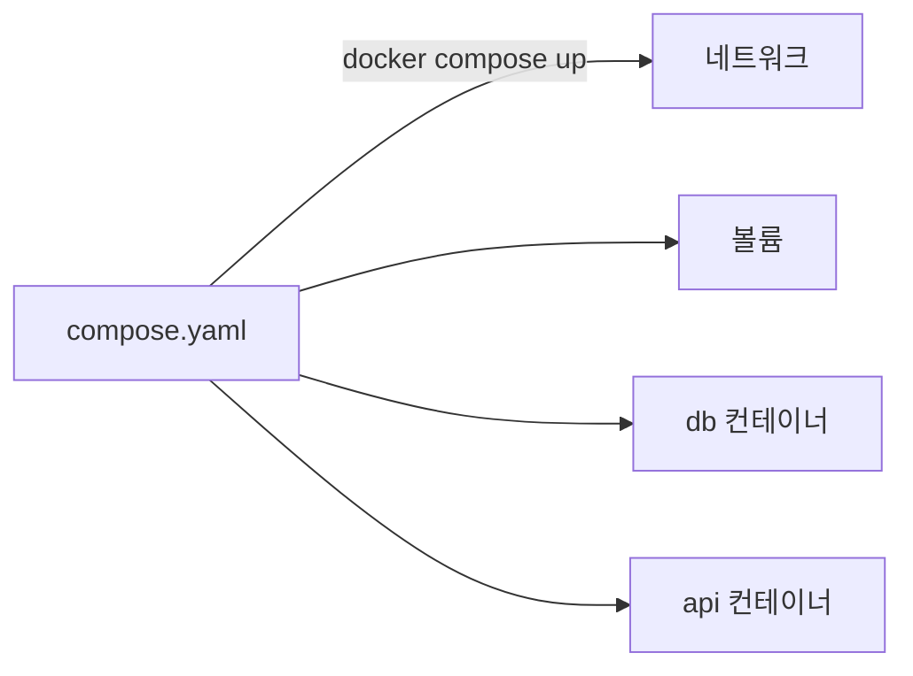
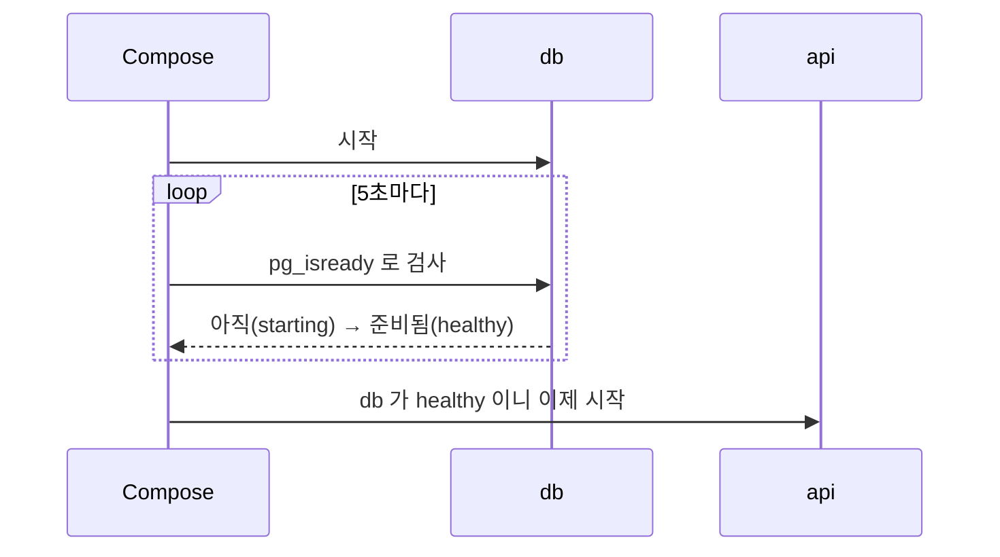

# 10주. Compose 로 여러 서비스

!!! abstract "이번 주에 할 수 있게 되는 것"
    - `compose.yaml` 한 파일로 여러 컨테이너(서비스)를 한 번에 올리고 내릴 수 있다.
    - `services`·`volumes`·`networks` 가 각각 무엇인지 설명할 수 있다.
    - `depends_on` 과 `healthcheck` 로 "DB 가 준비된 뒤에 API 가 시작"되게 할 수 있다.
    - 재시작 정책을 고르고, `docker compose up/down/logs/ps` 를 쓸 수 있다.

| 준비물 | 예상 시간 |
|---|---|
| 7~9주차(이미지·빌드·볼륨·네트워크·환경 변수) | 읽기 2시간 · 실습 3시간 · 문제 1시간 |

## 1. 왜 배우나

9주차에 DB 와 앱을 띄우려니 `docker network create`, `docker volume create`, `docker run ...` 을 긴 옵션과 함께 여러 번 쳐야 했어요. 순서를 틀리거나 옵션을 하나 빼면 안 돼요. Docker Compose 는 이 모든 것을 **한 파일에 적어 두고 명령 하나로** 올려 줘요. 사실상 "내 서비스 전체의 레시피"예요.



!!! note "하이픈 없는 `docker compose`"
    옛 글에는 `docker-compose`(하이픈)와 파일 맨 위 `version: "3"` 이 나와요. 하이픈 버전(v1)은 이제 지원하지 않는 옛 방식이고, 지금은 `docker compose`(공백)를 써요. 파일의 `version:` 은 쓰지 않아도 되고, 쓰면 "낡은 키"라는 경고만 나와요. 파일 이름은 `compose.yaml` 이 기본이에요. ([Compose 역사](https://docs.docker.com/compose/intro/history/), [명세](https://github.com/compose-spec/compose-spec/blob/main/spec.md))

## 2. compose.yaml 읽기

이번 주 예제는 **방문 횟수를 세는 API**(`api`)와 **PostgreSQL**(`db`)이에요. `/hits` 를 부를 때마다 숫자가 1 올라가고, 숫자는 DB 에 저장돼요. 파일 전체는 [`compose.yaml`](../labs/week10/compose.yaml) 이에요. 나눠서 읽어요.

```yaml
services:
  db:
    image: postgres:17
    volumes:
      - pgdata:/var/lib/postgresql/data
    networks:
      - backend
  api:
    build: .
    ports:
      - "8000:8000"
    networks:
      - backend

volumes:
  pgdata:

networks:
  backend:
```

세 개의 최상위 칸이 있어요.

| 칸 | 뜻 | 9주차와 연결 |
|---|---|---|
| `services` | 띄울 컨테이너들. 이름(`db`, `api`)이 곧 네트워크 안의 호스트 이름이에요 | `--name` |
| `volumes` | 쓸 named volume 선언 | `docker volume create` |
| `networks` | 쓸 네트워크 선언 | `docker network create` |

서비스 안에서 `image:` 는 받아 쓸 이미지, `build:` 는 Dockerfile 이 있는 폴더(`.`)예요. `ports:` 는 `-p`, `volumes:` 는 `-v`, `environment:` 는 `-e` 에 해당해요. `- "8000:8000"` 처럼 따옴표를 치는 게 안전해요. YAML 이 `숫자:숫자` 를 다르게 읽는 일이 있어서예요.

## 3. 설정 넣기

```yaml
  db:
    environment:
      POSTGRES_USER: app
      POSTGRES_PASSWORD: ${DB_PASSWORD:-lab-only-password}
      POSTGRES_DB: app
```

`${DB_PASSWORD:-lab-only-password}` 는 "내 PC 환경 변수나 `.env` 파일에 `DB_PASSWORD` 가 있으면 그 값을, 없으면 `lab-only-password` 를" 이라는 뜻이에요. Compose 는 `compose.yaml` 옆의 `.env` 파일을 자동으로 읽어요. 비밀번호를 파일에 직접 적지 않고 `.env` 에 두고, `.env` 는 Git 에 올리지 않아요(9주차). 기본값 `lab-only-password` 는 실습용이에요. 실제 서비스에서는 쓰지 마세요.

## 4. 시작 순서: depends_on 과 healthcheck

`api` 는 시작하자마자 DB 에 접속해요. 그런데 `db` 컨테이너가 "켜졌다"와 "DB 가 접속을 받을 준비가 됐다"는 다른 일이에요. PostgreSQL 은 켜진 뒤에도 몇 초간 초기화를 해요. 그냥 `depends_on: [db]` 로는 컨테이너가 **시작**하기만 기다려서, 준비 전에 `api` 가 접속하다 실패할 수 있어요.

그래서 두 가지를 같이 써요.

1. `db` 에 **healthcheck** 를 줘서 "정말 준비됐는지" 를 주기적으로 검사해요.
2. `api` 의 `depends_on` 에서 `condition: service_healthy` 로 "건강해질 때까지 기다려"라고 해요.

```yaml
  db:
    healthcheck:
      test: ["CMD-SHELL", "pg_isready -U app -d app"]
      interval: 5s
      timeout: 3s
      retries: 10
      start_period: 10s

  api:
    depends_on:
      db:
        condition: service_healthy
```



| 키 | 뜻 |
|---|---|
| `test` | 건강 검사 명령. 성공(종료 코드 0)하면 건강해요 |
| `interval` | 검사 간격 |
| `timeout` | 검사 한 번의 제한 시간 |
| `retries` | 연속으로 몇 번 실패하면 `unhealthy` 로 볼지 |
| `start_period` | 시작 직후 이 시간 동안은 실패해도 세지 않는 준비 시간 |

`depends_on` 의 `condition` 은 세 가지가 있어요. `service_started`(시작만 하면), `service_healthy`(건강해야), `service_completed_successfully`(끝까지 성공적으로 실행되고 종료해야). 이번엔 `service_healthy` 를 써요. (키 설명은 [Compose 명세](https://github.com/compose-spec/compose-spec/blob/main/spec.md) 기준이에요.)

!!! warning "그래도 앱은 재시도할 줄 알아야 해요"
    `depends_on` 은 **처음 올릴 때** 순서만 보장해요. 운영 중에 DB 가 재시작되면 앱의 연결은 끊겨요. 실제 앱은 연결 실패 시 재시도하도록 만들어요. 우리 예제는 연결 실패를 503 으로 알려 주는 정도예요.

## 5. 재시작 정책

```yaml
    restart: unless-stopped
```

| 값 | 뜻 |
|---|---|
| `no` | 기본값. 다시 시작하지 않아요 |
| `on-failure` | 실패(0이 아닌 종료)했을 때만 다시 시작 |
| `always` | 늘 다시 시작 |
| `unless-stopped` | 내가 직접 멈춘 경우만 빼고 다시 시작 |

서버에서 오래 돌릴 서비스에는 `unless-stopped` 가 무난해요. 컴퓨터를 껐다 켜거나 앱이 죽었을 때 알아서 살아나요. 실습 중 개발 PC 에서는 `no` 로 둬도 좋아요. (값은 [Compose 서비스 문서](https://docs.docker.com/reference/compose-file/services/) 기준)

## 6. 자주 쓰는 명령

`compose.yaml` 이 있는 폴더에서 실행해요.

| 명령 | 하는 일 |
|---|---|
| `docker compose up -d` | 필요하면 빌드하고, 전부 뒤에서 올려요 |
| `docker compose up -d --build` | 소스를 고친 뒤 이미지를 다시 빌드해서 올려요 |
| `docker compose ps` | 서비스 상태(건강 여부 포함) |
| `docker compose logs -f api` | `api` 로그를 계속 보기 |
| `docker compose exec db psql -U app` | 돌고 있는 서비스 안에서 명령 실행 |
| `docker compose down` | 컨테이너·네트워크를 지워요. **볼륨은 남겨요** |
| `docker compose down -v` | 볼륨까지 지워요. **데이터가 사라져요** |

`down` 은 볼륨을 남기고 `down -v` 는 지운다는 차이가 9주차 내용과 이어져요. DB 데이터를 지키려면 `-v` 를 조심하세요.

## 직접 해보기

[`docs/labs/week10/README.md`](../labs/week10/README.md) 를 따라 해요. `docker compose up -d` 한 번으로 API 와 DB 를 올리고, `/hits` 를 불러 숫자가 오르는 것을 보고, 전부 내렸다가 다시 올려도 숫자가 이어지는 것을 확인해요. (터미널 실습이라 Colab 배지는 없어요.)

## 막히면

| 증상 | 원인 | 해결 |
|---|---|---|
| `docker: 'compose' is not a docker command` | Compose 플러그인이 없어요 | Docker Desktop 은 기본 포함. WSL 안 Engine 은 `docker-compose-plugin` 패키지를 설치([설치 문서](https://docs.docker.com/engine/install/ubuntu/)) |
| `/hits` 가 503 `DB 에 연결하지 못했어요` | `db` 가 아직 준비 전이거나 접속 정보가 달라요 | `docker compose ps` 로 `db` 가 `healthy` 인지, `DB_HOST` 가 `db` 인지 확인 |
| `docker compose up` 이 `yaml: ... mapping values` 오류 | 들여쓰기·콜론 뒤 공백 실수 | YAML 은 **스페이스 2칸**, 탭 금지. 에디터의 YAML 표시를 켜 보세요 |
| `port is already allocated` | 8000번을 다른 프로그램이 써요 | `ports` 를 `"8001:8000"` 으로 바꾸고 `localhost:8001` 로 접속 |
| 비밀번호를 바꿨는데 DB 가 옛 비밀번호로 열려요 | `POSTGRES_PASSWORD` 는 **DB 를 처음 만들 때만** 적용돼요 | 연습 데이터라면 `docker compose down -v` 후 다시 `up` |

## 확인 문제

1. `compose.yaml` 의 최상위 세 칸 `services`·`volumes`·`networks` 는 9주차의 어떤 명령과 대응하나요?

    ??? note "답 보기"
        `docker run`(+`--name`, `-p`, `-e`), `docker volume create`, `docker network create` 에 대응해요.

2. `depends_on: [db]` 만 쓰면 왜 API 가 DB 접속에 실패할 수 있나요?

    ??? note "답 보기"
        컨테이너가 시작하기만 기다릴 뿐, DB 가 접속을 받을 준비가 됐는지는 기다리지 않기 때문이에요. 준비 여부는 `healthcheck` 와 `condition: service_healthy` 로 기다려요.

3. `docker compose down` 과 `docker compose down -v` 의 차이는?

    ??? note "답 보기"
        `down` 은 컨테이너와 네트워크를 지우고 볼륨은 남겨요. `-v` 를 붙이면 볼륨도 지워서 DB 데이터가 사라져요.

4. `restart: unless-stopped` 는 어떤 경우에 컨테이너를 다시 시작하나요?

    ??? note "답 보기"
        앱이 죽었거나 Docker 가 다시 켜졌을 때 다시 시작해요. 사용자가 직접 `stop` 한 경우는 다시 시작하지 않아요.

5. `compose.yaml` 맨 위에 `version: "3"` 을 써야 하나요?

    ??? note "답 보기"
        쓰지 않아도 돼요. 현재 Compose 명세에서 `version` 키는 낡은 키이고, 쓰면 경고만 나와요.

## 더 읽기

- [Compose 개요](https://docs.docker.com/compose/)
- [Compose 파일 레퍼런스: services](https://docs.docker.com/reference/compose-file/services/)
- [Compose Specification](https://github.com/compose-spec/compose-spec/blob/main/spec.md)
- [Compose 의 시작 순서 제어](https://docs.docker.com/compose/how-tos/startup-order/)

## 이번 주 체크리스트

- [ ] `compose.yaml` 의 services·volumes·networks 를 내 말로 설명할 수 있다
- [ ] `docker compose up -d` 로 API + DB 를 올렸다
- [ ] `/hits` 숫자가 오르는 것을 봤다
- [ ] `down` 후 다시 `up` 해도 숫자가 이어지는 것을 확인했다
- [ ] healthcheck 와 `service_healthy` 의 역할을 설명할 수 있다
- [ ] 확인 문제 5개를 풀었다
