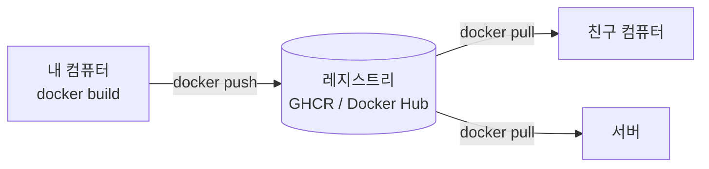
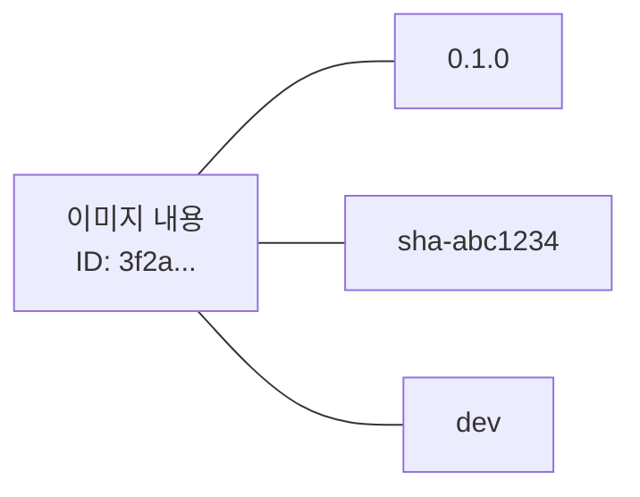
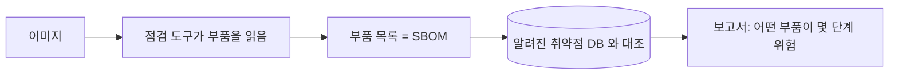
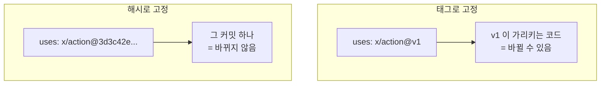
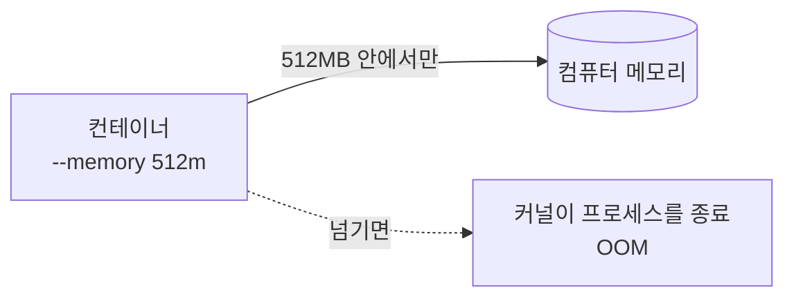
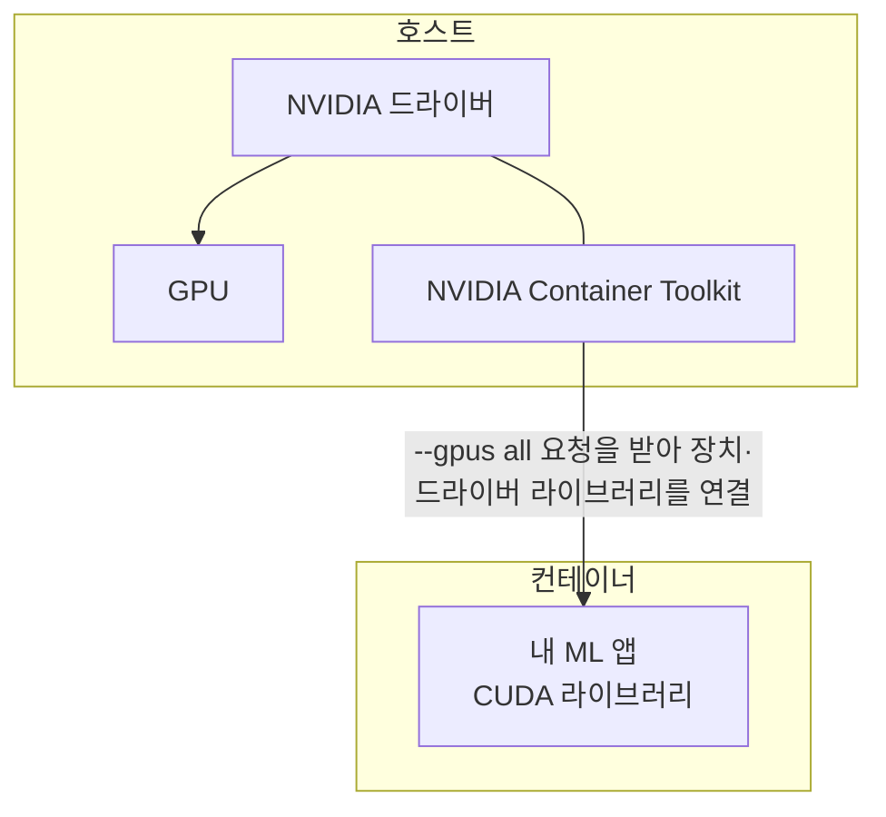

# 11주. 배포·보안·자원·GPU

!!! abstract "이번 주에 할 수 있게 되는 것"
    - 레지스트리(registry)가 무엇인지 설명하고, 태그 규칙(`latest` 의 함정, 버전·커밋 해시)에 맞게 이미지 이름을 붙일 수 있다.
    - 내 이미지를 GitHub Container Registry(GHCR)에 올리고 내려받을 수 있다.
    - 점검표로 이미지를 검사하고, SBOM 이 무엇인지 말할 수 있다.
    - 컨테이너를 root 가 아닌 사용자·읽기 전용·CPU/메모리 제한으로 돌릴 수 있다.
    - GPU 컨테이너가 어떻게 동작하는지 개념을 설명하고, `devcontainer.json` 이 무엇인지 안다.

| 준비물 | 예상 시간 |
|---|---|
| 8주(Dockerfile)·10주(Compose) 마친 상태, Docker 동작, GitHub 계정 | 읽기 2시간 · 실습 3시간 · 문제 1시간 |

## 1. 왜 배우나

지금까지는 이미지를 **내 컴퓨터 안에서** 만들고 돌렸어요. 하지만 이미지는 "남에게 건네야" 쓸모가 있어요. 친구 컴퓨터, 서버, 수업 서버에서 `docker run` 한 줄로 내 앱이 떠야 하니까요.

그런데 건네는 순간 질문이 생겨요.

- 이미지를 **어디에** 두지? → 레지스트리
- 어떤 **이름표**를 붙이지? → 태그 규칙
- 이 이미지 안에 **위험한 게** 없나? → 점검과 보안
- 내 앱이 컴퓨터를 **독차지하면?** → 자원 제한
- 모델이 **GPU** 를 쓰고 싶다면? → GPU 컨테이너

이번 주는 "만든 이미지를 안전하게 내보내는 법" 이에요.

## 2. 레지스트리와 태그 규칙

레지스트리(registry)는 **이미지 보관소**예요. 코드를 GitHub 에 올리듯 이미지를 레지스트리에 올려요. 7주에 `docker pull` 로 받은 이미지도 레지스트리(Docker Hub)에서 온 거예요.



| 레지스트리 | 특징 |
|---|---|
| Docker Hub | 공식 이미지(`python`, `nginx`)가 있는 곳. 내려받기 횟수 한도가 있어서 로그인을 권해요. 무료 계정의 정확한 한도는 Docker 문서(6시간당 횟수)와 가격 페이지(시간당 횟수)가 서로 달라서 **이 강좌는 숫자를 적지 않아요**(미확인). `docker login` 을 하고 쓰면 돼요 |
| GHCR (`ghcr.io`) | GitHub 계정과 붙어 있는 보관소. CI(GitHub Actions)와 연결이 쉬워서 이 강좌의 기본이에요 |

GHCR 이름 형식은 `ghcr.io/소유자/이미지이름:태그` 이고 **소문자**로 써요. ([GitHub 문서](https://docs.github.com/en/packages/working-with-a-github-packages-registry/working-with-the-container-registry))

### 태그는 "이름표"예요

같은 이미지에 이름표를 여러 개 붙일 수 있어요. 그림으로 보면 이래요.



**`latest` 의 함정.** `latest` 는 "가장 최신" 이라는 **뜻이 아니에요**. 그냥 태그를 안 붙이면 기본으로 붙는 이름일 뿐이고, 누가 덮어쓰면 내용이 바뀌어요. 어제 `latest` 를 받은 서버와 오늘 받은 서버가 **다른 이미지**를 돌릴 수 있고, 문제가 생겨도 "어제 걸로 돌려놔" 가 안 돼요.

| 이름표 | 예 | 바뀌나? | 언제 쓰나 |
|---|---|---|---|
| `latest` | `app:latest` | 덮어쓰면 바뀜 | 연습·실험에서만 |
| 버전 | `app:1.2.0` | 바꾸지 않기로 약속 | 사람이 읽는 릴리스 |
| 커밋 해시 | `app:sha-abc1234` | 커밋이 같으면 같음 | 배포·되돌리기의 기준 |

배포 파일(compose.yaml, 서버 명령)에는 **버전이나 커밋 해시**를 적어요. 12주 `ci.yml` 은 커밋마다 `sha-...` 태그를 자동으로 붙이고, `v1.0.0` 같은 git 태그를 달면 `1.0.0` 도 붙여요.

### GHCR 에 올리기

토큰(비밀번호 대용)으로 로그인하고, 이름을 맞춰 태그한 뒤 push 해요. GitHub 문서의 명령 그대로예요.

```bash
echo $CR_PAT | docker login ghcr.io -u 내아이디 --password-stdin
docker tag app:dev ghcr.io/내아이디/app:0.1.0
docker push ghcr.io/내아이디/app:0.1.0
```

- 토큰은 `write:packages` 권한이 있는 것을 써요(받기만 하면 `read:packages`). 토큰은 **비밀번호**라서 코드·채팅에 붙이지 않아요.
- 처음 올린 패키지는 **비공개(private)** 가 기본이에요. 남이 받게 하려면 패키지 설정에서 공개로 바꿔요.

!!! tip "CI 에서는 토큰을 만들 필요가 없어요"
    GitHub Actions 안에서는 자동으로 주어지는 `GITHUB_TOKEN` 과 `packages: write` 권한으로 올릴 수 있어요. 12주에서 해요.

## 3. 이미지 점검과 SBOM

이미지는 내 코드 + 베이스 이미지 + 설치한 패키지 수백 개로 이뤄져요. 내가 안 쓴 코드에서 **알려진 보안 구멍(취약점, CVE)** 이 나올 수 있어요.



- **점검 도구**: Docker Scout(`docker scout quickview 이미지` 로 요약 — [공식 문서](https://docs.docker.com/reference/cli/docker/scout/quickview/)), Grype 등이 있어요. 이미지의 부품을 취약점 목록과 맞춰 봐요.
- **SBOM**(소프트웨어 부품 목록, Software Bill of Materials): "이 이미지에 무엇이 들어 있나" 의 **재료 목록**이에요. 식품의 원재료 표시와 같아요. Syft 는 `syft 이미지 -o spdx-json=./spdx.json` 처럼 SBOM 을 파일로 뽑아요([Syft README](https://github.com/anchore/syft)). 나중에 새 취약점이 발표되면 SBOM 만 보고 "내 이미지가 영향받나" 를 바로 알 수 있어요.
- **서명(cosign 등)**: 이미지에 "이건 내가 만든 거 맞아요" 도장을 찍어요. 이 강좌에서는 개념만 알면 돼요.

결과가 "취약점 0개" 일 필요는 없어요. **High/Critical 이 몇 개인지 알고, 베이스 이미지를 올려서 줄일 수 있는지** 보는 게 출발점이에요. 점검표는 [실습 폴더](../labs/week11/scan-checklist.md)에 있어요.

## 4. 공급망 보안 — 점검 도구도 공격받아요

우리는 남이 만든 이미지·패키지·GitHub Action 을 **가져다 써요**. 이 연결 고리를 공급망(supply chain)이라 해요. 고리 중 하나가 변조되면 내 빌드가 같이 오염돼요.

**실제 사건(2026-03, Trivy).** 이미지 점검 도구 Trivy 의 배포물이 변조됐어요. 악성 바이너리 v0.69.4, GitHub Action(`trivy-action`)의 태그 76/77개 변조, Docker Hub 이미지 0.69.5·0.69.6 변조가 보고됐어요. 보안 도구가 공격 통로가 된 거예요. (출처: [GitHub 보안 권고 GHSA-69fq-xp46-6x23](https://github.com/aquasecurity/trivy/security/advisories/GHSA-69fq-xp46-6x23), [Docker 블로그](https://www.docker.com/blog/trivy-supply-chain-compromise-what-docker-hub-users-should-know/). 사고 이후 최종 사후 보고서는 확인하지 못했어요.)

왜 위험했을까요? 태그는 **옮길 수 있는 이름표**예요. `uses: some/action@v1` 은 "v1 이라는 이름표가 붙은 것" 이라, 이름표를 다른 코드에 옮겨 붙이면 **내 워크플로가 모르는 새에 다른 코드를 실행**해요.



교훈 세 가지예요.

1. **Action 은 커밋 해시로 고정**하고, 뒤에 `# v7.0.1` 처럼 사람이 읽는 버전을 주석으로 적어요. 12주 `ci.yml` 이 이렇게 돼 있어요.
2. **이미지·도구는 버전을 고정**하고, 가능하면 **다이제스트**(이미지 내용의 지문, `이름@sha256:...`)로 고정해요. 다이제스트는 내용이 바뀌면 값이 바뀌므로 "같은 이미지" 를 보장해요.
3. 설치 스크립트를 `curl ... | sh` 로 **바로 실행하지 말고**, 내려받아 읽어 본 뒤 실행해요.

(도구를 해시로 고정하면 보안 업데이트도 직접 올려야 해요. 그 대가로 "모르는 새 바뀌는 일" 을 막는 거예요. 해시 갱신을 알려 주는 자동화 도구가 있지만 이 강좌에서는 다루지 않아요.)

## 5. 비root·읽기 전용·최소 이미지

컨테이너가 뚫려도 **피해를 작게** 만드는 세 가지 습관이에요.

| 습관 | 어떻게 | 막는 것 |
|---|---|---|
| root 로 돌리지 않기 | Dockerfile 에 `USER app` | 침입자가 컨테이너 안에서 root 권한을 갖는 것 |
| 읽기 전용 | `docker run --read-only` / compose `read_only: true` + 쓸 곳만 `tmpfs` | 침입자가 파일을 심거나 바꾸는 것 |
| 불필요한 권한 버리기 | `--cap-drop ALL` / compose `cap_drop: [ALL]` | 쓰지도 않는 리눅스 특수 권한 |

12주 Dockerfile 은 이렇게 해요.

```dockerfile
RUN useradd --system --uid 10001 --user-group --no-create-home app
...
USER app
```

**최소 이미지**: 이미지에 든 게 적을수록 취약점도 적어요. 멀티스테이지(8주)로 빌드 도구를 버리고, `-slim` 베이스를 쓰고, 꼭 필요한 파일만 `COPY` 해요. Docker 는 2025-12 에 보강 이미지(Docker Hardened Images) 1,000여 개를 무료·Apache 2.0 으로 공개했다고 발표했어요(받으려면 로그인이 필요하다는 2차 자료가 있어 조건은 미확인). 관심 있으면 [Docker 보도자료](https://www.docker.com/press-release/docker-makes-hardened-images-free-open-and-transparent-for-everyone/)를 읽어 봐요.

!!! warning "읽기 전용이 깨뜨리는 것"
    앱이 로그·캐시·임시 파일을 쓰면 `read-only file system` 오류가 나요. 그때는 쓰는 폴더만 `tmpfs`(메모리 디스크)나 볼륨으로 열어요. "전부 열기" 로 되돌리지 말아요.

## 6. CPU·메모리 제한

컨테이너는 따로 막지 않으면 **컴퓨터의 자원을 가능한 만큼** 써요. 모델을 올린 앱이 메모리를 끝없이 먹으면 같은 컴퓨터의 다른 컨테이너도 같이 죽어요. 그래서 **상한**을 걸어요.



Docker 공식 문서([Resource constraints](https://docs.docker.com/engine/containers/resource_constraints/))의 옵션이에요.

| 옵션 | 뜻 |
|---|---|
| `--memory`, `-m` | 쓸 수 있는 메모리 상한. 최솟값 6m |
| `--memory-swap` | `--memory` 와 같은 값이면 스왑(디스크를 메모리처럼) 못 씀 |
| `--cpus` | CPU 사용량 상한. `--cpus="1.5"` = 1.5 개 분량 |

기본으로 메모리 초과(OOM)가 나면 커널이 컨테이너 안의 프로세스를 죽여요. Compose 에서는 `mem_limit: 512m`, `cpus: 1.0`, `pids_limit: 100` 처럼 써요(Compose 명세의 서비스 속성).

제한값을 정하는 요령: 평소에 얼마나 쓰는지 **재 보고**(`docker stats`) 그보다 넉넉히 잡아요. ML 서비스는 **모델 크기 + 라이브러리** 만큼은 메모리에 올라가요. 실습은 [resource-limits.md](../labs/week11/resource-limits.md)에 있어요.

## 7. GPU 컨테이너 — 개념만

딥러닝은 GPU 로 빨라져요. 그런데 컨테이너는 기본적으로 **호스트(내 컴퓨터)의 GPU 를 못 봐요.** 컨테이너는 컴퓨터의 일부만 보여 주는 방이라서, 장치를 따로 "열어 줘야" 해요.



- **드라이버는 호스트에**, 앱과 CUDA 라이브러리는 컨테이너 안에 있어요. 그 둘을 이어 주는 게 **NVIDIA Container Toolkit** 이에요.
- 설치 순서(공식): 호스트에 NVIDIA 드라이버 → Toolkit 설치 → `sudo nvidia-ctk runtime configure --runtime=docker` → `sudo systemctl restart docker` ([NVIDIA 설치 문서](https://docs.nvidia.com/datacenter/cloud-native/container-toolkit/latest/install-guide.html)).
- 실행(Docker 공식 문서): `docker run -it --rm --gpus all ubuntu nvidia-smi` — 컨테이너 안에서 `nvidia-smi` 가 GPU 표를 보여 주면 성공이에요. Compose 에서는 서비스에 `gpus: all` 을 써요.
- **CDI**(Container Device Interface)는 "장치를 컨테이너에 연결하는 표준 방식" 이에요. Toolkit 1.19 부터 기본 모드가 CDI 방식(JIT CDI)으로 바뀌었고, Docker 에서 `nvidia.com/gpu=all` 같은 장치 이름을 써요(NVIDIA 릴리스 노트). 현재 권장 테스트 명령(`--gpus all` 대 CDI 장치 이름)과 WSL2·Docker Desktop 에서의 GPU 지원은 **확인하지 못했으니** NVIDIA 문서를 직접 봐요.

**1학년에게 현실적인 길.** 노트북에 NVIDIA GPU 가 없는 경우가 많아요. 이 강좌의 12주 프로젝트는 **CPU 만으로** 돌아요. GPU 는 개념만 알고, 직접 써 보고 싶다면 [Google Colab](https://colab.research.google.com/)의 GPU 런타임이나 클라우드 GPU 에서 해 봐요. 컨테이너로 GPU 모델을 서빙하는 방법은 자매 강좌 [모델 서빙](https://metahomo.github.io/dl-serving-course/)에서 이어져요.

## 8. devcontainer 소개

지금까지는 "앱을 컨테이너에 넣는" 이야기였어요. **개발 환경 자체**를 컨테이너에 넣을 수도 있어요. 프로젝트에 `.devcontainer/devcontainer.json` 파일을 두면, VS Code 의 Dev Containers 확장이나 GitHub Codespaces 가 그 설명대로 컨테이너를 만들고 **그 안에서** 편집·실행해요. 팀원 모두가 같은 환경에서 시작해요. 명세는 [containers.dev](https://containers.dev/)에 있어요.

```json
{
  "name": "iris-service",
  "image": "python:3.13-slim",
  "forwardPorts": [8000],
  "postCreateCommand": "pip install uv && uv sync"
}
```

| 키 | 뜻 |
|---|---|
| `image` | 개발 컨테이너의 바탕 이미지 |
| `forwardPorts` | 컨테이너 안의 포트를 내 브라우저로 이어 줘요 |
| `postCreateCommand` | 컨테이너가 처음 만들어진 뒤 한 번 실행할 명령 |

12주 종합 프로젝트에 이 파일을 추가하면 "clone → Codespaces 열기" 만으로 재현돼요(선택).

## 9. 큰 그림 — 실제 프로젝트는 어떻게 하나

이번 주 내용이 한 흐름으로 이어진 공개 사례가 있어요. [miniproject5_kms](https://github.com/metahomo/miniproject5_kms)의 README 는 흐름을 이렇게 한 줄로 적어요.

> 코드 변경 → PR 시험 → v* 태그 → 이미지(GHCR) → 서버 교체 → /health 확인 (실패하면 직전 판으로 자동 복귀)

- 워크플로: [`.github/workflows`](https://github.com/metahomo/miniproject5_kms/tree/main/.github/workflows)(`ci` · `model` · `rollback` · `uptime`)
- 배포·되돌리기 절차서: [runbooks](https://github.com/metahomo/miniproject5_kms/tree/main/runbooks)

지금은 읽지 않아도 돼요. 12주에 내 프로젝트를 만든 뒤 "이게 더 커지면 이렇게 되는구나" 로 훑어봐요.

## 직접 해보기

[실습 폴더 `docs/labs/week11/`](../labs/week11/README.md)

1. 작은 이미지에 태그를 3개 붙여 보고 `latest` 가 왜 위험한지 설명해요.
2. GHCR 에 push 해요.
3. [점검표](../labs/week11/scan-checklist.md)로 내 이미지를 검사해요.
4. `--read-only`·비root 로 돌려요.
5. [자원 제한 실습](../labs/week11/resource-limits.md)에서 OOM 을 직접 일으켜 봐요.

Docker 를 못 깔았다면 GitHub Codespaces 나 Killercoda 에서 같은 명령을 쳐요.

## 막히면

| 증상 | 원인 | 해결 |
|---|---|---|
| `denied` / `unauthorized` (push) | 토큰에 `write:packages` 없음, `-u` 아이디 오타 | 토큰 권한 확인, 다시 `docker login ghcr.io` |
| `invalid reference format` | 이미지 이름에 대문자 | 소문자만 쓰기 |
| 다른 컴퓨터에서 `pull access denied` | 패키지가 비공개 | 공개로 바꾸거나 `docker login ghcr.io` |
| `read-only file system` | 읽기 전용인데 앱이 파일을 씀 | 쓰는 폴더만 `tmpfs`/볼륨 |
| 컨테이너가 갑자기 종료(코드 137) | 메모리 상한 초과(OOM) 가능성 | `docker inspect -f '{{.State.OOMKilled}}' 이름` 이 `true` 면 상한을 올리거나 앱의 메모리 사용을 줄여요 |

## 확인 문제

**1.** `app:latest` 로 배포하면 왜 문제가 생길 수 있나요?

??? note "답 보기"
    `latest` 는 덮어쓰면 내용이 바뀌는 이름표라서, 시점에 따라 서로 다른 이미지를 받을 수 있고 "어제 버전으로" 되돌리기도 어려워요. 버전(`1.2.0`)이나 커밋 해시(`sha-abc1234`)처럼 바뀌지 않는 이름표를 써요.

**2.** SBOM 은 무엇이고, 왜 도움이 되나요?

??? note "답 보기"
    이미지에 들어 있는 소프트웨어 부품의 목록이에요. 나중에 새 취약점이 발표됐을 때 이미지를 다시 뜯지 않아도 "내 이미지가 영향받는 부품을 쓰는지" 를 바로 확인할 수 있어요.

**3.** `uses: some/action@v1` 보다 `uses: some/action@<커밋 해시>` 가 안전한 이유는?

??? note "답 보기"
    태그는 다른 코드로 옮겨 붙일 수 있어서(Trivy 사건처럼) 모르는 새에 내용이 바뀔 수 있어요. 커밋 해시는 그 커밋 하나만 가리켜서 바뀌지 않아요.

**4.** 컨테이너를 root 가 아닌 사용자로 읽기 전용으로 돌리는 이유를 한 문장으로 쓰세요.

??? note "답 보기"
    컨테이너가 뚫려도 침입자가 얻는 권한과 바꿀 수 있는 파일을 최소로 줄여 피해를 작게 만들려고요.

**5.** GPU 컨테이너에서 드라이버는 어디에 설치하고, Toolkit 은 무슨 일을 하나요?

??? note "답 보기"
    드라이버는 호스트(컴퓨터)에 설치해요. NVIDIA Container Toolkit 은 `--gpus` 요청을 받아 GPU 장치와 드라이버 라이브러리를 컨테이너에 연결해 줘요.

## 더 읽기

- [GHCR 사용법 — GitHub Docs](https://docs.github.com/en/packages/working-with-a-github-packages-registry/working-with-the-container-registry)
- [Resource constraints — Docker Docs](https://docs.docker.com/engine/containers/resource_constraints/)
- [GPU access — Docker Docs](https://docs.docker.com/engine/containers/gpu/)
- [NVIDIA Container Toolkit 설치](https://docs.nvidia.com/datacenter/cloud-native/container-toolkit/latest/install-guide.html)
- [Trivy 사건 보안 권고 GHSA-69fq-xp46-6x23](https://github.com/aquasecurity/trivy/security/advisories/GHSA-69fq-xp46-6x23)
- [Dev Containers 명세](https://containers.dev/)
- 자매 강좌: [모델 서빙](https://metahomo.github.io/dl-serving-course/)

## 이번 주 체크리스트

- [ ] 11주 본문을 읽었다
- [ ] 이미지에 버전·커밋 해시 태그를 붙이고 `latest` 의 함정을 설명할 수 있다
- [ ] 이미지를 GHCR 에 push 하고 pull 해 봤다
- [ ] 점검표로 내 이미지를 검사해 결과를 적었다
- [ ] 읽기 전용·비root 와 메모리 제한(OOM)을 직접 확인했다
- [ ] 확인 문제 5개를 풀었다
