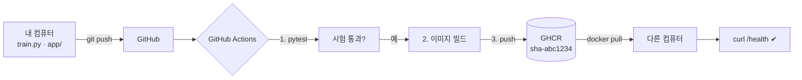
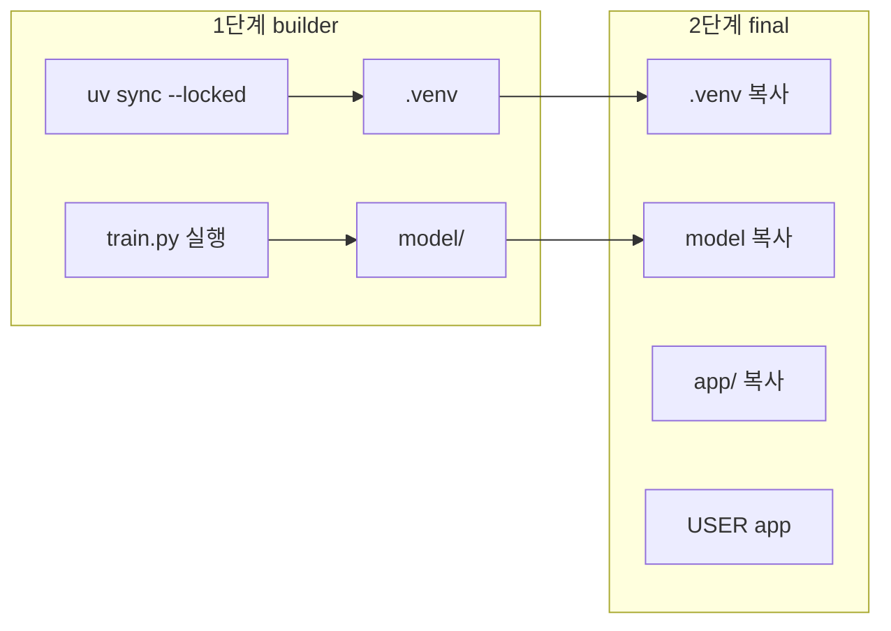
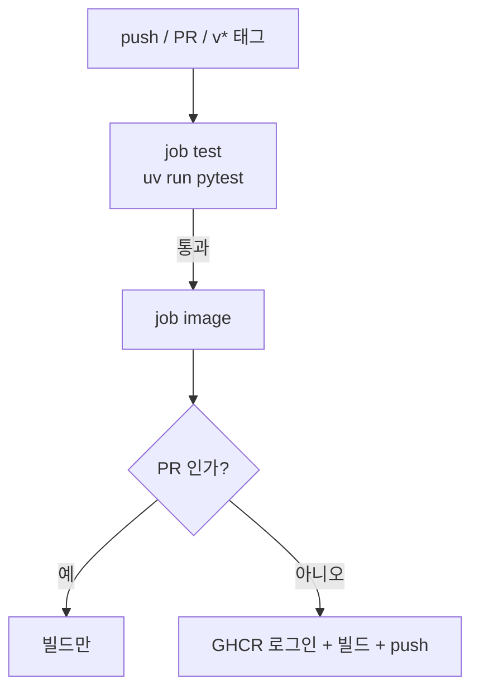
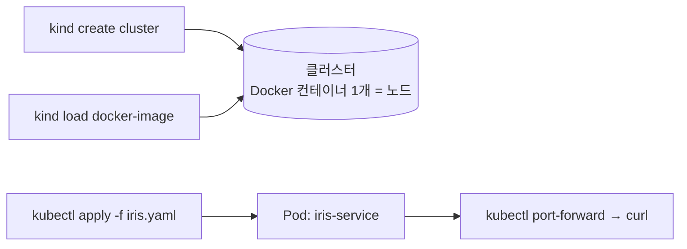

# 12주. 종합 프로젝트 — ML 추론 서비스를 컨테이너로

!!! abstract "이번 주에 할 수 있게 되는 것"
    - 작은 ML 모델과 API 를 **Dockerfile(멀티스테이지·uv) → compose.yaml(헬스체크) → GitHub Actions → GHCR** 로 이어 붙일 수 있다.
    - 이미지를 **다른 컴퓨터에서 pull 해서 실행**하고, 그 방법을 README 한 장(넘겨주기 문서)에 적을 수 있다.
    - 11주의 점검표(비root·읽기 전용·자원 제한·태그·Action 고정)를 내 프로젝트에 적용할 수 있다.
    - 5분 안에 내 프로젝트를 설명하고 시연할 수 있다.
    - (선택) kind 로 쿠버네티스 클러스터를 만들어 Pod 하나를 띄워 볼 수 있다.

| 준비물 | 예상 시간 |
|---|---|
| 1~11주, Docker 동작, GitHub 계정, uv | 읽기 1시간 · 실습·프로젝트 5시간 · 발표 준비 1시간 |

## 1. 왜 배우나

12주 동안 배운 것을 따로따로 연습했어요. Git, 리눅스, Dockerfile, Compose, 레지스트리. 이제 이걸 **한 줄로 이어** 봐요.

> 내 코드를 GitHub 에 올리면 → 시험이 자동으로 돌고 → 이미지가 만들어져 레지스트리에 올라가고 → **다른 컴퓨터에서 명령 몇 줄로** 같은 서비스가 뜬다.

이게 되면 "내 컴퓨터에서만 돼요" 가 끝나요. 취업 후 실무에서 하는 일의 축소판이기도 해요.



## 2. 예시 프로젝트: 붓꽃 추론 서비스

[실습 폴더 `docs/labs/week12/`](../labs/week12/README.md)에 **동작하는 출발점**이 들어 있어요. 이걸 따라 해 본 뒤, 모델과 API 를 내 것으로 바꿔서 제출해요.

| 파일 | 역할 |
|---|---|
| `train.py` | scikit-learn 으로 붓꽃 150건을 학습(수 초)해 `model.joblib` 저장 |
| `app/main.py` | FastAPI 앱. `GET /health`, `POST /predict` |
| `test_app.py` | pytest 5개 |
| `Dockerfile` | 멀티스테이지 + uv + 비root + HEALTHCHECK |
| `compose.yaml` | 앱 + 헬스체크 + 읽기 전용·자원 제한 |
| `ci.yml` | 시험 → 빌드 → GHCR push |

학습이 몇 초라서 CI 에서도 이미지 빌드 중에 학습할 수 있어요. 같은 코드 → 같은 모델이라는 점에서 재현이 쉬워요. 데이터(붓꽃)는 UCI 에서 CC BY 4.0, scikit-learn 은 BSD-3-Clause 예요.

## 3. 만드는 순서와 핵심 코드

자세한 명령과 기대 출력은 [실습 README](../labs/week12/README.md)에 있어요. 여기서는 **왜 그렇게 쓰는지** 만 짚어요.

### 3-1. 앱: 시험하기 쉽게 만들기

앱은 `create_app(model_path)` 함수로 만들어요. 그러면 시험에서 **임시 폴더에 직접 학습한 모델**을 끼워 쓸 수 있어서, 이미지·파일 없이도 `pytest` 가 돌아요.

```python
def test_predict_setosa(client):
    r = client.post("/predict", json={"features": [5.1, 3.5, 1.4, 0.2]})
    assert r.json()["label"] == "setosa"
```

`/health` 는 모델을 못 불러왔으면 **503** 을 돌려줘요. "프로세스는 살았지만 일을 못 하는" 상태를 헬스체크가 잡아내게 하려는 거예요(10주).

### 3-2. Dockerfile: 두 단계로



- 1단계에서 uv 로 의존성을 설치하고 모델을 학습해요. 2단계에는 **결과물(.venv, model)만** 복사해서 빌드 도구·캐시가 이미지에 안 남아요.
- 의존성 설치(`COPY pyproject.toml uv.lock` → `uv sync`)를 소스 복사보다 **먼저** 해서, 코드만 바뀌면 설치 층은 캐시를 재사용해요(8주).
- `uv` 는 `ghcr.io/astral-sh/uv:0.13.9` 처럼 **버전을 고정**해서 가져와요(`latest` 안 씀).
- `useradd` + `USER app` 으로 비root, `HEALTHCHECK` 는 파이썬으로 `/health` 를 호출해요(슬림 이미지에는 `curl` 이 없어요).
- `uv.lock` 을 **커밋**해야 `--locked` 빌드가 돼요. `.dockerignore` 도 잊지 말아요.

### 3-3. compose.yaml: 헬스체크와 안전 기본값

```yaml
services:
  app:
    image: ghcr.io/OWNER/iris-service:${IMAGE_TAG:-dev}
    build: .
    ports: ["${HOST_PORT:-8000}:8000"]
    healthcheck:
      test: ["CMD", "python", "-c", "import urllib.request; urllib.request.urlopen('http://127.0.0.1:8000/health', timeout=2)"]
      interval: 10s
      timeout: 3s
      retries: 3
      start_period: 10s
    read_only: true
    tmpfs: [/tmp]
    cap_drop: [ALL]
    mem_limit: 512m
    cpus: 1.0
    pids_limit: 100
```

- `image` 의 태그를 환경 변수 `IMAGE_TAG` 로 받아서, 같은 파일로 **내 컴퓨터(빌드)** 와 **다른 컴퓨터(받아서 실행)** 를 모두 처리해요.
- 최상위 `version:` 은 쓰지 않아요(Compose 명세에서 무시돼요).

### 3-4. GitHub Actions: 시험 → 빌드 → push



`ci.yml` 의 핵심 약속 세 가지예요.

1. **`needs: test`** — 시험이 실패하면 이미지를 만들지 않아요(게이트).
2. **권한 최소화** — 전체 기본은 `contents: read`, 올리는 작업에만 `packages: write`.
3. **Action 은 커밋 해시로 고정** — 11주 Trivy 사례의 교훈. 해시 뒤 주석에 사람이 읽는 버전을 적었어요.

태그는 `docker/metadata-action` 이 만들어요. 커밋마다 `sha-abc1234`, 버전 태그(`v1.0.0`)를 달면 `1.0.0`. 이 Action 은 버전 태그에 `latest` 를 자동으로 붙이는 기본 동작이 있어서 `flavor: latest=false` 로 꺼 뒀어요([metadata-action 문서](https://github.com/docker/metadata-action)).

### 3-5. 다른 컴퓨터에서 받아 실행

```bash
docker pull ghcr.io/내아이디/iris-service:sha-abc1234
docker run --rm -d --name iris -p 8000:8000 ghcr.io/내아이디/iris-service:sha-abc1234
curl -s localhost:8000/health
```

패키지가 비공개이면 `docker login ghcr.io` 가 먼저 필요해요. 처음 올린 패키지는 비공개가 기본이에요(11주).

다른 컴퓨터를 구하기 어려우면 GitHub Codespaces 나 Killercoda 를 "다른 컴퓨터" 로 써요.

## 4. 요구사항

**필수**

1. **작은 ML 모델 + API.** 학습이 **수 초**에 끝나는 scikit-learn 모델 하나와 FastAPI 앱(`/health`, `/predict` 최소). 데이터는 **공개 라이선스**인 것만 쓰고 README 에 라이선스를 적어요.
2. **시험.** pytest 3개 이상(정상 응답, 잘못된 입력, `/health`).
3. **Dockerfile.** 멀티스테이지, uv 사용, 의존성 층 분리, `uv`·베이스 이미지 태그 고정, 비root, `HEALTHCHECK`.
4. **compose.yaml.** 앱 + 헬스체크 + 재시작 정책 + 읽기 전용 또는 자원 제한 중 하나 이상.
5. **GitHub Actions.** 시험 통과 후에만 이미지 빌드·push. Action 은 커밋 해시 고정. 권한 최소.
6. **GHCR.** 커밋 해시 태그가 붙은 이미지가 올라가 있어요. `latest` 하나만 두지 않아요.
7. **재현.** 다른 컴퓨터(또는 Codespaces)에서 README 만 보고 pull·실행·`curl` 확인이 돼요.
8. **점검표.** [11주 점검표](../labs/week11/scan-checklist.md)를 내 이미지로 채워 제출해요.

**선택(가산점 없이 도전)**: `.devcontainer/devcontainer.json` 추가, kind 맛보기(아래), 여러 아키텍처 빌드.

!!! warning "지켜야 할 것"
    - 토큰·비밀번호·`.env` 를 저장소에 올리지 않아요.
    - 남의 모델·데이터를 쓰면 출처와 라이선스를 README 에 적어요.
    - 실습용으로 올린 패키지·토큰은 끝난 뒤 정리해요.

## 5. 채점 기준표 (100점)

| 영역 | 배점 | 만점 기준 |
|---|---|---|
| 재현(다른 컴퓨터 실행) | 25 | README 의 명령만으로 다른 환경에서 pull → 실행 → `curl /health` 성공 |
| Dockerfile | 20 | 멀티스테이지·uv·층 분리·버전 고정·비root·HEALTHCHECK 가 모두 있음 |
| CI/CD | 20 | 시험 → 이미지 → push 자동. Action 해시 고정·권한 최소·`sha-` 태그 |
| compose.yaml | 10 | 헬스체크가 동작하고 `docker compose ps` 에 `healthy` 가 나옴 |
| 보안·자원 점검 | 10 | 점검표 작성, × 항목은 고쳤거나 이유를 적음 |
| README(넘겨주기 문서) | 10 | 아래 6절의 항목을 모두 갖춤 |
| 발표 | 5 | 5분 안에 흐름과 시연, 한계까지 설명 |

부분 점수는 "항목의 절반 이상 충족 = 절반" 으로 줘요. 자가 채점해서 README 맨 끝에 점수표를 붙여 제출해요.

## 6. 제출물: README 넘겨주기 문서

README 는 **내 프로젝트를 처음 보는 사람**이 읽고 실행할 수 있어야 해요. 아래 틀을 써요.

```markdown
# 프로젝트 이름
한 줄 설명 (무엇을 맞히는/예측하는 서비스인가)

## 데이터와 모델
- 데이터 출처·라이선스:
- 모델 종류 / 학습 시간 / 지표(예: 정확도):

## 실행 방법 (다른 컴퓨터에서)
1. 준비물: Docker
2. (비공개면) docker login ghcr.io
3. docker pull ghcr.io/아이디/이름:sha-xxxxxxx
4. docker run --rm -d -p 8000:8000 ghcr.io/아이디/이름:sha-xxxxxxx
5. 확인: curl localhost:8000/health  → 기대 출력

## API
| 경로 | 입력 | 출력 |

## 개발 방법
- 시험: uv run pytest
- 이미지 빌드: docker build ...
- compose: docker compose up --build

## 구조
(mermaid 그림 한 장: 코드 → CI → GHCR → 실행)

## 한계와 다음에 할 일
(모델이 못 하는 것, 보안·자원에서 남은 것)

## 자가 채점
(5절 표)
```

**제출**: 공개 GitHub 저장소 링크 + Actions 초록불 화면 + GHCR 패키지 링크 + 점검표.

## 7. 발표 구성 (5분)

| 시간 | 내용 |
|---|---|
| 0:30 | 무엇을 만들었나 (한 문장 + 입력/출력 예) |
| 1:00 | 전체 흐름 그림 (코드 → CI → GHCR → 실행) |
| 2:00 | **시연**: 다른 컴퓨터(또는 Codespaces)에서 pull → 실행 → `curl` |
| 1:00 | 보안·자원: 비root, 읽기 전용, 제한값을 왜 그렇게 잡았나 |
| 0:30 | 한계와 다음에 할 일, 질문 |

시연은 **미리 녹화한 화면을 보험으로** 준비해요. 네트워크가 느려도 발표는 이어져야 하니까요.

### 더 큰 사례

[miniproject5_kms](https://github.com/metahomo/miniproject5_kms)는 같은 흐름을 더 크게 키운 공개 저장소예요. README 는 "코드 변경 → PR 시험 → v* 태그 → 이미지(GHCR) → 서버 교체 → /health 확인 (실패하면 직전 판으로 자동 복귀)" 로 요약하고, [워크플로](https://github.com/metahomo/miniproject5_kms/tree/main/.github/workflows)와 [runbooks](https://github.com/metahomo/miniproject5_kms/tree/main/runbooks)(배포·롤백 절차서)를 갖췄어요. 롤백 절차서까지 쓰는 점이 우리 프로젝트와의 차이예요. 모델을 컨테이너로 **제대로 서빙**하는 방법은 자매 강좌 [모델 서빙](https://metahomo.github.io/dl-serving-course/)으로 이어가요.

## 8. (선택) kind 로 쿠버네티스 맛보기

쿠버네티스(Kubernetes)는 컨테이너 **여러 개를 여러 컴퓨터에서 관리**해 주는 도구예요. 1~2시간 "맛보기" 로 **내 컴퓨터 안에 작은 클러스터**를 만들어 Pod 하나를 띄워 봐요. kind 는 Docker 컨테이너를 클러스터의 "컴퓨터(노드)" 로 써서 이걸 가능하게 해요([kind 빠른 시작](https://kind.sigs.k8s.io/docs/user/quick-start/)).

!!! note "무리하지 마세요"
    kind 는 Docker 에 메모리를 꽤 요구해요(공식 문서: Windows·Mac 의 Docker VM 은 6GB 이상, 8GB 권장). RAM 이 8GB 정도인 노트북이면 건너뛰고, 웹에서 Killercoda 의 쿠버네티스 시나리오로 대신해도 돼요. 설치 방법은 위 kind 문서와 쿠버네티스 공식 문서의 `kubectl` 설치 안내를 따라요.



1. 클러스터 만들기: `kind create cluster`
2. 이미지를 클러스터에 넣기(레지스트리를 거치지 않는 방법): `kind load docker-image iris-service:0.1.0`
3. kind 문서의 주의: **`:latest` 태그를 피하거나 `imagePullPolicy` 를 `IfNotPresent`(또는 `Never`)로** 둬요. 쿠버네티스는 `latest` 이미지를 기본으로 새로 받으려 해서, 방금 넣은 이미지를 무시할 수 있어요.

`iris.yaml` (이 글에서만 보여 주는 예시예요):

```yaml
apiVersion: apps/v1
kind: Deployment
metadata:
  name: iris
spec:
  replicas: 1
  selector:
    matchLabels:
      app: iris
  template:
    metadata:
      labels:
        app: iris
    spec:
      containers:
        - name: iris
          image: iris-service:0.1.0
          imagePullPolicy: IfNotPresent
          ports:
            - containerPort: 8000
          readinessProbe:
            httpGet:
              path: /health
              port: 8000
```

```bash
docker build -t iris-service:0.1.0 .
kind create cluster
kind load docker-image iris-service:0.1.0
kubectl apply -f iris.yaml
kubectl get pods
kubectl port-forward deployment/iris 8000:8000     # 다른 터미널에서 curl localhost:8000/health
kind delete cluster                                  # 끝나면 지우기
```

`readinessProbe` 는 Compose 의 `healthcheck` 와 같은 역할이에요. "준비됐을 때만 트래픽을 보내요". 개념이 이어지는 걸 확인하는 게 이 절의 목표예요.

(이 절의 명령은 이 글을 쓴 서버에 Docker 가 없어서 직접 실행해 보지 못했어요. YAML 문법과 kind 공식 문서의 명령만 대조했어요.)

## 직접 해보기

[실습 폴더 `docs/labs/week12/`](../labs/week12/README.md)

1. 예시 프로젝트를 내 저장소로 복사하고, 1~6단계를 따라 "다른 컴퓨터에서 실행" 까지 성공해요.
2. 모델·API 를 내 것으로 바꿔요 (다른 공개 데이터, 입력 항목 변경 등).
3. 시험·Dockerfile·compose·CI 를 맞춰 고치고 Actions 초록불을 만들어요.
4. 점검표를 채우고, README 와 발표를 준비해요.

시간이 부족하면 모델은 예시 그대로 두고 **파이프라인 쪽(3~8번 요구사항)** 에 집중해요. 이 주의 핵심은 모델 성능이 아니라 **넘겨주기** 예요.

## 막히면

| 증상 | 원인 | 해결 |
|---|---|---|
| Actions 의 `image` 작업이 `denied` | 올리는 작업에 `packages: write` 가 없거나 저장소의 Actions 권한이 막힘 | `ci.yml` 의 `permissions` 와 저장소 설정 확인 |
| 빌드가 `uv.lock` 없음으로 실패 | `uv lock` 을 안 했거나 커밋 안 함 | `uv lock` 후 커밋 |
| 다른 컴퓨터에서 `pull access denied` | 패키지가 비공개 | 공개로 변경 또는 `docker login ghcr.io` |
| `docker compose ps` 가 계속 `starting`/`unhealthy` | 모델 파일 경로 오류, 앱이 시작 중에 죽음 | `docker compose logs app` 로 원인 확인 |
| 이미지가 너무 큼 | 멀티스테이지가 아니거나 `.dockerignore` 없음 | `docker image history` 로 큰 층 찾기, `.dockerignore` 추가 |

## 확인 문제

**1.** CI 에서 `needs: test` 를 쓰는 이유는?

??? note "답 보기"
    시험이 실패하면 이미지를 만들거나 올리지 않게 하려고요. 깨진 코드가 레지스트리에 올라가 배포되는 것을 막는 문이에요.

**2.** 배포용 이미지에 `latest` 대신 `sha-abc1234` 태그를 쓰면 무엇이 좋은가요?

??? note "답 보기"
    어떤 커밋에서 만든 이미지인지 알 수 있고, 내용이 바뀌지 않으니 같은 이름을 받으면 같은 이미지예요. 문제가 생기면 이전 해시로 되돌릴 수 있어요.

**3.** 멀티스테이지에서 2단계에 `.venv` 와 `model/` 만 복사하는 이유는?

??? note "답 보기"
    빌드 도구·캐시·소스 같은 실행에 필요 없는 것이 최종 이미지에 남지 않게 해서, 이미지를 작고 안전하게 만들려고요.

**4.** `/health` 가 모델을 못 불러왔을 때 200 이 아니라 503 을 돌려주는 이유는?

??? note "답 보기"
    프로세스가 떠 있어도 일을 못 하는 상태를 헬스체크가 "unhealthy" 로 잡아내게 하려고요. 200 을 주면 고장 난 서비스도 정상으로 보여요.

**5.** "다른 컴퓨터에서 README 만 보고 실행" 이 되려면 README 에 반드시 들어가야 할 것 세 가지는?

??? note "답 보기"
    (예) 준비물(Docker), 이미지 이름과 **고정된 태그**를 포함한 pull·run 명령, 성공을 확인하는 명령과 기대 출력. 비공개 이미지면 로그인 방법도 필요해요.

## 더 읽기

- [uv 의 Docker 통합 가이드](https://docs.astral.sh/uv/guides/integration/docker/)
- [GitHub Actions 로 GHCR 에 올리기 — Docker Docs](https://docs.docker.com/build/ci/github-actions/push-multi-registries/)
- [docker/metadata-action](https://github.com/docker/metadata-action)
- [Compose 서비스 속성(healthcheck 등) — Compose 명세](https://github.com/compose-spec/compose-spec)
- [kind 빠른 시작](https://kind.sigs.k8s.io/docs/user/quick-start/)
- [miniproject5_kms](https://github.com/metahomo/miniproject5_kms) (큰 사례) · 자매 강좌 [모델 서빙](https://metahomo.github.io/dl-serving-course/)

## 이번 주 체크리스트

- [ ] 예시 프로젝트로 "다른 컴퓨터에서 실행" 까지 성공했다
- [ ] 내 모델·API 로 바꾸고 pytest 가 통과한다
- [ ] Actions 가 시험 → 빌드 → GHCR push 까지 초록불이다
- [ ] 점검표를 채웠다
- [ ] README(넘겨주기 문서)와 자가 채점표를 썼다
- [ ] 5분 발표를 준비하고 시연을 녹화해 뒀다
